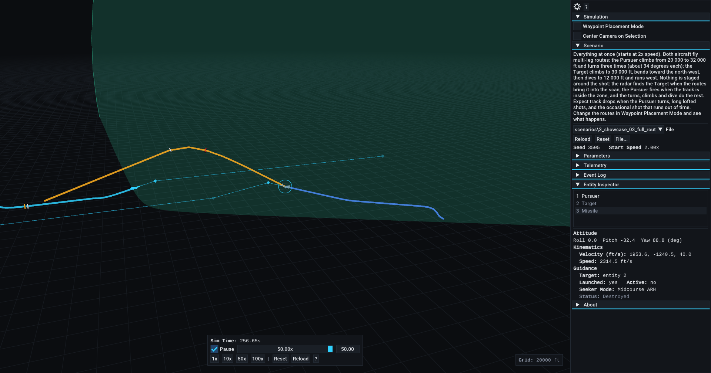
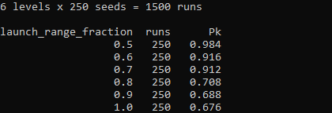
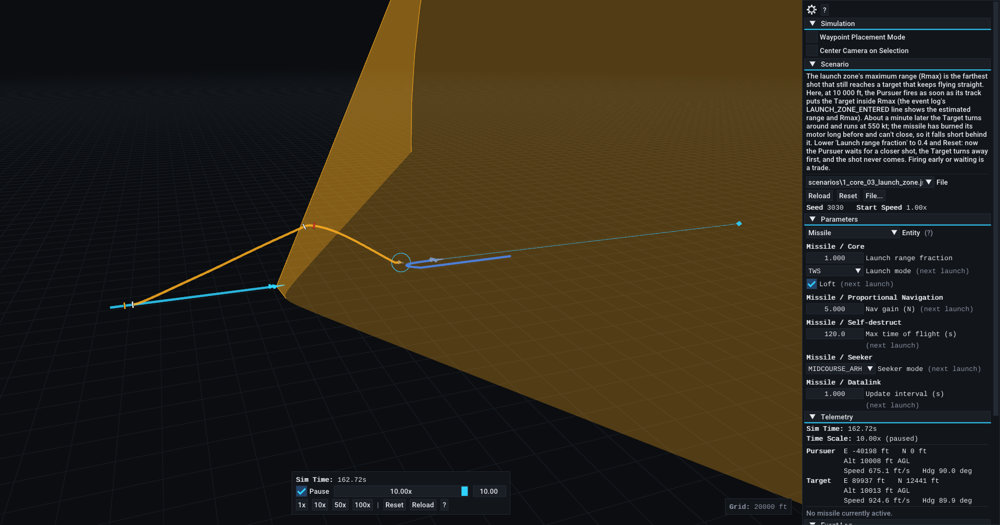
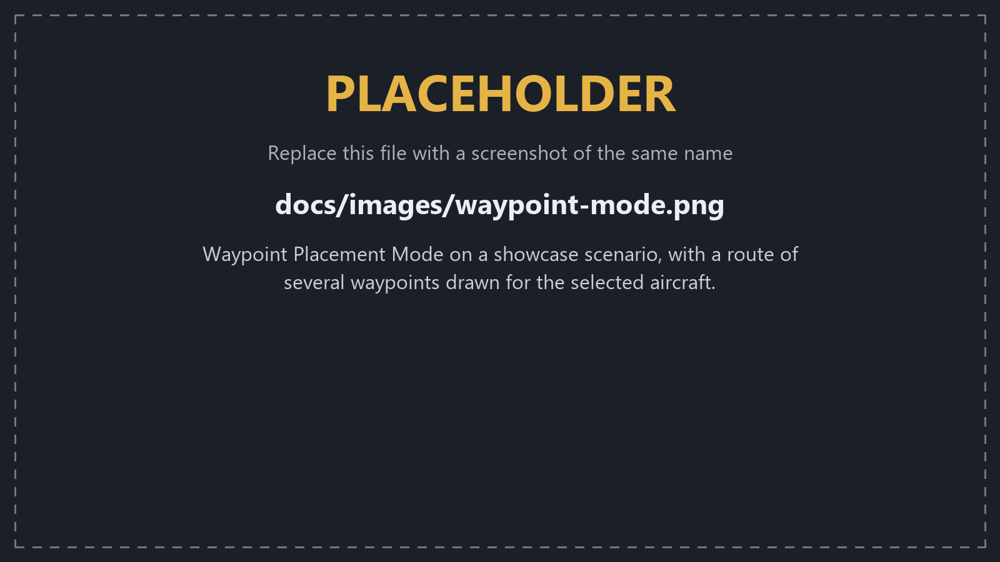
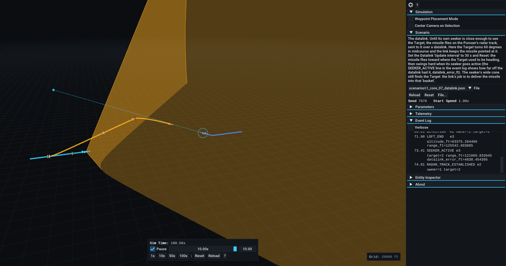
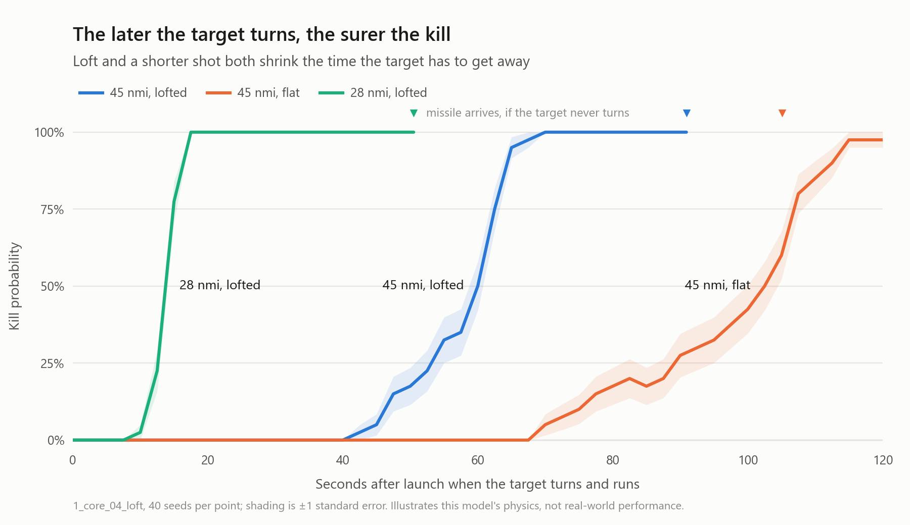

# bvr_sim

[](https://github.com/bubbarooski/bvr_sim/actions/workflows/ci.yml)

A beyond-visual-range (BVR) air-combat simulator for learning how a radar
shot actually works, for practicing modeling and simulation, and for
asking "what are the odds?" with Monte Carlo. JSBSim-flown F-16s, an
AIM-120-class missile with proportional-navigation guidance and a
datalink, radar detection and tracking, and a radar warning receiver, all
spawned from JSON scenario files, watched live in a 3D viewer, and run by
the thousand headlessly.



## What it is for

**Learning BVR.** Nineteen numbered scenarios, each built around one idea:
how a radar builds a track, when the launch zone opens, why a long shot
lofts, why a lock warns the target and a TWS shot does not, how a datalink
keeps the missile guided before its own seeker can see, how a target
"notches" a radar by beaming it. Pause, step, change a setting, and watch
the result in the 3D view, the event log and the telemetry panels
([Running the GUI](#running-the-gui)).

**Practicing modeling and simulation.** The physics is written down, not
hidden: [REFERENCE.md](docs/REFERENCE.md) gives the equations each system
implements, [VALIDATION.md](docs/VALIDATION.md) checks them against
published data and first principles, and [SOURCES.md](docs/SOURCES.md)
lists every source, tagged primary or secondary. A number is either cited,
derived, or labelled an ESTIMATE; nothing is tuned silently to make a
check pass. The code is a small hand-rolled entity-component-system with a
fixed 120 Hz step, a single seeded random stream, and a test suite that
checks the model against closed-form answers. It is a workable template for
learning how to build, verify and validate a simulation. Each aircraft and
missile type is a data file, not code.

**Monte Carlo.** One run is one draw. Change only the random seed and the
same engagement can end in a kill or a miss, because detection is a
probability, the radar track has measurement noise and the warhead's kill
is a roll against miss distance. The point of the tool is to run an
engagement hundreds or thousands of times and read a probability off the
result, then change one setting and see how that probability moves. A
1,000-run sweep of a five-minute engagement takes about 2½ minutes on a
6-core desktop, and gives bit-identical results at any thread count
([Monte Carlo](#running-a-batch-monte-carlo)).



**What it isn't.** Not a validated model of any real aircraft, missile or
radar: their real performance is not public, and the published figures
disagree with each other. Not an engagement-planning or
weapons-effectiveness tool either. Launch ranges, detection ranges and
kill probabilities illustrate the physics; they do not predict anything.
Only a short list of **teaching knobs** is editable (listed in
[docs/SCHEMA.md](docs/SCHEMA.md#teaching-knobs)); every other number
belongs to an aircraft or missile type file. See
[What this simulator is and isn't](docs/REFERENCE.md#what-this-simulator-is-and-isnt)
for what it models and what each piece teaches.

## Building

Clone with submodules. `deps/jsbsim`, `deps/glfw`, `deps/imgui`,
`deps/eigen`, and `deps/googletest` are git submodules; `deps/gl3w` and
`deps/json` are vendored in the repo.

```
git clone --recurse-submodules https://github.com/bubbarooski/bvr_sim.git
```

Requires CMake 3.25+ (4.2+ for the Visual Studio 2026 generator) and a C++17 compiler.

### Windows (Visual Studio)

JSBSim's repo includes a deeply nested asset tree that can exceed the
default 260-character path limit, which fails the submodule checkout.
Enable long paths once, before cloning:

```
git config --global core.longpaths true
```

```
cmake -S . -B build -G "Visual Studio 18 2026" -A x64
cmake --build build --config Debug     # interactive/GUI work
cmake --build build --config Release   # headless batch + Monte Carlo
```

Any recent Visual Studio works — swap the `-G` for your installed version
(e.g. `"Visual Studio 17 2022"`), or drop `-G` entirely to let CMake pick.
Binaries land in `build/Debug/` or `build/Release/`: the app
(`bvr_sim`, `bvr_batch`) at the top, the test binaries in
`tests/`, and the measurement and model-fitting tools in `tools/`.

### Linux / macOS

On Linux, GLFW needs the X11/Wayland and OpenGL development headers. On
Debian/Ubuntu:

```
sudo apt install build-essential cmake libgl1-mesa-dev libx11-dev libxrandr-dev \
    libxinerama-dev libxcursor-dev libxi-dev libwayland-dev libxkbcommon-dev \
    wayland-protocols pkg-config
```

macOS needs only the Xcode command-line tools and CMake. Then:

```
cmake -S . -B build -DCMAKE_BUILD_TYPE=Release
cmake --build build -j
```

Single-config generators (Make, Ninja) put binaries directly in `build/`,
so drop the `Release/` segment from the paths below.

### Debug vs Release

Use **Release** for anything headless. It is about 10x faster than Debug
(the 19-scenario smoke test: 12 s vs 123 s) and costs nothing in
fidelity: the two agree to rounding and reach the same verdict, though
a run near a threshold can resolve a tick apart. Compare results from
the same build; a Release run is bit-identical to itself
([REFERENCE 15.5](docs/REFERENCE.md#155-determinism)).

## Running the GUI

The viewer loads scenarios, aircraft data, and fonts by path relative to
the working directory. The build copies `data/` and `fonts/` next to the
executable and links `scenarios/` there, so run it **from its output
directory**:

```
cd build/Release
./bvr_sim                                          # scenarios/1_core_01_first_shot.json
./bvr_sim scenarios/1_core_08_notch.json
```

The sim starts paused. Controls:

| Input | Action |
| --- | --- |
| **Space** | Pause / resume |
| **R** / **Shift+R** | Reset (keep edits) / Reload from file, paused at t=0 |
| **1**-**4** | Speed 1x / 10x / 50x / 100x |
| **F** | Follow the selected entity |
| **Tab** | Select the next aircraft |
| **M** | Select and follow the missile once launched |
| **W** | Waypoint placement mode (while paused) |
| **?** | List every shortcut |
| Left-drag | Pan |
| Right-drag | Orbit |
| Scroll | Zoom |
| Left-click an aircraft | Select it (click again to deselect) |
| Double-click empty space | Stop following the selected entity |
| **Ctrl+Z** | Remove the last waypoint (waypoint placement mode) |



The bottom panel holds pause, time scale, speed presets, Reset,
Reload and **Record**, which writes every tick's state (every entity and
radar track) to a CSV in `recordings/` beside the executable
([columns](docs/SCHEMA.md#tick-recording)). The sidebar holds the scenario (its File popup has **New
Scenario** and **Save As**), the parameter editor, telemetry, the event
log and the entity inspector; the gear at its top opens Settings (what
the 3D view draws, which panels show, cone opacity, and Advanced mode,
which adds the finer knobs and each type's own values). Ticks on the
trails mark where events happened (radar track and lock, launch, the
target's radar warnings, the missile's seeker going active); hover one for
what and when. While paused,
**Waypoint Placement Mode** lets you click to add waypoints for the
selected aircraft, drag a waypoint vertically to change its altitude, and
right-click one to delete it and every point after it.



Scenarios live under `scenarios/`, numbered so the GUI's File list reads
as a short course. Each one says what it teaches and what to watch, and
most name a setting to try, at the top of the sidebar's Scenario section:

- `1_core_*` — one concept each: the first shot, how the radar builds a
  track, the launch zone, loft, STT vs TWS on the target's warning
  receiver, SARH illumination, the datalink, the Doppler notch, a tail
  chase, and the end-game turn.
- `2_combined_*` — two or three of those interacting: height as energy,
  look-down against a beaming target, a target diving in midcourse, a
  crossing shot broken into a tail chase, weather, and a SARH lock broken
  by a beam.
- `3_showcase_*` — longer engagements with routes, climbs and turns: a
  combat air patrol, a climb to meet a high threat, and a free-flowing
  engagement.



`custom/` is for your own: `scenarios/custom/_template.json` is a starting
point, and [docs/SCHEMA.md](docs/SCHEMA.md) documents every key.

## Running a batch (Monte Carlo)

A single run answers "what happened this time". A batch answers "how
often". `bvr_batch` runs many variants of one scenario in parallel,
with no window. Run it from the **repo root** so `scenarios/` and
`data/jsbsim_data/` resolve.

**Reading a result.** Pk is the fraction of launched missiles that hit. With
`n` runs its one-standard-error uncertainty is `√(Pk(1−Pk)/n)`: 250 runs pin
a Pk near 0.5 to about ±3 points, and 1,000 runs pin one near 0.94 to about
±0.8. To compare two settings, run both over the same seeds and check that
the difference is larger than that uncertainty. The seed is the only source
of randomness, so a sweep is reproducible: the same spec gives the same
numbers from the same build at any `--jobs` count
([REFERENCE 15.5](docs/REFERENCE.md#155-determinism)).

Questions a sweep can answer: does loft raise Pk on a long shot, and by how
much? How much range does a 120 kt headwind cost a shot the launch zone calls
in range? What does a more
sensitive radar buy, an earlier shot or a better one? Does STT or TWS change
the kill odds, or only the target's warning? Each is one knob swept over
many seeds.

The easiest way in is the Python tooling, which builds the run list,
invokes the runner, and loads the results into pandas:

```
pip install -r requirements.txt
cmake --build build --config Release --target bvr_batch
python experiments/_template.py
```

`experiments/_template.py` is a heavily commented, runnable sweep of
launch range against kill probability on the notch scenario; copy it to
ask your own question. `datalink_quality_pk.py` and `target_reaction_time_pk.py` are
fuller worked examples. Output lands in `experiments/results/` (gitignored).

`target_reaction_time_pk.py` asks how long a target can wait before it
turns and runs. It moves the turn along the target's route so that it
comes a set number of seconds after the launch, and plots Pk against that
time for a 45 nmi shot with and without loft, and for a 28 nmi shot:



Lofted, the 45 nmi shot is beaten by a turn in its first minute, about
half a minute before it would arrive. Flown flat, it is beaten by a turn
almost up to the moment of arrival. Holding fire to 28 nmi cuts the
target's window to about 14 s. The spread in each rise comes from the
dice: when the radar confirms its track sets the launch range, and the
shorter shots are the ones that survive a mid-flight turn.

To drive the runner directly, write a spec:

```json
{
  "scenario": "scenarios/1_core_01_first_shot.json",
  "max_sim_time_s": 400,
  "runs": [
    { "run_id": 0, "seed": 1001 },
    { "run_id": 1, "seed": 1002, "overrides": { "/missile_doctrine/kill_radius_m": 6.0 } }
  ]
}
```

Each run is a seed plus optional JSON Pointer overrides patched into a
copy of the scenario before it loads. `run_id` and `seed` are optional:
an omitted `run_id` is the run's position in the list, and an omitted
`seed` is the scenario's own. `run_id`s must be unique, a seed is a
non-negative integer, and the run's seed is its `seed` field (an override
of `/seed` is refused). An aircraft's start altitude and heading are each
written twice in a scenario; overriding either key moves the aircraft. Then:

```
./build/Release/bvr_batch --spec spec.json --out results.csv [--jobs N] [--record traj_dir]
```

This writes `results.csv` (one row per run: launch, detection, hit/miss,
miss distance, ...) and `results_events.csv` (one row per event, joinable
on `run_id`). `--record <dir>` adds a per-run CSV of every entity's and
radar track's changing state (10 Hz by default; `--record-decimation 1`
for every tick), the same columns the GUI's **Record** button writes —
see [docs/SCHEMA.md](docs/SCHEMA.md#tick-recording). Run with no arguments for the full option list. Rows are
written in run order, and `--jobs 1` gives the same results as any other
job count: the two outputs match byte for byte except the `wall_ms`
column.

## Tests

Tests are GoogleTest binaries registered with CTest, plus a stdlib `unittest`
suite for the Python tooling. Run from the build directory:

```
ctest --test-dir build -C Release --output-on-failure
```

| Target | Covers |
| --- | --- |
| `unit_tests` | Pure logic: atmosphere, drag tables, vector/matrix math, camera projection and picking, intercept scoring, track table, parameter registry, event log |
| `validation_tests` | Whole-pipeline checks: missile integration vs exact kinematics, radar equation, PN guidance and missile propulsion/drag/mass/envelope, F-16 kinematic identities and stability, radar confirmation/notch/FOV gating, save/load round-trips and reset determinism, the `bvr_batch` command line (job-count determinism, CSV output, error handling), plus a sanity sweep over every teaching scenario |
| `PythonTools` | `tests/python/`: the experiment framework's pointer helper and error handling, the `batch_compare` regression gate (`--identical` must not call different work identical), and `clean.py`'s deletion rules. Skips what needs pandas or a built `bvr_batch` |

`real_world_validation` and `perf_benchmark` also build. They are
measurement tools rather than pass/fail tests, so CTest doesn't run them.

`python tools/analysis/coverage.py` measures line coverage of the sim core
(everything but the GUI) by both test binaries, using
[OpenCppCoverage](https://github.com/OpenCppCoverage/OpenCppCoverage) on a
Debug build: it prints coverage per source folder (`--files` per file) and
writes an HTML report to `build/coverage/html/`.

For a memory-error sweep, configure a separate AddressSanitizer tree
(MSVC) and run the tests from it:

```
cmake -S . -B build/asan -G "Visual Studio 18 2026" -A x64 -DINTERCEPT_ASAN=ON
cmake --build build/asan --config RelWithDebInfo
ctest --test-dir build/asan -C RelWithDebInfo --output-on-failure
```

The ASan runtime DLL (`clang_rt.asan_dynamic-x86_64.dll`) lives in the
MSVC `bin\Hostx64\x64` folder; run from a Developer prompt or put that
folder on `PATH`.

## Keeping the tree clean

CMake never deletes the build files of a target that was removed, and
experiments accumulate results. `python tools/clean.py` lists what is
stale (old targets' build files and binaries, Python caches, files left in
the repo root); add `--yes` to delete it. `--results <label> ...` also prunes
`experiments/results/` to the named `batch_compare` labels, and `--build`
removes `build/` entirely for a from-scratch build.

## Documentation

| Document | What it is |
| --- | --- |
| [docs/REFERENCE.md](docs/REFERENCE.md) | Modeling & simulation reference: the physics, sensor models, and guidance math, with the equations each system implements |
| [docs/SCHEMA.md](docs/SCHEMA.md) | Scenario JSON authoring reference: every key, its unit, and default |
| [docs/VALIDATION.md](docs/VALIDATION.md) | Accuracy assessment against published F-16/AIM-120/sensor performance data |
| [docs/SOURCES.md](docs/SOURCES.md) | Every source used, tagged primary or secondary, with what it was used for |
| [docs/timing_report.md](docs/timing_report.md) | Wall-clock timing of a single run vs. a 1,000-run Monte Carlo sweep |

`python tools/analysis/build_reference_pdf.py` renders REFERENCE.md to a
print-quality PDF with SOURCES.md as an appendix (`--input`/`--output` to
render another doc; output is gitignored).

## License

Apache License 2.0 (see [LICENSE](LICENSE)). Third-party dependencies under
`deps/` and the JSBSim aircraft data under `data/jsbsim_data/` are each
under their own license — see [NOTICE](NOTICE).

## Acknowledgements

Flight dynamics are provided by [JSBSim](https://github.com/JSBSim-Team/jsbsim),
including its F-16 model by Erik Hofman. Rendering and UI use
[Dear ImGui](https://github.com/ocornut/imgui), [GLFW](https://github.com/glfw/glfw),
and [gl3w](https://github.com/skaslev/gl3w); math uses
[Eigen](https://gitlab.com/libeigen/eigen); scenario I/O uses
[nlohmann/json](https://github.com/nlohmann/json); tests use
[GoogleTest](https://github.com/google/googletest).
