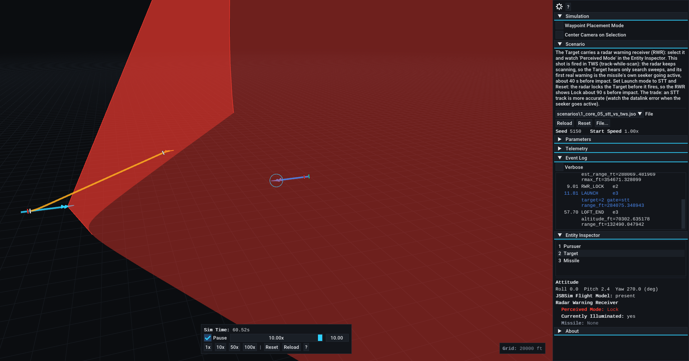

# intercept_sim

## A Modeling & Simulation Reference

*The physics, sensor models, and guidance mathematics behind the
simulator*

---

`intercept_sim` is a single-process C++ air-engagement simulator: aircraft
flown by a six-degree-of-freedom flight dynamics model, a
proportional-navigation missile, radar and radar-warning sensors, and
a launcher-to-missile datalink — all driven from declarative scenario files,
viewable live in 3D, and runnable headlessly for batch analysis.

This document explains **what the simulator computes and why**. It is not
a user manual. Every equation below is the equation the code actually
evaluates; every measured figure is output from the validation suite,
reproduced in the *Validation & Accuracy* section.

---

## What this simulator is and isn't

**What it is.** A learning tool for beyond-visual-range air combat, built
from public data and first-principles physics. It models the features a
real system has — how the radar detects and tracks, how the missile flies,
guides and runs out of energy, why a lock warns the target — at the
fidelity that changes what a user sees, and no further. Every primary
number (thrust, mass, drag, speeds, radar power and reference ranges,
seeker and gimbal limits) cites a published source or a first-principles
derivation; every secondary number is labelled an ESTIMATE.

**What it isn't.** Not a validated model of any real aircraft, missile or
radar — their real performance is not public, and the published figures
disagree with each other — and not an engagement-planning or
weapons-effectiveness tool. Launch ranges, detection ranges and kill
probabilities are illustrative of the physics, not predictions. Only a short list of **teaching knobs** is editable; every
other number belongs to an aircraft or missile type file.

**What it keeps, and what each piece teaches.** The test for keeping a
feature is that it teaches a concept visible in the result.

| Kept | Teaches |
|---|---|
| JSBSim F-16 (turns, climb, ceiling, top speed, fuel validated), waypoint autopilot | Energy and turn performance; why altitude and speed buy missile range |
| Standard atmosphere with a hot/cold-day offset, one steady wind | Air density sets thrust, drag and range |
| Three-stage motor, mass burn-off, drag vs Mach, lift slope + angle-of-attack and structural limits, gravity, true PN, one response lag, launch turn, loft, self-destruct | The energy fight: boost, coast, bleed, maximum range; why a long shot climbs into thin air |
| Gimbal cone, datalink midcourse handing over to an active seeker, memory coast, datalink fallback, the seeker's own Doppler notch | Why the launcher keeps tracking after it fires; losing the target off the gimbal; notching the missile |
| Radar equation with aspect RCS, Swerling fluctuation, Doppler notch, measured and filtered track | The R⁴ law; detection as a probability; beaming |
| RWR search / lock / missile warning, Earth horizon | Why a lock warns the target and a TWS shot does not until the seeker goes active; the R² / R⁴ asymmetry |
| Closest-approach scoring, Pk vs miss distance, seeded Monte Carlo | Lethality as a probability; reading a batch |

---

## Table of Contents

**[What this simulator is and isn't](#what-this-simulator-is-and-isnt)**

**1. [Conventions](#1-conventions)**
  1.1 [Coordinate frames](#11-coordinate-frames) · 1.2 [Units](#12-units) · 1.3 [Notation](#13-notation)

**2. [Simulator Architecture](#2-simulator-architecture)**
  2.1 [Entity–component–system model](#21-entitycomponentsystem-model) · 2.2 [Fixed-timestep loop](#22-fixed-timestep-loop) · 2.3 [System execution order](#23-system-execution-order) · 2.4 [Determinism](#24-determinism) · 2.5 [Batch execution and reproducibility](#25-batch-execution-and-reproducibility)

**3. [Atmosphere](#3-atmosphere)**
  3.1 [U.S. Standard Atmosphere 1976](#31-us-standard-atmosphere-1976) · 3.2 [Agreement with JSBSim](#32-agreement-with-jsbsim) · 3.3 [Wind](#33-wind) · 3.4 [Wind profile](#34-wind-profile)

**4. [Aircraft Flight Model](#4-aircraft-flight-model)**
  4.1 [Six-DOF dynamics and trim](#41-six-dof-dynamics-and-trim) · 4.2 [Flat-Earth coordinate mapping](#42-flat-earth-coordinate-mapping) · 4.3 [The cascaded autopilot](#43-the-cascaded-autopilot) · 4.4 [The F-16 pitch flight control system](#44-the-f-16-pitch-flight-control-system) · 4.5 [Gusts](#45-gusts) · 4.6 [Aircraft types](#46-aircraft-types)

**5. [The Flight Envelope](#5-the-flight-envelope)**
  5.1 [Available load factor (V–n)](#51-available-load-factor-vn) · 5.2 [Bank-angle limiting](#52-bank-angle-limiting) · 5.3 [Overstress and structural damage](#53-overstress-and-structural-damage)

**6. [Missile Flight Physics](#6-missile-flight-physics)**
  6.1 [Point-mass kinematics](#61-point-mass-kinematics) · 6.2 [Three-stage propulsion](#62-three-stage-propulsion) · 6.3 [Mass depletion](#63-mass-depletion) · 6.4 [Aerodynamic drag](#64-aerodynamic-drag) · 6.5 [Missile normal force and turn ceiling](#65-missile-normal-force-and-turn-ceiling) · 6.6 [Control execution](#66-control-execution) · 6.7 [Missile types](#67-missile-types) · 6.8 [Gravity and gravity bias](#68-gravity-and-gravity-bias) · 6.9 [Launch turn](#69-launch-turn) · 6.10 [Loft](#610-loft)

**7. [Proportional Navigation](#7-proportional-navigation)**
  7.1 [The guidance law](#71-the-guidance-law) · 7.2 [Closing velocity](#72-closing-velocity) · 7.3 [Line-of-sight rate](#73-line-of-sight-rate) · 7.4 [Guidance response time](#74-guidance-response-time) · 7.5 [Navigation gain](#75-navigation-gain) · 7.6 [Steering across the body axis](#76-steering-across-the-body-axis)

**8. [Seeker Modeling](#8-seeker-modeling)**
  8.1 [Gimbal cone and memory coast](#81-gimbal-cone-and-memory-coast) · 8.2 [Seeker modes](#82-seeker-modes) · 8.3 [The active seeker](#83-the-active-seeker)

**9. [Radar](#9-radar)**
  9.1 [The monostatic radar equation](#91-the-monostatic-radar-equation) · 9.2 [Radar cross-section](#92-radar-cross-section) · 9.3 [Pulse-Doppler clutter notch](#93-pulse-doppler-clutter-notch) · 9.4 [Blind range](#94-blind-range) · 9.5 [Radar horizon](#95-radar-horizon) · 9.6 [Frames and track confirmation](#96-frames-and-track-confirmation) · 9.7 [Track quality](#97-track-quality) · 9.8 [Parameter grounding](#98-parameter-grounding) · 9.9 [Atmospheric attenuation](#99-atmospheric-attenuation) · 9.10 [Probability of detection](#910-probability-of-detection) · 9.11 [Track measurement and filtering](#911-track-measurement-and-filtering)

**10. [Radar Warning Receiver](#10-radar-warning-receiver)**
  10.1 [The Friis one-way link](#101-the-friis-one-way-link) · 10.2 [The R² / R⁴ asymmetry](#102-the-r--r-asymmetry) · 10.3 [Perceived emitter mode](#103-perceived-emitter-mode) · 10.4 [Missile warning](#104-missile-warning)

**11. [Navigation Error](#11-navigation-error)**
  11.1 [What the missile knows](#111-what-the-missile-knows) · 11.2 [Where navigation error stops acting](#112-where-navigation-error-stops-acting) · 11.3 [Datalink target state](#113-datalink-target-state) · 11.4 [Perceived vs. true state](#114-perceived-vs-true-state)

**12. [Engagement Resolution](#12-engagement-resolution)**
  12.1 [Closest point of approach](#121-closest-point-of-approach) · 12.2 [Sub-tick CPA recovery](#122-sub-tick-cpa-recovery) · 12.3 [Airframe geometry](#123-airframe-geometry) · 12.4 [Probabilistic lethality](#124-probabilistic-lethality) · 12.5 [Arming range](#125-arming-range) · 12.6 [Ground impact](#126-ground-impact) · 12.7 [Self-destruct](#127-self-destruct) · 12.8 [Launch zone](#128-launch-zone)

**13. [The Control Interface](#13-the-control-interface)**

**14. [Scenario Library](#14-scenario-library)**

**15. [Validation & Accuracy](#15-validation--accuracy)**
  15.1 [Methodology](#151-methodology) · 15.2 [Closed-form checks](#152-closed-form-checks) · 15.3 [Behavioral checks](#153-behavioral-checks) · 15.4 [Scenario regression](#154-scenario-regression) · 15.5 [Determinism](#155-determinism) · 15.6 [Monte Carlo behavior](#156-monte-carlo-behavior)

**16. [Modeling Limitations](#16-modeling-limitations)**

**17. [References](#17-references)**

---

# 1. Conventions

## 1.1 Coordinate frames

**World frame.** **Y-up**: **X = east, Y = up, Z = north**. The XZ plane is
the horizontal ground plane at mean sea level. All world positions are in
feet. As an (X, Y, Z) triple this is *left-handed* (east × up points south),
which no simulation arithmetic depends on; the 3D view's right-handed
projection is fed north flipped, so the picture is not mirrored (looking
north, east is on the right).

**Body frame.** For an aircraft: **+X starboard, +Y up, +Z forward
(nose)**. Attitude is stored as Euler angles `(roll φ, pitch θ, yaw ψ)` in
degrees, applied in the standard aerospace order.

**Heading.** Compass convention: 0° = north, 90° = east. A heading ψ maps
to the horizontal unit vector

```
ĥ(ψ) = (sin ψ, 0, cos ψ)
```

which is why yaw appears as `sin` on the X (east) component and `cos` on
the Z (north) component throughout the code — the opposite of the
mathematical convention, and a direct consequence of compass headings
being measured clockwise from north.

**Aspect angle.** The angle between a target's own heading vector and the
target-to-observer line of sight: 0° = nose-on (target pointed at the
observer), 90° = beam, 180° = tail-on. Always in [0°, 180°], since it
comes from `acos` of a normalized dot product.

## 1.2 Units

The simulator is **English internally** — feet, slugs, pounds-force, ft/s,
slug/ft³ — matching the flight dynamics model's native property units and
avoiding a conversion on every physics access.

Two subsystems are exceptions, deliberately:

- **Radar and RWR** compute in **SI** (meters, watts). Radar equations are
  universally stated that way, and every published transmit power, gain,
  wavelength, and sensitivity figure is metric. Only the range term is
  converted, once, at the call site.
- **Scenario JSON** specifies a handful of quantities in metric where that
  is the natural authoring unit (kill radius, RCS, wing area, weight),
  converted once at load.

`kFeetPerMeter = 3.280839895` throughout.

## 1.3 Notation

| Symbol | Quantity | Unit |
|---|---|---|
| `ρ` | air density | slug/ft³ |
| `a` | speed of sound | ft/s |
| `V` | true airspeed / speed | ft/s |
| `q` | dynamic pressure, ½ρV² | lbf/ft² |
| `n`, `Nz` | normal load factor | G |
| `N` | proportional-navigation gain | — |
| `Pt`, `Pr` | transmitted / received power | W |
| `G`, `Gr` | antenna gain (transmit / receive), linear | — |
| `λ` | wavelength | m |
| `σ` | radar cross-section | m² |
| `R` | range | m (radar), ft (dynamics) |
| `Pk` | probability of kill | — |

---

# 2. Simulator Architecture

## 2.1 Entity–component–system model

Entities are plain integer IDs. Components are plain data structs stored
in one map per component type. Systems iterate the entities that have the
components they need and ignore the rest.

This is not an aesthetic choice — it is what makes the physics composable.
A missile is a `Transform` + `Kinematics` + `Guidance`; an aircraft is a
`Transform` + flight-model + `Autopilot`. Giving the missile a datalink
means attaching a `Datalink` component, not adding a branch inside the
guidance law. Attaching a G-limit component is what subjects an
aircraft to the V–n envelope; an entity without one is not "exempt via a
flag", it simply never appears in that system's iteration.

The practical consequence for a reader of this document: **every model
described below is gated on component presence, not on configuration
flags.** Where the text says "entities with an RCS are detectable", that
is literally how the radar loop is written.

## 2.2 Fixed-timestep loop

Physics advances in fixed steps of

```
Δt = 1/120 s
```

decoupled from render frame rate by an accumulator. The rendering loop
banks real elapsed time, then drains it in whole fixed steps before
drawing once. Frame time is clamped at 0.25 s so a debugger pause or
window drag cannot queue hours of catch-up.

**Time scale multiplies the number of steps, not the step size.** A
`sim_speed` of 10 runs ten 1/120 s steps per frame's worth of banked time;
it does not run one step of 1/12 s. This matters because control loops
and the flight dynamics integrator must sample at the same rate. Running
one control update per ten dynamics steps is a tenfold drop in effective
control-loop frequency purely from a display setting, and it produces
genuine numerical instability (control surfaces saturating alternately
every tick), not merely a cosmetic difference.

The flight dynamics model's own internal integration rate is also 120 Hz,
so at `sim_speed = 1` there is exactly one dynamics step per physics tick.

## 2.3 System execution order

Order within one tick follows the data dependencies:

```
1.  Waypoint       route geometry -> autopilot setpoints
2.  Control        setpoints -> control surface commands
3.  Environment    each aircraft's JSBSim atmosphere and wind
4.  Flight dynamics  surfaces -> six-DOF integration -> Transform
5.  Ground impact  aircraft at altitude 0 destroyed (§12.6)
6.  Guidance       PN + thrust + drag -> missile acceleration
7.  Integration    constant-acceleration advance of missile state
    ---- simTime advances here ----
8.  Radar (airborne)     observe the state produced above
9.  Datalink      relays this tick's airborne track to the missile
10. RWR
11. Launch        fires on this tick's radar track, not last tick's
12. Intercept     resolves on the range that resulted from all of it
13. Self-destruct  missiles out of energy or time (§12.7)
```

Four orderings are load-bearing rather than arbitrary:

- **Guidance before integration** so the integration step uses this tick's freshly
  computed acceleration, not a stale one.
- **Launch after the radar systems** so the launch gate reads this tick's
  track state.
- **Datalink after the radar systems** so an update carries this tick's
  track. Guidance reads it on the next tick, which is a real one-tick
  datalink latency.
- **Self-destruct after intercept** so a closest-approach pass on the same
  tick is scored as the pass it is, not cut short by the time limit (and
  it holds off mid-pass inside the kill radius, [§12.7](#127-self-destruct)).

## 2.4 Determinism

There is exactly one random number generator in the simulator: a
`std::mt19937_64` stream seeded from the scenario file. Every stochastic
process draws from it — RCS scintillation, RWR signal jitter, radar
measurement noise and the lethality roll.

Consequences that matter for analysis:

- Same seed + same scenario ⇒ **bit-identical run**, verified at startup
  by drawing two parallel streams and comparing.
- Any change to *how many* draws a system makes re-sequences every
  subsequent draw. This is why sensors are **sweep-gated**: a system that
  drew on every 120 Hz tick instead of every sweep would consume orders of
  magnitude more of the shared stream, and its consumption rate would leak
  into unrelated results.
- The order systems visit entities in is part of the seed. Every component
  store iterates in ascending entity ID, on every platform and whatever order
  the components were added in, so two radars, or two missiles resolving on
  one tick, draw from the stream in the same order everywhere. (A hash
  container would visit them in a library-specific order.)
- Debug and Release builds agree to rounding, not bit for bit: the
  optimizer computes some floating-point results in a different order,
  and a run near a threshold can then land a tick apart. Take results
  from Release; two Release runs of the same seed are bit-identical
  ([15.5](#155-determinism)).

## 2.5 Batch execution and reproducibility

A single engagement is one sample of a stochastic process. Any statement
about *how often* something happens — a kill probability, a track-loss
rate, the spread of miss distances — requires many runs, so the simulator
ships a batch driver alongside the interactive one.

**Every run is independent.** A run's outcome is a pure function of its
scenario and its seed. The simulator holds no mutable global state: the
one RNG stream and the event log live in a per-run `SimContext`, the
entity data in a per-run `World`, and each aircraft's flight model in its
own JSBSim instance with its own property tree. Runs therefore share
nothing, and can execute concurrently on separate threads within one
process rather than as separate processes.

**Parallelism does not change results.** This is a verified property, not
an assumption. The same batch executed serially and across twelve threads
produces identical output on every field of every run. Because runs are
independent, thread count, scheduling order, and machine load cannot
influence any recorded value — only the order lines are written to the
output file, which carries a run identifier for exactly that reason.

**Runs are addressed by parameter, not by file.** A batch specifies a base
scenario plus, for each run, a seed and a set of parameter overrides
addressed by JSON Pointer (`/missile_doctrine/seeker/fov_half_angle_deg`).
Overrides are applied to an in-memory copy of the parsed scenario, so a
sweep writes no intermediate scenario files and a thousand-run experiment
touches the filesystem exactly twice — once to read the base scenario,
once to append results.

**Output is per-run, typed, and tabular.** Each run emits its engagement
milestones as structured values — launch time and range, first detection,
firing solution, seeker acquisition and loss, resolution time, miss
distance, Pk, armed state, impact point and region — rather than as text
to be parsed back. The same values the interactive event log displays as
strings are written directly by the systems that compute them.

Results are two joinable CSV tables: a wide one, one row per run, with
each swept parameter as its own column; and a long one, one row per
event, keyed on the run identifier. Splitting them keeps the wide table
a clean rectangle — one run, one row — while preserving the event detail
the typed columns do not carry, such as the reason a seeker lost lock.

A representative cost, measured on a 12-thread desktop: 500 runs of a
full head-on BVR engagement complete in 49 s, about 0.10 s of wall time
per run. Roughly 27% of each run is JSBSim model loading and trim
solution, the remaining 73% simulation.

---

# 3. Atmosphere

## 3.1 U.S. Standard Atmosphere 1976

Air density and the local speed of sound drive dynamic pressure, drag,
Mach number, and the lift-limited edge of the flight envelope. Both are
evaluated in closed form from the 1976 standard, layer by layer, on every
call — there is no table and no interpolation.

The standard is defined in **geopotential** altitude `H`, in which gravity
is constant with height, so geometric altitude `h` is converted first:

```
H = h · r₀ / (r₀ + h)                r₀ = 6 356 766 m
```

Each layer has a base altitude `H_b`, base temperature `T_b`, and constant
lapse rate `L_b`. Temperature is linear within a layer, and pressure follows
from hydrostatic balance:

```
T = T_b + L_b · (H − H_b)

p = p_b · (T_b / T)^(g₀ / (R·L_b))          L_b ≠ 0
p = p_b · exp(−g₀ · (H − H_b) / (R·T_b))    L_b = 0  (isothermal)

ρ = p / (R·T)          a = √(γ·R·T)
```

with `R` = 1716.56 ft·lbf/(slug·°R), `g₀` = 32.174 ft/s², `γ` = 1.4, and
sea-level pressure 2116.228 lbf/ft². The layers run to 86 km:

| Base (geopotential) | Base temperature | Lapse rate |
|---|---|---|
| 0 ft | 518.67 °R (15 °C) | −3.57 °R per 1 000 ft |
| 36 089 ft (tropopause) | 389.97 °R | isothermal |
| 65 617 ft | 389.97 °R | +0.55 °R per 1 000 ft |
| 104 987 ft | 411.57 °R | +1.54 °R per 1 000 ft |
| 154 199 ft | 487.17 °R | isothermal |
| 167 323 ft | 487.17 °R | −1.54 °R per 1 000 ft |
| 232 940 ft | 386.37 °R | −1.10 °R per 1 000 ft |
| 278 386 ft | 336.50 °R | isothermal above |

Density falls faster than temperature in the troposphere because pressure
falls too. Above the tropopause temperature is constant, so density decays
as a pure exponential and the speed of sound stops changing — until the
stratosphere warms again above 20 km, which matters for a lofted missile.

**Temperature offset (ISA deviation).** A hot or cold day shifts every
layer's temperature by the same ΔT. Sea-level pressure stays standard, and
pressure aloft follows hydrostatically from the shifted temperatures, so a
hot column is *taller*: at sea level hot air is thinner, but at 40 000 ft
an ISA+30 °C day is about 5% *denser* than a standard one, because less of
the atmosphere's mass sits below that height.

A scenario sets it with `environment.temperature_offset_c` (see
`SCHEMA.md`). It reaches JSBSim before trim — so the trim solves for the
day the aircraft will actually fly — and every other reader through the
sim context, which the loop refreshes each tick, so a live edit reaches
both at once.

## 3.2 Agreement with JSBSim

Every aircraft flies JSBSim's own atmosphere; the missile, the flight
envelope, and the radar read this one. If the two disagreed, a missile and
its target at the same altitude would be flying in different air. They are
built to the same definition — the same layer table, the same gas
constants, the same geopotential conversion, and the same hydrostatic
treatment of a temperature offset as JSBSim's `SetTemperatureBias` — and
the agreement is checked directly against a live JSBSim instance to 1 part
in 10⁹ in density and speed of sound, from sea level to 100 000 ft and
across offsets of −25 to +20 °C (see [§15.2](#152-closed-form-checks)).

## 3.3 Wind

One steady wind, the same at every altitude and everywhere horizontally:
`wind_speed_kts` and `wind_from_deg`. Directions are where the wind blows
**from** (the meteorological convention, so 270 is a westerly, moving air
east). As a velocity of the air in the world frame (x east, y up, z north):

```
W = −V_w · (sin χ, 0, cos χ)        χ = from_deg
```

Everything that flies, flies relative to that moving air:

- **Aircraft.** JSBSim's own wind (`atmosphere/wind-*-fps`) is set to `W`,
  so its aerodynamics see airspeed, angle of attack and sideslip through
  the moving air, while position integrates the ground velocity.
  `airspeed_kts` is the true airspeed through the air, not the ground
  speed.
- **Missile.** A point mass that points into its relative wind, so its
  velocity *through the air*, `v − W`, stands in for its body axis: drag,
  Mach, dynamic pressure, the G envelope, the thrust direction, the
  seeker's boresight and the fin trim-error frame all use it
  ([§6](#6-missile-flight-physics)). Guidance geometry — line of sight,
  closing velocity — stays in the ground frame the target is tracked in.
- **Waypoint steering** crabs into the crosswind to hold the track to the
  waypoint ([§13](#13-the-control-interface)).

**Spawning in wind.** A steady wind leaves the airflow over the airframe
unchanged, so the still-air trim is already the trim in wind. Each aircraft
is trimmed in still air exactly as in calm conditions; on the run's first
tick its ground velocity is shifted by `W` while JSBSim's wind starts
blowing — the air-relative state is the trimmed one, unchanged. JSBSim's
own initial-condition wind cannot be used for this: `FGInitialCondition`
holds its wind as air-minus-ground velocity, `FGWinds` as ground-minus-air,
and `Initialize` (which trim calls repeatedly) copies one into the other
unconverted. An F-16 spawned that way at 400 kt true in a 60 kt wind
measured 280 kt at 90° of sideslip, and would not trim.

**Galilean consistency.** Because aircraft and missile share one air mass,
an engagement in which nothing is tied to the ground — aircraft holding
heading — is the calm engagement translated with the wind:
`scenario_basic` launches at the same time and the same range (to 0.1 m)
in any steady wind. What the wind changes is everything anchored to the
ground: waypoint routes, the Doppler notch (which works on ground-relative
radial speed), and the ground itself. That is the lesson the wind teaches.

A calm scenario's wind is exactly zero rather than merely small, and every
use of it is skipped or subtracts an exact zero, so a scenario without
wind reproduces its calm results bit for bit. Batch results record the
wind each run flew (`surface_wind_kts`, `surface_wind_from_deg`).

## 3.4 Wind profile

The wind is the single steady wind of [§3.3](#33-wind): one speed and one
direction at every altitude. There is no winds-aloft profile, shear or jet
stream, so the teaching knobs are the wind's speed and direction alone.

---

# 4. Aircraft Flight Model

## 4.1 Six-DOF dynamics and trim

Aircraft are flown by **JSBSim**, an open-source six-degree-of-freedom
flight dynamics model, using its General Dynamics F-16A model. The
simulator owns one flight dynamics executive per aircraft entity and reads
position, attitude, rates, load factor, and mass back into the world each
tick. Aerodynamic forces, engine model, mass properties, and fuel burn are
JSBSim's; the simulator supplies control surface and throttle commands.
Four parts of the model are the project's own: the pitch flight control
system ([§4.4](#44-the-f-16-pitch-flight-control-system)), the flaperon
mixing, the compressibility drag, and the Mach dependence of lift,
stability and drag due to lift.

**Flaperon mixing.** The stock model's symmetric flaperon deflection,
which drives flap lift and drag, summed left and right flaperons with the
flap schedule entering at opposite signs. The schedule cancelled and the
aileron entered instead, so any aileron acted as both flaperons raised.
At 0.55 of aileron in a hard pull that cost −0.55 of lift coefficient, a
third of the wing's lift. The gain also converted to radians the wrong way
round. The symmetric deflection is now the flap schedule itself, and
flap drag acts on its magnitude.

**Flap schedules.** The stock trailing edge flap schedule drooped the
flaperons 20° below 250 KCAS in any configuration, which on a clean
aircraft cruising at 35 000 ft and 420 KTAS (235 KCAS) put 20° of flap on
the wing and made its fuel flow 46% too high. The flight manual (T.O.
GR1F-16CJ-1-1, Flight Controls: Trailing Edge Flaps) says the TEFs are
controlled by the gear handle, the ALT FLAPS switch, airspeed and Mach:
down only with the gear handle down (or ALT FLAPS EXTEND), 20° below 240
knots, reducing with airspeed to nearly retracted at 370. The model now
droops them that way (`fcs/tef-gear-down-rad`, scaled by gear position)
and holds them neutral gear up; the stock −2° above Mach 0.9 stays. The
manual says the leading edge flaps follow Mach, AoA and altitude without
giving the schedule; the model uses the one published with its aerodynamic
tables (Nguyen et al., NASA TP-1538 [[Nguyen 1979]](SOURCES.md#nguyen-1979), 1979), steady state:
`δLEF = 1.38 α − 9.05 q̄/p + 1.45` degrees, limited to −2° (the stock
model's value above Mach 0.9 and on the ground; the manual gives 2° up on
the ground) and 25°. It replaces stock steps to 15° above 5° AoA and 25°
above 15° whatever the Mach, and changes nothing the validation checks by
more than 0.3%.

**Compressibility drag.** The stock table, a four-point add-on, left
supersonic drag 25–30% below measured F-16C data. It is refitted to
flight-derived zero-lift drag at Mach 0.9 and 1.3 (NASA TP-3414 [[Saltzman 1994]](SOURCES.md#saltzman-1994)) and
wind-tunnel minimum drag at Mach 1.6–2.16 (NASA TP-3355 [[Fox 1993]](SOURCES.md#fox-1993), less the
wingtip missiles' share), giving clean CD₀ 0.023 / 0.046 / 0.049 / 0.047
at Mach 0.9 / 1.3 / 1.6 / 2.0. Between 0.9 and 1.3 it follows Raymer's [[Raymer]](SOURCES.md#raymer)
drag-rise construction.

**Installed thrust.** The engine's tables were Aero-Matic's [[Aero-Matic]](SOURCES.md#aero-matic) generic
augmented-turbofan lapse, written identically for every afterburning
engine, with a 60 000 ft column of zeros that halved thrust by 55 000 ft.
They are now fitted to the F-16C flight manual [[F-16C flight manual]](SOURCES.md#f-16c-flight-manual) (T.O. GR1F-16CJ-1-1,
Appendix A, F100-PW-229, flight-test data): its MIL and MAX AB level
accelerations, at drag index 0, from sea level to 30 000 ft (MIL) and
40 000 ft (MAX AB), at 20 000, 24 000 and 28 000 lb. Level flight gives
`(W/g) dV/dt = T cos α − D`, so with the model's drag and AoA
(`tools/drivers/drag_sample`, flying the aircraft) thrust at each table Mach is
chosen so that integrating that equation, with weight falling by the
manual's fuel, reproduces the manual's times (`tools/fit/thrust_fit.py`).
The manual's combat speeds, where 500 ft/min of climb remains, add
`Ps = 500 ft/min` points. Afterburning times are reproduced to 0.4–0.6 s
rms up to 20 000 ft and 0.5–3.7 s at 30 000–40 000 ft; military to 0.7–2.0 s.
One thrust curve fits all three weights, which checks the drag due to
lift at these lift coefficients. Mach rows beyond an altitude's data take
the Mach shape of the next altitude up whose data reach further.

Above the accelerations there are no engine data. Military thrust at
40 000 ft is fitted to the manual's 500 ft/min climb envelope (Fig.
A8-2): at each MIL envelope point `Ps = 500 ft/min` at 1 g, so
`T cos α = D + W Ps / V` there; above it, thrust scales with pressure δ
(corrected thrust constant in the isothermal stratosphere). Afterburning
thrust scales as `δ^1.25` above 40 000 ft: augmentor combustion efficiency
falls with burner pressure, so it lapses faster than the core; the
exponent is the one free parameter, calibrated to the combat ceiling
chart (Fig. A8-1). The idle table is not Aero-Matic's, whose idle rose
with altitude to more than the whole military thrust at 50 000 ft (and
military thrust in JSBSim sits on top of idle): it is the sea-level row
scaled with δ. Static sea-level
afterburning thrust comes out at 27 713 lbf, against the engine's 29 100
lbf uninstalled rating, without being fitted to it. Fitted thrust peaks
near Mach 1.7–1.8 at 30 000 and 40 000 ft and falls past 1.9, as a fixed
normal-shock inlet's recovery does. The published top speeds, Mach 2.05
at 40 000 ft and 1.2 at sea level, are airspeed limits the aircraft
reaches while still accelerating, so they say nothing about where thrust
meets drag. See `VALIDATION.md`, climb, ceiling and top speed.

**Fuel flow.** JSBSim burns fuel as thrust × TSFC (military power) or
thrust × ATSFC (afterburner); the stock file gave afterburning a constant
2.05 and military power a constant with a temperature factor, which put
the acceleration tables' fuel 23% low at sea level. The standard turbofan
shape (Raymer, *Aircraft Design*, installed engine performance: TSFC rises
with Mach and as the square root of temperature) is used with the
exponents left free, and every number is calibrated (`tools/fit/fuel_fit.py`).

Afterburning: `ATSFC = 1.8695 · θ^0.7947 · (1 + 0.2604 M)` (θ the static
temperature ratio; M held to at least 0.3), fitted to the flight manual's
fuel-flow chart, Fig. A8-4, digitised into `reference/fuel_flow.csv`, over
the points where the thrust tables rest on flight data (an extrapolated
thrust would put its error into the TSFC): 3.4% rms.

Military power, with `x = 1 − N2norm` (0 at full power), `u = M − 0.7`
(M held to 0.3–1.0) and `v = θ − 0.85`:

    TSFC = 0.6370 θ^0.579 (1 + 0.6389 M)(1 + 1.002 u²)(1 + 2.167 u v)
         × (1 − 0.705 x + 2.593 x²)(1 + 1.028 x u)(1 + 0.961 x v)

The first line is the full-power TSFC, fitted to the chart (3.0% rms) and
0.77 at Mach 0.3 at sea level against a published static 0.74. The second
is the part-throttle factor, fitted jointly to the manual's Subsonic Cruise
tables, which give total fuel flow in steady level flight (thrust equals
drag) by altitude, speed and weight: `tools/drivers/cruise_sample` flies each
point in the model for its thrust and engine speed, and the fit is to every
weight but 24 000 lb (3.3% rms over 559 points), which validation flies.
JSBSim's own part-throttle rise, `(0.84 + x²) / 0.84`, missed by up to 17%.
The cruise points carry the model's drag as well as its TSFC, and the
manual's data cannot separate the two (three equations, four unknowns:
cruise gives drag × TSFC, the chart thrust × TSFC, the accelerations
thrust − drag). The residual that no simple TSFC law removed followed lift
coefficient and Mach, the same sign as the turn-chart residuals, so the
polar-break term was made Mach-dependent from the turn charts (which
measure drag without the TSFC); that halved the turn residuals and left the
cruise residual where it was, so it is not a drag error at the lift
coefficients the turns reach. The factor is an effective part-throttle
TSFC for this installation and absorbs whatever drag error remains at
CL 0.2–0.5. The fit depends on the thrust tables and
the drag, so it is the last step of the refit order: drag_sample,
thrust_fit, cruise_sample, fuel_fit.

JSBSim limits how fast fuel flow follows thrust (1 000 pph/s at military
power, 5 000 pph/s afterburning, hard-coded in `FGTurbine`), so after a
throttle step the fuel burned lags the thrust by seconds. Steady flows are
unaffected. See `VALIDATION.md`, Fuel flow.

**Drag above the polar break.** The NASA tables and the TP-3414 flight
drag due to lift (to CL ≈ 0.65) [[Saltzman 1994]](SOURCES.md#saltzman-1994)
leave the drag of a hard turn untested. A sustained turn is where
full-power thrust equals drag, so with thrust fitted at 1 g the manual's
sustained-turn lines (the Ps = 0 lines of its Turn Performance charts, MAX
AB, 22 000 lb) give the drag coefficient at each lift coefficient they
reach:

    CD = T cos α / (q S)        at    CL = (n W − T sin α) / (q S)

Thrust points α above the flight path, so it carries part of the load
factor and the lift is what is left; α depends on CL, so CL is a fixed
point. At 15 000 ft and Mach 0.5, T = 18 445 lbf and α = 15.7°, so
T sin α is 0.25 g of the 3.54 g and CL is 1.16, not 1.24.
`tools/drivers/turn_sample` flies the model there (full-power thrust at 1 g,
then quick pulls to 0.85, 1.0 and 1.15 × the manual's load factor);
`tools/fit/lift_drag_fit.py` compares. Subsonic the model falls short by an
amount growing with CL, the polar's break as the flow starts to separate.
One term closes it:

    ΔCD = c(M) · max(0, |CL| − 0.65)

with c(M) = 0.099 / 0.124 / 0.094 / 0.068 / 0.057 at Mach 0.5 / 0.6 / 0.7 /
0.8 / 0.9, falling to 0 at 1.05, fitted to 17 points at 15 000–40 000 ft
and Mach 0.5–0.9 (0.0045 rms in CD): supersonic the manual shows no
shortfall. The turns reach CL 0.75–1.2 only, so they cannot say where the
shortfall starts; the CL below which the term is zero is held at 0.65, the
top of the measured drag due to lift, so the term stays off 1 g flight at
moderate CL (left free, the fit runs to its lower bound and puts drag into
cruise). The turns measure only drag that grows with lift: an error in the
1 g drag cancels, because the thrust fitted at 1 g carries it too. It is
`aero/coefficient/CDturn` in the drag axis. Because it changes 1 g drag at
altitude, the thrust fit, this fit and the FCS design are iterated together
until none moves.

**Mach effects on lift, stability and drag due to lift.** The NASA
TP-1538 tables are low-speed data, so on their own lift per degree of AoA
is the same at every Mach (0.0645/deg for the whole aircraft), and drag
due to lift does not grow transonically. Three terms correct that:

- **Lift**, a factor `k(M)` on the AoA-dependent lift: DATCOM theory [[USAF DATCOM]](SOURCES.md#usaf-datcom)
  (Helmbold–Polhamus slope, Prandtl–Glauert compressibility; A = 3.0,
  half-chord sweep 22.7°) below Mach 0.9 (1.08 at 0.6, 1.24 at 0.9). Above
  Mach 1.6 it comes from F-16C tunnel measurements (NASA TP-3355:
  0.068 / 0.058 / 0.052 / 0.048 per deg at 1.6 / 1.8 / 2.0 / 2.16).
  Between the two it is faired linearly. At high AoA (20° and above) the
  factor blends to a separate high-AoA value `k_hi(M)` between 10° and
  20°: 1.0 to Mach 0.6, then 0.984 / 0.967 / 0.925 / 0.88 at Mach 0.7 /
  0.8 / 0.85 / 0.9 and 0.87 from 0.95 to 1.6, where the supersonic slope
  ratio takes over. Real wings lose maximum lift with Mach as shocks form;
  no F-16 figure for the loss was found, so `k_hi` is **calibrated** to
  the flight manual's quickest turns at 30 000 and 40 000 ft (Turn
  Performance charts, 22 000 lb), the rows that reach the AoA limit near
  Mach 0.9–1.1. The same factor at 25° is exported as
  `aero/function/kCLmax-mach`, and the G envelope scales `CL_max` by it
  ([§5.1](#51-available-load-factor-vn)).
- **Stability.** The stock pitching-moment Mach term stopped at Mach 1.2,
  leaving the model 4–7% MAC less stable at Mach 1.6 than the F-16C
  measured: 25.7% MAC about its 0.35 MAC operational CG, from TP-3355's
  Cm–CL slope. Supersonic rows now hold that aerodynamic-centre position,
  taking the model's spawn CG as the operational CG.
- **Drag due to lift**, `ΔK(M)·CL²`, calibrated so the flown
  ΔCD/ΔCL² between trimmed 1 g and 3 g pull-ups matches F-16C data (NASA
  TP-3414 flight: 0.122 / 0.139 / 0.268 at Mach 0.6 / 0.9 / 1.3; TP-3355
  tunnel polar: 0.28 at 1.6) within 5%. The model had 0.018 at Mach 1.3:
  almost no supersonic drag due to lift.

The pitch FCS gains were re-identified and regenerated on the result.

**Fuel at spawn** is the type's: the model file's own load, 3 000 lb of
the F-16's 6 972 lb internal capacity, for a 20 630 lb spawn weight. A
full internal load is 24 602 lb. External tanks stay empty because no
drop-tank drag is modelled. The validation rigs fill the
internal tanks to match a published gross weight.

Initialization is a four-stage sequence, and every stage matters:

1. **Set initial conditions** — position, altitude, heading, true
   airspeed.
2. **Start the engines.** Without this the engine begins cold and idle
   while the airframe is already placed at cruise speed. That mismatch
   alone is enough to stall the aircraft within seconds, before the
   autopilot has any chance to matter.
3. **Retract the gear.** JSBSim spawns every model gear-down, and the
   F-16's gear-drag term then adds about 60% to clean parasite drag for
   the whole flight. Every entity spawns airborne, so the gear is raised
   before trim solves around it. Left down, it cost the F-16 a fifth of
   its top speed (Mach 1.59 against 2.02 at 40 000 ft).
4. **Trim.** Setting initial conditions establishes kinematic state only —
   it does not solve for the elevator, throttle, and angle of attack that
   actually *balance* the aircraft at that state. A full trim solve does.
   Skipping it hands the autopilot a large initial force imbalance to
   recover from rather than small deviations to correct.

The trim throttle is captured and reused as the speed loop's feed-forward
baseline (see [§4.3](#43-the-cascaded-autopilot)); pitch needs no such
baseline, because the flight control system holds 1 G at neutral stick on
its own ([§4.4](#44-the-f-16-pitch-flight-control-system)). For the F-16 at
400 KTAS / 25 000 ft trim solves to roughly 2.8° angle of attack and 0.28
throttle, at the model's own 20 630 lb spawn weight.

## 4.2 Flat-Earth coordinate mapping

JSBSim integrates over latitude and longitude; the simulator works in a
local Cartesian play area. The two are bridged by a flat-Earth
approximation referenced at (0°, 0°), where a degree of latitude and a
degree of longitude subtend the same ground distance:

```
lat = north_ft / 365221      lon = east_ft / 365221
```

365 221 ft ≈ 1° at the equator. The approximation is exact in the
north–south direction and degrades as `1/cos(lat)` east–west, which is
negligible over the tens of nautical miles a scenario spans, and is the
reason the reference point sits at the equator rather than at a mid-latitude
site.

## 4.3 The cascaded autopilot

The autopilot is a **cascaded proportional controller** sitting on top of
the aircraft's own flight control system. Laterally, heading error sets a
target bank angle and an inner loop holds it with the aileron. Vertically
it works on the *flight path*, not pitch attitude: altitude error sets a
climb rate, climb-rate error a vertical acceleration, and the load factor
that delivers it is sent as a stick command, because the F-16's pitch FCS
reads the stick as a load-factor demand ([§4.4](#44-the-f-16-pitch-flight-control-system)).

```
Heading loop (outer):
  e_ψ      = wrap(ψ_target − ψ)                      into (−180°, 180°]
  φ_target = clamp(4.0 · e_ψ,  −φ_max, +φ_max)

Bank loop (inner):
  s_roll   = min(1, 250 / q)                          high-speed roll-gain schedule, q = ½ρV² (psf)
  aileron  = clamp(s_roll · (0.04 · (φ_target − φ) − 0.01 · p),  −1, +1)

Vertical channel:
  ḣ_target = clamp(0.1 · (h_target − h),  ±V sin 60°)
  a_v      = 0.3 · (ḣ_target − ḣ)                     ft/s², vertical acceleration wanted
  n_cmd    = clamp( (cos γ + a_v / g − F_other) / max(cos φ cos θ, 0.1),  n_min, n_max )
  F_other  = N_x sin θ − N_y sin φ cos θ              sensed thrust/drag and side force, in g
  stick    = −(n_cmd − 1) / 8                         the FCS's 8 G per unit of stick

Speed loop:
  throttle = clamp(τ_trim + 0.04 · (V_target − V),   0, 1)
```

where `p` is roll rate in deg/s, `ḣ` climb rate in ft/s, `γ` the
flight-path angle, and `n_min`/`n_max` the envelope of
[§5.1](#51-available-load-factor-vn).

The vertical channel is the load-factor balance of the flight path. The
accelerometers' vertical specific force is exact kinematics,
`F_up = N_x sin θ − N_y sin φ cos θ + N_z cos φ cos θ` (body axial, side
and normal load factors, pitch θ and bank φ), and holding a vertical
acceleration `a_v` needs `F_up − cos γ = a_v / g`. It means the same thing
at every bank angle, and a coordinated level turn falls out of it as
`n = 1/cos φ` with no separate turn compensation. Near 85° of bank and
15–18° of AoA the other two terms are not small: thrust along the nose
(`N_x ≈ 1.5` in afterburner, so 0.15 g) and the side force (`N_y ≈ −0.2`)
add 0.35 g against the 0.6 g that `N_z cos φ cos θ` gives. The command used
to leave them out (vertical share over `cos φ` alone), which held an
autopilot steep turn 190–340 ft high with a standing offset that no
amount of time removed, because the loop believed the aircraft was sinking
at 0.3 g while it was level. With them, the worst altitude error in 25 s
of hard turn is 44–79 ft (`VALIDATION.md`). Its two gains give
`ḧ + K_v ḣ + K_v K_h h = 0` with `ω_n ≈ 0.17 rad/s` and damping 0.87; the
climb-rate crossover (≈ `K_v`) is kept well below the FCS's G-tracking
bandwidth, and at twice these gains the lag of the G response at altitude
made the cascade oscillate. Being proportional, it carries a small standing
offset: body-axis `N_z` reads about 0.99 in level flight (thrust at 2.8°
of AoA carries the rest), worth ~11 ft at 25 000 ft.

The roll-rate damping is deliberately light. JSBSim's F-16 flight control
system already closes its own roll-rate loop, and the heavier 0.1 that
once sat on top of it capped the aircraft's roll rate near 25°/s.

**Hard turns.** When the heading error saturates the bank command, the
target bank becomes the one where the flight path's vertical load factor
leaves the whole envelope for the turn:

```
φ_target = acos( (cos γ + a_v / g − F_other) / (n_max cos θ) )
```

The load-factor command is the same balance (clamped to the envelope), so
it reaches `n_max` as the bank does, and it never asks
for more than the current bank can hold level. The nose cannot rise while
rolling in. Getting there also needs the bank to arrive. A proportional
roll loop settles a few degrees short, and near the ~84° bank of a 9 G
level turn that is the difference between 9 G and 6. So the bank loop
adds integral action within 10° of its target:

```
aileron += 0.02 · ∫ (φ_target − φ) dt        bounded to ±0.25, cleared beyond 10° of error
```

Without it the autopilot's hardest turn reached half the aircraft's
instantaneous rate. With it, it reaches 93% (26.7 against 28.6 °/s; see
`VALIDATION.md`).

**Where integral action is, and is not.** The heading → bank chain is
self-zeroing at steady state, because a sustained bank cannot coexist
with a constant heading. Only the bank loop's last few degrees, which
matter in a steady hard turn, get an integral (above). In the vertical
channel the FCS already integrates load-factor error. The throttle loop
feeds trim throttle forward, which removes its offset at the source
rather than integrating it away.

**Sign conventions worth stating explicitly**, because both are the
opposite of the naive guess:

- **Stick and elevator are inverted.** The airframe's elevator
  pitching-moment derivative `Cm_δe` is negative, so *positive* elevator
  pitches the nose *down*, and aft stick is negative: hence
  `stick = −(n_cmd − 1)/8`.
- **Rate damping subtracts on roll.** Positive roll rate is a roll in
  progress that the aileron term must oppose.

**Airspeed is true, not calibrated.** The speed loop compares against
`velocities/vtrue-kts`, matching how the target speed was established.
Comparing a true-airspeed setpoint against a calibrated-airspeed
measurement is comparing two different physical quantities: an F-16 asked
for 400 kt at 25 000 ft settles at 554.6 KTAS under that mistake, because
400 KCAS at that altitude genuinely *is* about 555 KTAS.

**Near-reversal heading latch.** Past 175° of heading error the sign of
the wrapped error is numerically unstable — a command to reverse course
can flip between "turn left 179°" and "turn right 181°" tick to tick, and
the aircraft dithers instead of turning. The autopilot latches whichever
direction it was first sent and holds that commitment until the remaining
turn is unambiguous, releasing at 150°. The hysteresis gap matters:
releasing at the engage threshold would re-enter the chattering region
immediately. Both thresholds sit far above the ~21° error at which the
bank command saturates, so ordinary turns never touch this path.

**Roll-gain dynamic-pressure scheduling.** Aileron control power rises with
dynamic pressure `q = ½ρV²`, so a fixed roll gain that is well-damped at cruise
becomes an under-damped roll limit cycle at high speed: above about 460 KTAS
the aircraft holds its commanded bank while the aileron hunts ±0.3 tick to
tick, wallowing load factor and altitude. Scaling the roll command by
`min(1, q_ref/q)` with `q_ref = 250 psf` (the ~400 kt / 25 000 ft tuning point)
holds the roll loop's natural frequency and damping ratio constant with speed —
for the second-order bank loop `ω_n² ∝ gain·q` and `ζ ∝ √(gain·q)`, so
`gain ∝ 1/q` fixes both. At or below the reference the scale is 1, leaving the
tuned low-speed regime — and every scenario that flies there — untouched. With
it, sustained turns are steady from 340 to 650 KTAS.

## 4.4 The F-16 pitch flight control system

The real F-16's flight control system reads the stick as a **load-factor
command** with an angle-of-attack limiter. The JSBSim model as published
does not. Its pitch channel treats full aft stick as a bounded pitch-*rate*
demand that settles near 12° of angle of attack, about 4 G at 300 kt, and
reaches 9 G only past ~500 kt. Its integrator also never runs (the PID
trigger meant to enable it freezes it at any airspeed), and its gravity
correction is applied with the wrong sign. The project replaces that
channel in its own copy of the model
(`data/jsbsim_data/aircraft/f16/f16.xml`) with a designed one. Roll, yaw
and the leading-edge flap schedule are the model's own.

**Command path.**

```
n_c      = 8 · (−stick)                       full aft (−1) = +8 G above 1 G = 9 G;
                                              full forward (+0.44) ≈ −2.5 G
n_c     ← lag(n_c, 0.15 s) − L_α              prefilter, then the AoA limiter
L_α      = 2 G/deg · [ max(0, α_lead − α_lim) + min(0, α_lead + 5°) ]
α_lim    = 21° − 0.8 · max(0, N_z − 1)        the G/AoA blend
α_lead   = α + 15 · max(1, 300/q̄) · washout(q, 1 s)   deg, q in rad/s, q̄ in psf
```

The limiter holds full aft stick at or below about 26° in 1 g flight and
keeps a full push from stalling the wing negatively at −5°.

**G/AoA blend.** The F-16 FLCS lowers its AoA limit as load factor rises;
secondary sources put it near 15° at 9 G. The real schedule is not
public. The model's slope, 0.8° per G, is **calibrated**: the flight
manual's quickest turns at 9 G (T.O. GR1F-16CJ-1-1 [[F-16C flight manual]](SOURCES.md#f-16c-flight-manual) Turn Performance
charts, 22 000 lb, sea level to 20 000 ft) need about CL 1.26 at 9 G
against 1.65 at 1 g, and this slope gives it. It is measured, not
commanded, load factor, so a full aft stick at 1 g still reaches the 1 g
limit. With it the quickest turns match within 3% up to 40 000 ft and
corner velocity is 386 kt (VALIDATION.md).

**Lead.** The limiter is led by the washed-out pitch rate, so a fast
pitch-up is caught before it overshoots, while a steady turn rate adds
no lead. How far the AoA travels after the limiter reverses the elevator
is the pitch rate squared over the pitch deceleration full elevator can
give, and that deceleration is proportional to dynamic pressure. A fixed
lead sized for a low-altitude fight let a full pull at 50 000 ft
(q̄ ≈ 100 psf) reach 40° AoA. The lead therefore grows as 300/q̄ below
300 psf; above it, where every fight below about 30 000 ft is flown, it
is unchanged. The 300 psf is a design choice, not F-16 data. A full pull
at 50 000 ft overshoots the blended limit by about 1°.

**Control law.**

```
Δn     = N_z − 1
e      = n_c − Δn
δ      = δ_trim + K_ff·n_c − K_p·(0.6·n_c − Δn) − K_i·∫e dt + K_q·(q − g·Δn/V)
```

`δ` is the normalized elevator (+1 = 25° trailing-edge down). Pitch trim
sets the 1 g surface position directly, so a trim residual is never a
standing G command. The damping acts on the pitch rate the load factor
does not account for (`q = g·Δn/V` in a steady pull-up), so a sustained
pull leaves no static elevator in it. The integral is kept in G-seconds
and scaled by the scheduled `K_i` afterwards: the setpoint weight leaves
`K_p·0.4·n_c` of static elevator for the integral to hold, and held in
G-seconds that share rescales with the schedule as the aircraft bleeds
speed. Integrating elevator directly left the loop chasing the schedule,
about 0.4 G short at 600 kt as the aircraft decelerated through transonic.
The integrator freezes while the surface is saturated, and while trim
runs. Trim suspends integration, so an integrator left running through
trim's iterations saturates the surface and trim fails.

**Gain design.** The four gains are Mach × altitude tables produced by two
tools, rerun whenever the aerodynamics or the law change:

1. `tools/drivers/fcs_identify.cpp` trims the aircraft at each grid point (6
   altitudes × 17 Mach numbers, 1 000–50 000 ft, Mach 0.3–2.0), bypasses
   this channel, flies a 3-2-1-1 elevator input, and fits the bare
   airframe's short period by least squares:

   ```
   α̇  = Z_α Δα + Z_q q + Z_δ Δδ
   q̇  = M_α Δα + M_q q + M_δ Δδ
   Δn = N_α Δα + N_q q + N_δ Δδ
   ```

   The `q̇` and `α̇` fits have R² ≥ 0.997 at all 88 trimmable points. The
   load-factor fit has R² ≥ 0.99 at 85 of them, and its weakest is 0.94,
   at 20 000 ft and Mach 0.3, near the stall. The airframe is statically
   unstable (`M_α > 0`) around Mach 0.7–0.8 (the F-16's relaxed static
   stability), strongly stable supersonic (`M_α` to −97 s⁻²) as the
   aerodynamic centre moves aft, and `n/α` runs from 4 to 130 G/rad.
   Points the aircraft cannot trim at (too slow high up, too fast low
   down) take the nearest trimmed Mach at the same altitude. So do points
   at the edge of the envelope where the identification input swung AoA
   more than 5° from trim. There the fit is not a small-perturbation
   model, and at 50 000 ft / Mach 0.5 it made the placement singular.

2. `tools/fit/fcs_design.py` treats the law with `n_c = 0` as state feedback on
   `[α, q, ∫e]` and places all three closed-loop poles:
   - the **short period** at a control anticipation parameter
     `CAP = ω²/(n/α) = 1.0` and damping 0.75, inside MIL-F-8785C [[MIL-F-8785C]](SOURCES.md#mil-f-8785c) Level 1
     for Category A flight (CAP 0.28–3.6, damping 0.35–1.30). `ω` is
     clipped to 1.8–7 rad/s. The elevator rate limit sets the top, and the
     slowest corners would otherwise be sluggish.
   - the **integrator pole** at `−min(ω, 3)` rad/s.

   `K_ff` is half the static elevator per G of a steady pull-up. Together
   with the prefilter and the 0.6 setpoint weight it shapes the command
   response without moving those poles. In the tool's linear check, with
   a one-tick delay and a 0.05 s actuator, every grid point overshoots a
   unit G step by ≤ 6.0% and reaches 90% in ≤ 1.33 s. All points stay
   stable with control power halved or doubled and the loop delay
   tripled.

**Measured on the nonlinear model** (full aft stick from trimmed level
flight, JSBSim alone):

| Condition | Peak G | Settled G | Max AoA | 90% of peak |
|---|---|---|---|---|
| 1 000 ft, 600 kt | 9.19 | 8.95 | 5.2° | 0.75 s |
| 1 000 ft, 350 kt | 8.77 | — (AoA-limited, bleeding speed) | 23.4° | |
| 16 000 ft, 600 kt | 9.09 | 8.97 | 16.1° | |
| 30 000 ft, 800 kt | 9.00 | 7.04 (bleeding speed: supersonic drag due to lift) | 14.9° | 0.75 s |
| 30 000 ft, 350 kt | 4.07 | AoA-limited | 25.6° | |
| 30 000 ft, 250 kt | 2.27 | AoA-limited | 27.8° (brief) | |

The worst peak anywhere on the grid is 9.19 G (+2%). AoA stays at or
below about 26° everywhere except the slowest corner, 30 000 ft at
250 kt. There the aircraft is near the stall and overshoots briefly to
27.8° before settling at 27.1°. Neutral stick holds 1.00 G. A
1.2 G stick pulse rings by at most 0.3 G, against 1.8–3.5 G for the first
hand-tuned version of this law, which was abandoned because it oscillated.
The stock channel, by comparison, delivered 3.7 G at 250 kt and 5.6 G at
350 kt.

## 4.5 Gusts

The aircraft fly in steady air: there is no turbulence. The load-factor flight
control system ([§4.4](#44-the-f-16-pitch-flight-control-system)) would reject
gusts to a few feet of altitude, and the missile would never feel them.

## 4.6 Aircraft types

Everything true of every aircraft of one type, rather than of one
aircraft in one scenario, is data in `data/aircraft/<id>/aircraft.json`:
the JSBSim model that flies it, its wing area and hit box
([§12.3](#123-airframe-geometry)), its V-n envelope's inputs (`CL_max`,
structural limits, damage model; [§5](#5-the-flight-envelope)), how its
flight control system reads stick and throttle (G per unit of stick; the
military and maximum throttle commands), and which fuel tanks are
internal. Each file also records where every value came from. The
reference data the type is fitted and validated against (the F-16's
flight manual tables) lives beside it.

`AircraftCatalog` parses a type the first time a scenario names it and
shares one immutable `AircraftType` among every entity of that type
through an `AircraftComponent`. Per-aircraft state stays in components:
the `GLimitComponent` starts as the type's envelope, may be overridden
field by field by the scenario, and then carries that one airframe's
damage. Systems ask the type rather than holding constants:
`ControlSystem` scales the stick by the type's G per unit and caps the
throttle at its maximum command, `FlightDynamicsSystem` loads its model
and fills its internal tanks, and the intercept logic measures miss
distance against the *target's* hit box.

The F-16 is `f16c_block50`. Adding an aircraft is a new type directory
and its JSBSim model; no code changes. What does not yet move with the
type is the autopilot's loop tuning ([§4.3](#43-the-cascaded-autopilot)),
which was tuned on the F-16's dynamics and would need re-tuning (or
per-type gains) for an airframe that responds very differently.

---

# 5. The Flight Envelope

## 5.1 Available load factor (V–n)

The maximum load factor an aircraft can generate is the lesser of what its
wing can lift and what its structure can survive:

```
n_aero = (½ · ρ(h) · V² · CL_max · S) / W      (before the G/AoA blend; below)

n_max  = min(n_aero, n_structural_pos)
n_min  = max(−n_aero, n_structural_neg)
```

This is the classic **V–n diagram**: available G rises with V² at low
speed (not enough dynamic pressure to generate maximum lift), then
flattens at the structural cap above corner velocity. The negative side
mirrors it, capped by the (negative) structural limit; no separate
negative-CL_max is modeled.

**`CL_max` = 1.65 for the F-16**, the lift at its AoA limit. Two
measurements set it:
- **The limit:** about 25° in 1 g flight. Published descriptions put it
  at 25.2–25.5°, as margin below the directional-stability loss near 29°,
  and the pitch flight control system ([§4.4](#44-the-f-16-pitch-flight-control-system))
  holds the same.
- **The lift there:** measured quasi-statically on the model, whose lift
  tables are the NASA TP-1538 [[Nguyen 1979]](SOURCES.md#nguyen-1979) wind-tunnel database. With the leading-edge
  flaps scheduled to 25°, CL is 0.76 at 10°, 1.10 at 15°, 1.43 at 20° and
  1.65 at 25° (after removing about 0.02 of pitch-rate lift from the 1.68
  measured in the pull). Subsonic it is the same at every Mach: the
  lift's Mach factor is held back to 1 at high AoA, because no F-16
  figure shows maximum lift rising with Mach. Supersonic it falls with the
  measured lift-curve slope. The envelope reads that factor live from
  the model (`aero/function/kCLmax-mach`: 0.90 at Mach 1.8, 0.81 at 2.0),
  so the type's `cl_max` is the low-speed value.

**The G/AoA blend.** The flight control system's AoA limit falls with
load factor ([§4.4](#44-the-f-16-pitch-flight-control-system)), so the
lift available at `n` G is less than at 1 g:
`CL(n) = k(M)·CL_max − L·(n − 1)`, with `L` the type's
`cl_max_loss_per_g` (0.049 for the F-16, from CL 1.65 at 1 g and 1.26 at
9 G; calibrated to the same quickest turns as the limiter). With
`Q = ½ρV²S/W`, solving `n = CL(n)·Q` for `n`:

```
n_aero = (k(M)·CL_max + L) · Q / (1 + L · Q)
```

which is the first formula when `L` is 0
(`FlightEnvelope::AircraftAeroLimitPositiveG`).

With 1.65 and the G/AoA blend the aircraft reaches 9 G at about 386 kt at
sea level, inside the published 330–440 kt. (A CLmax of 1.2 would cap the
autopilot's demand at 70% of the wing's lift and put the flown corner
velocity at 482 kt.)

**Weight is live, not static.** `W` is read from the flight model's
current `inertia/weight-lbs` each tick, not from a fixed scenario value.
Available G therefore genuinely rises as fuel burns off — a real effect
(lower weight, more available lift-limited G at the same dynamic
pressure), and one the validation suite measures directly: over a fuel
burn of 258.8 lb (from the F-16's 20 630 lb spawn weight), available G at a
fixed 675 ft/s and 25 000 ft is 4.33 at 25 000 lb and 5.17 at the live weight
of 20 371 lb.

**Actual** load factor comes from `accelerations/Nz`, JSBSim's normal load
factor in the standard aviation sign convention — level 1 G flight reads
+1.0. Not `accelerations/n-pilot-z-norm`, which is sign-flipped the other
way (reading −1.0 in level flight) and would invert every comparison. Both
properties were probed empirically during trimmed straight-and-level
flight before either was trusted.

## 5.2 Bank-angle limiting

Rather than a flat bank cap, the maximum commandable bank is inverted from
the same envelope. A coordinated altitude-holding turn at bank φ needs
`n = 1/cos φ`, so:

```
φ_max = min( arccos(1 / n_max),  85° )     for n_max > 1
φ_max = 0                                   otherwise
```

The result is physically self-consistent: shallow bank limits at low speed
where little G is available, steep ones near and above corner velocity,
and an implicit structural cap that arrives at exactly the same speed the
elevator-side check starts biting. `n_max ≤ 1` means the airframe cannot
hold level flight at this speed and altitude at all, let alone spare G for
a bank — wings level.

The 85° ceiling exists because `arccos(1/n)` diverges toward vertical,
where the coordinated-turn relation stops being meaningful.

Entities with no G-limit component fall back to a flat 25° cap.

## 5.3 Overstress and structural damage

The autopilot never *asks* for more than the envelope: its load-factor
command is clamped to `[n_min, n_max]` before it reaches the stick
([§4.3](#43-the-cascaded-autopilot)). An exceedance is therefore the
airframe overshooting that command — a gust, an unload lagging a
suddenly-lowered limit, a transient — and it is recorded rather than
corrected a second time:

```
overG   = Nz − n_max        (or n_min − Nz on the negative side)
```

(The stick is not scaled down while over the limit: it is a load-factor
command, so scaling it toward zero would pull toward 1 G and fight the
unload.)

Overstress accumulates lasting damage:

```
damage += overG · Δt · damage_accumulation_rate         while over limit

if damage ≥ 1.0:
    STRUCTURAL_FAILURE, entity destroyed
```

The rate (0.01 per G-second, an ESTIMATE in the type file) is sized so a
brief, modest overstress spike of a few G-seconds accumulates only a
small fraction of the failure threshold: failure takes 100 G-seconds over
the limit. Destruction needs repeated, sustained overstress — it is not an
incidental side effect of ordinary hard maneuvering, and the F-16's flight
control system, which commands at most 9 G, rarely lets it happen at all.

Damage does not lower the structural limits: the one rule above is the
whole mechanism.

---

# 6. Missile Flight Physics

The missile is deliberately lighter-weight than the aircraft: a **point
mass** with kinematics and guidance, no six-DOF model. It has no
aerodynamic attitude of its own — it is treated as fin-stabilized and
weathervaning, so its body axis is its velocity through the air (its
velocity minus the wind, [§3.3](#33-wind)); its rendered orientation is
simply its ground velocity vector.
Steering is a lateral acceleration command, not a control-surface
deflection.

This is a deliberate fidelity choice, not an omission. A BVR missile's
useful behavior is dominated by energy state (thrust, drag, mass) and
guidance law, both of which are modeled in full. Airframe attitude
dynamics would add state without changing intercept outcomes at this
scale.

## 6.1 Point-mass kinematics

Missile state is position, velocity, and acceleration. Each tick advances
it by a constant-acceleration step, written in Runge–Kutta stage form:

```
k₁ = v
k₂ = v + a·Δt/2
k₃ = v + a·Δt/2
k₄ = v + a·Δt
x  ← x + (Δt/6)(k₁ + 2k₂ + 2k₃ + k₄)
v  ← v + a·Δt
```

Acceleration is computed once per tick by guidance and held constant
across the stages, so this is algebraically the closed-form
constant-acceleration step `x = x₀ + v₀t + ½at²` — verified to
7.8×10⁻¹² ft over 500 steps. It is not fourth-order Runge–Kutta over the
guidance dynamics: the acceleration is never re-evaluated at the
intermediate stages. The stage form is kept only because rewriting it
changes floating-point rounding, and with it every recorded trajectory.

The missile's rendered attitude is derived from velocity each tick:

```
ψ = atan2(vₓ, v_z)         yaw
θ = atan2(v_y, √(vₓ² + v_z²))   pitch
φ = 0                       no bank model for a point mass
```

A missile crossing the ground plane downward stops there rather than
integrating on below it — checked as a genuine downward crossing (previous
altitude above zero), so a synthetic test missile that starts at the
origin is not frozen on its first tick.

## 6.2 Three-stage propulsion

Thrust is **force-based** (lbf, divided by current mass) rather than a
flat acceleration, so mass depletion feeds through the same `F = ma`:

| Stage | Window | Thrust |
|---|---|---|
| Boost | `t < 3.0 s` | 5670 lbf |
| Sustain | `3.0 s ≤ t < 8.0 s` | 3170 lbf |
| Coast | `t ≥ 8.0 s` | 0 |

Thrust acts along the missile's body axis — its velocity through the air —
for the whole burn window, whatever the speed: a solid motor cannot be
throttled, so nothing caps the burnout speed but drag. (There is no thrust
cutoff speed: over the teaching scenarios burnout air speed spans
3 944–4 174 ft/s.)
It is a separate physical concern from the lateral PN steering
command and is therefore not subject to the G-limit clamp — motor thrust
and airframe G-capability are different constraints.

The stage figures are AMRAAM-class. Detailed motor specifications are not
public, so the four stage numbers are not read off a datasheet — but they
are not free either. Their **total impulse is constrained**: divided by
the propellant weight in [§6.3](#63-mass-depletion) it must produce a
specific impulse a solid HTPB motor can actually achieve, which it does
at 247.8 s against a published ~245 s. See
[VALIDATION.md](VALIDATION.md), where this constraint caught a real
error.

They were also sized so all three stages stay visibly distinct: a
900 ft/s launch at 25 000 ft reaches 2620 ft/s at the end of boost and
4409 ft/s at the end of sustain ([§15.2](#152-closed-form-checks)), so
sustain still does meaningful work.

## 6.3 Mass depletion

Propellant burns off linearly over the boost + sustain window:

```
f = clamp(t_since_launch / (t_boost + t_sustain), 0, 1)
m(t) = m_dry + m_propellant · (1 − f)
```

AIM-120 type: **6.294 slug dry + 4.121 slug propellant = 10.415 slug at
launch** — 91.9 kg + 60.1 kg = 152.0 kg.

Neither number is round, because both are pinned simultaneously. The sum
must match the AIM-120's published 152 kg launch mass; the propellant
alone must match its published motor load, because total impulse divided
by propellant weight is the motor's specific impulse and a solid HTPB
motor cannot exceed roughly 245 s. Two constraints, two numbers, no
freedom left over.

That second constraint is not bookkeeping. A model carrying 3.0 slug of
propellant for the same total impulse would imply a 340 s motor — a third
more efficient than solid chemistry permits. The symptom would not be the
mass but the *mass history*: too little propellant means too little mass
shed, so the missile coasts heavy, drags wrongly, and arrives with the
wrong control authority. See [VALIDATION.md](VALIDATION.md).

Mass is computed fresh each tick from elapsed time rather than tracked as
persistent state, since it is fully determined by quantities the guidance
system already has on hand. It feeds both thrust acceleration and drag
deceleration through the same relationship, so the missile genuinely
accelerates harder late in the burn under constant thrust, and decelerates
harder from drag once light and coasting. Measured: acceleration rises
from 554.5 ft/s² at t = 0.5 s to 617.1 ft/s² at t = 2.5 s under identical
boost thrust.

## 6.4 Aerodynamic drag

```
q     = ½ · ρ(h) · V²
M     = V / a(h)
D     = q · Cd(M) · A_ref
a_drag = −(D / m) · V̂
```

`V` is the velocity through the air, `v − W` ([§3.3](#33-wind)), which is
the ground velocity in calm air. Drag opposes it and is applied whether or
not guidance is still
active — a missile that missed or exceeded its range flies on under its
motor (if still burning), gravity and drag rather than vanishing, until it
self-destructs ([§12.7](#127-self-destruct)).

`Cd(M)` is a linearly interpolated table with the physically required
transonic wave-drag peak:

| Mach | 0.0 | 0.5 | 0.8 | 0.9 | 1.0 | 1.1 | 1.2 | 1.5 | 2.0 | 3.0 | 4.0 |
|---|---|---|---|---|---|---|---|---|---|---|---|
| Cd | 0.30 | 0.30 | 0.35 | 0.45 | **0.60** | 0.58 | 0.50 | 0.40 | 0.35 | 0.32 | 0.30 |

Flat subsonic at 0.30 for a slender body, doubling through the transonic
region as wave drag builds, then easing back as the missile settles into
the Mach 3–4 regime it actually operates in. The table is
**illustrative, not AIM-120 data**: no measured AIM-120 drag is public,
so its accuracy against the real missile is unknown (see
`VALIDATION.md` — Where it is weakest). This is a deliberate choice, not
an open gap: the lesson is the shape, a peak near Mach 1 higher than both
the subsonic and supersonic values, which is physically required and
which validation checks. The table is the motor-off (coast)
zero-lift drag, and it is used for the **whole flight**, burning or
coasting.

Also noted: Fleeman's [[Fleeman]](SOURCES.md#fleeman) power-off base drag alone is 40–58% of the
table's subsonic values, which hints that the table's flat 0.30 subsonic
may be low.

The AIM-120 type's reference area is a 0.584 ft (~178 mm) diameter body:
`π(0.584/2)² = 0.2679 ft²`. This is the *drag* reference area and is
entirely distinct from radar cross-section.

Drag is what actually bleeds off the boost phase's Mach-4-class speed over
a long flight. Air is dense enough at low altitude that a missile this
fast sees several G of deceleration well after burnout — realistic, and
the reason real BVR shots lose significant energy over range, especially
down low.

## 6.5 Missile normal force and turn ceiling

The missile turns by flying at an angle of attack: its body and fins then
make a normal force. One model of that force, `CN(α, M)` on the drag
reference area `S_ref`, sets both how hard it can turn and what turning
costs in drag.

### The normal-force model

A lift slope, plus one term for the body's extra lift at high angle of
attack, pinned so the curve reaches `CN_max` exactly at `α_max`:

```
CN(α, M) = a α + b α²,      α ≤ α_max (held above)
a = CN_α(M)                 the lift slope, per degree
b = (CN_max(M) − a α_max) / α_max²
```

Two tables over Mach in the type file, `cn_alpha_per_deg_vs_mach` and
`cn_max_vs_mach`, linear between rows and held at the ends. `CN_max` must
be at least `a α_max` at every Mach (so `b ≥ 0` and CN rises with α): a
type file that breaks this fails to load.

What a user sees in it: the slope is the cost of turning (below ~10°,
where guidance flies, the curve is nearly the straight line), and `CN_max`
is the ceiling. Subsonic the two nearly agree (`b ≈ 0`); supersonic the
body's crossflow lift roughly doubles CN at 30° over the straight line.

**Where the AIM-120's numbers come from (DERIVED).** Both tables are
computed by `tools/fit/fit_normal_force.py` from a component build-up of
published theory (its inputs are
`data/missiles/aim120/fit/normal_force_buildup.json`): body potential lift `sin 2α cos(α/2)` (Allen & Perkins,
NACA 1048), the body's viscous crossflow `η Cdc(M_c, Re_n) (A_p/S_ref) sin²α`
with its Reynolds-number drop (Jorgensen, NASA TN D-6996 and TN D-7228
[[Jorgensen 1973b]](SOURCES.md#jorgensen-1973b); Missile DATCOM
[[Missile DATCOM]](SOURCES.md#missile-datcom)), and the wing and tail with
slender-body interference and wing downwash on the tail (NACA 1307), on
AIM-120C geometry partly measured off a published side view. Supersonic it
is within ~10% of NASA TM X-3310
[[Jorgensen 1976]](SOURCES.md#jorgensen-1976). The two tables are read off it:

- `CN_max(M)`: the theory's CN at α_max, at 25 000 ft, standard day.
- `CN_α(M)`: with `CN_max` pinned, the least-squares slope over α 0.5–10°,
  the band guidance flies in. So it is the slope that gets the turning
  cost right, not dCN/dα at exactly zero.

13 Mach rows, 0.3–4.0, scaled from π d²/4 to `S_ref`. Against the theory:
`CN_max` within 5% at every Mach (exact at the rows); CN within about ±11%
at 5–9°; drag due to lift within ±13% from 1 to 20 G at Mach 0.9–3.0.

CN at α = 30° (`CN_max`): 10.5 (M0.7), 10.7 (M0.8), 18.9 (M1.2), 20.3
(M2.0), 17.2 (M3.0).

### Turn ceiling

```
n_aero = q · CN_max(M) · S_ref / (m(t) · g)
n_max  = min(n_aero, n_structural)
```

The aircraft's `q CLmax S / W` ([§5](#5-the-flight-envelope)), for the
missile. `α_max = 30°` (fin flow separation in the IASGATG 2014 CFD study [[IASGATG 2014]](SOURCES.md#iasgatg-2014)
[S]; the only source found), a property of the type, not the scenario:
`CN_max` is the force at that angle, so changing it means refitting the
tables. `n_structural = 30 G`: no structural limit is published; 30 G is
that CFD study's test load, inside the 25–40 G spread of unsourced claims.

The lateral PN command plus the autopilot's gravity bias
([§6.8](#68-gravity-and-gravity-bias)) is clamped to `n_max`. Exceedance
is logged as informational; there is no missile damage model. Missiles
without a G-limit component (synthetic test missiles) fall back to a flat
30 G clamp and fly without drag due to lift.

Available lateral G at 25 000 ft: **30.0 early** (2500 ft/s, full mass,
structural cap) and **19.1 late** (1200 ft/s, dry).

### Drag due to lift

Lift is not free. The normal force acts along the body normal, which α
tilts back from the flight path, so `N sin α` of it opposes the motion.
Each guided tick, from the lateral acceleration the airframe actually
delivers (after the clamp, gravity bias included):

```
CN    = m |a_n| / (q S_ref)
α     = 2 CN / (a + √(a² + 4 b CN))     the quadratic's positive root, clamped to α_max
a_ind = −|a_n| sin α · V̂                 mass cancels
```

No lift, no induced drag: the ballistic coast after a miss is unaffected.
Typical guided flight sits at α 1.5–9°.

### Effect on outcomes

Drag due to lift costs energy: turning bleeds speed, so a long shot that has
to maneuver arrives slower or not at all.

### Known gaps

- **Untrimmed**: no tail deflection to hold α, so drag is slightly low and
  the ceiling slightly high. CG is not used.
- **CN_max vs CFD**: `CN_max` ≈ 19–20 supersonic (from published crossflow
  theory) against the IASGATG [[IASGATG 2014]](SOURCES.md#iasgatg-2014) study's 12–13. No measured
  data for an L/d ≈ 20 body exists to settle it; reported as a known
  discrepancy in [VALIDATION.md](VALIDATION.md), not tuned.
- **The 10–25° band**: between the slope and the pin the quadratic is
  smooth where the theory has a kink near M1.2; CN there differs from it
  by up to ~30%. Guidance rarely flies there except hard endgame turns.
- **Altitude**: the tables are computed at 25 000 ft. The theory's subsonic
  `CN_max` is up to ~34% higher above 35 000 ft (its Reynolds-number drop,
  the least checked part of it), so a slow missile very high up pulls
  somewhat less G than the theory gives.
- The change of axial force with α is ignored (only the normal force's
  rearward component is added).

## 6.6 Control execution

The missile delivers its commanded lateral acceleration through one lag, the
guidance response time ([§7.4](#74-guidance-response-time)). There is no
separate fin trim bias or control-effectiveness error.

## 6.7 Missile types

Everything true of every missile of one type, rather than of one shot in
one scenario, is data in `data/missiles/<id>/missile.json`: the motor
([§6.2](#62-three-stage-propulsion)), the mass split
([§6.3](#63-mass-depletion)), the drag reference area and `Cd(M)` table
([§6.4](#64-aerodynamic-drag)), the
normal-force tables, α_max and structural limit
([§6.5](#65-missile-normal-force-and-turn-ceiling)), the autopilot's
response time and launch turn ([§7.4](#74-guidance-response-time),
[§6.9](#69-launch-turn)), the seeker hardware — mode, gimbal cone, memory
coast and the active seeker's link budget ([§8](#8-seeker-modeling)) —
the fuze's arming range ([§12.5](#125-arming-range)) and the self-destruct
limits ([§12.7](#127-self-destruct)). Each file
records where every value came from, and says so plainly where a value
is an estimate rather than published data.

The scenario's `missile_doctrine` names the type. Its values seed the
shot, and the doctrine may override any of them for that scenario; the
rest of the doctrine — navigation gain, range, warhead lethality, and
the navigation, datalink and control error models — is how the missile
is employed and how well it senses, which belongs to the scenario. The
launched missile carries its type through a `MissileComponent`, which is
where guidance reads the drag table; a synthetic test missile built
without a type is a drag-free point mass.

`MissileCatalog` loads and shares types exactly as `AircraftCatalog`
does ([§4.6](#46-aircraft-types)); both are one catalog template over
different type files. The current type is `aim120`.

## 6.8 Gravity and gravity bias

Gravity acts on the missile for its whole flight, guided or not:
`g = (0, −32.174, 0) ft/s²`, flat Earth, world Y up.

A real missile does not let guidance discover gravity as a disturbance
to steer out. Its autopilot adds a **gravity bias** — the lift that holds
the airframe up — to the guidance command, so a missile with nothing to
correct flies straight rather than sagging (gravity compensation:
gravity is a known acceleration, so the command cancels it rather than
leaving PN to chase it like a target maneuver; the bias below follows
from first principles). Lift can only act across the body axis, so
the bias cancels only gravity's component perpendicular to it. With
`û` the body axis (the air velocity, [§6](#6-missile-flight-physics)):

```
g⊥    = g − (g·û) û
a_cmd = clamp( a_PN − g⊥ ,  n_max · g )     -- §6.5, before control error §6.6
                                             -- a_PN already across û, §7.6
a     = a_cmd + a_thrust + a_drag + g
```

With no guidance command the net gravity effect is `(g·û) û` alone: a
level missile holds altitude exactly, and one climbing at flight-path
angle `γ` decelerates by `g sin γ` along its axis, which lift cannot
help. The guidance system re-derives exactly these cases in a
known-answer check ([§15.2](#152-closed-form-checks)).

**It costs available G.** The bias is added *before* the clamp, so PN
and bias together count against the turn ceiling: lift spent holding the
airframe up cannot also be spent turning. A missile too slow for its
fins to make 1 G cannot hold itself up, and sinks by the difference.

**It outlives the seeker.** When lock is lost and the memory coast runs
out, the PN command goes to zero but the bias stays: the autopilot keeps
flying the airframe, only the steering stops. A missile that has lost
its target flies on straight, losing only `g sin γ`, rather than
falling.

**It is always on**, since every real tactical autopilot has it and
turning it off would teach nothing a user would choose. What it
does, in a recorded near-hit shot: the bias held a level missile within ~250 ft of its launch
altitude; without it the same missile sank steadily and struck the
ground 41 s before the bias-on shot resolved.

The post-resolution coast (`guidance.active` false) is gravity and drag
alone, as before: no autopilot is flying a missile whose engagement is
over. It ends at the ground ([§6.1](#61-point-mass-kinematics)) or at
self-destruct ([§12.7](#127-self-destruct)), whichever comes first.

## 6.9 Launch turn

A missile launched with the target well off its nose does not start on
proportional navigation. Its autopilot first turns it toward the line of
sight at everything the airframe has, and hands over to the guidance law
once the target is close to the velocity vector:

```
θ = angle between air velocity û and LOS
while launch turn not done:
    if θ ≤ θ_exit:  launch turn done (for the rest of the flight)
    else:           a_cmd = n_max · g · unit(LOS across û)  + bias (§6.8)
```

`n_max` is the live turn ceiling ([§6.5](#65-missile-normal-force-and-turn-ceiling)),
so the turn is as hard as the airframe allows at that speed and altitude;
the direction is the LOS's component across the body axis (lift can act
nowhere else, [§7.6](#76-steering-across-the-body-axis)). The command asks for
the whole ceiling on purpose, so it is not logged as guidance
overdemanding the airframe (`MISSILE_G_LIMIT_EXCEEDED`). The turn needs a
valid lock (or, in midcourse, the datalinked track) to know where to
turn; with none the missile flies on as in [§8.1](#81-gimbal-cone-and-memory-coast).

**Why it exists.** PN commands acceleration proportional to the LOS
*rate*, not the LOS *angle*. A target 44° off the nose with little LOS
rate gets almost no command, so the missile drifts out of its 45° seeker
gimbal. Without the turn, a launch with the target just inside the gimbal
acquires at once and then loses the target (the launch zone,
[§12.8](#128-launch-zone), would have 757 zero cells from it).

**The number is an estimate.** No AIM-120 autopilot data is public.
`autopilot.launch_turn_exit_deg` is 15° for the AIM-120: a third of the
45° gimbal, leaving PN room to keep the target inside it. It is the
type's value, read-only in a scenario and in the GUI (edit the type file);
`0` turns the launch turn off. Test rigs that start a missile
mid-flight start with the turn already done.

## 6.10 Loft


On a long shot the missile climbs into thinner air, where drag is lower,
and comes down onto the target, arriving faster and reaching farther than
on a straight course. It is a simple rule, not an optimised trajectory:

```
at firing:   γ_L = 0                                   R₀ ≤ R_start
                   γ_max (R₀ − R_start)/(R_full − R_start)
                   γ_max                               R₀ ≥ R_full
             (R₀ = the launcher's ESTIMATED range: what fire control knows)

climbing:    a_cmd = (a_PN · ŝ) ŝ  +  (V/τ_L)(γ_L − γ) n̂  + bias (§6.8)
             ŝ = horizontal, across the air velocity;  n̂ = up, across it
             γ = air flight-path angle

ends when:   the target lies γ_L or more below the missile's horizon
          or the missile stops steering on the datalink
          or burnt out, and the turn ceiling n_max (§6.5) < n_loft
then:        the launch turn (§6.9) re-arms and pushes it over; PN after
```

- Sideways the missile still flies PN, so it keeps making good its
  bearing; only the vertical plane is the loft's. The climb angle follows
  its command as a first-order lag with time constant τ_L, so the pull-up
  asks a few G, not the airframe's limit, and like the launch turn it is
  not logged as guidance overdemand. `LOFT_END` marks the push-over.
- **Who lofts.** Only a MIDCOURSE_ARH missile that starts on the datalink,
  and only while it is on it: its seeker is not measuring yet, so the
  climb cannot carry the target out of the gimbal. ARH and SARH missiles
  measure from the rail and fly PN as before.
- **Why the G limit.** The turn ceiling falls with the air's density.
  Without the limit, a loft from 45 000 ft climbed so high that once burnt
  out it could not pull the 2 G self-destruct floor
  ([§12.7](#127-self-destruct)), and head-on Rmax there fell from 67 to
  59 nmi. That is the real trade: thin air saves energy but takes away
  steering.
- **Teaching knob** `missile_doctrine.loft` (default on): off, the same
  shot flies straight. A 44.8 nmi `scenario_basic` shot climbs ~44 000 ft
  and arrives with its seeker active at 2 040 ft/s instead of 1 460.

**The numbers are fitted, not published.** No public source gives an
AIM-120 loft angle, threshold range or apex. Public descriptions say only
that air-to-air missiles loft for range and energy, peaking at 20 000–
110 000 ft, most at 80 000–100 000 ft (Wikipedia, *Missile lofting* [[Wikipedia Missile lofting]](SOURCES.md#wikipedia-missile-lofting) [S]),
and that the AIM-120D3's range gain came from trajectory shaping, not a
new motor (Barrie, IISS [S]). So the schedule is fitted to this model:
`loft.start_range_nmi` 10, `full_range_nmi` 40, `max_climb_deg` 20 are the
climb angles that gave the best end-game speed at fixed launch ranges
(8–50 nmi head-on, 15 000/25 000/35 000 ft, Mach 0.9 each, with the type's
120 s time of flight), rounded to a straight line: within ~5 % of the best
speed at almost every probed point, worst −11 % (15 000 ft at 40 nmi).
Below ~10 nmi climbing gains nothing. `climb_time_constant_s` 2 and
`min_available_g` 8 are ESTIMATES; the 8 G was picked from launch-zone
sweeps (4 and 8 G, 80 000 and 100 000 ft ceilings — 8 G and 80 000 ft gave
the same zone). With the time limit lifted, the best angles were 5–15°
and head-on reach nearly doubled on 250 s glides — which is why the fit
keeps the type's 120 s.

---

# 7. Proportional Navigation
## 7.1 The guidance law

The missile flies **true proportional navigation**, steered across its
body axis ([§7.6](#76-steering-across-the-body-axis)). The governing idea:
if the line-of-sight direction to a target is not rotating, the two
objects are on a collision course. PN therefore commands lateral
acceleration proportional to the LOS rotation rate, scaled by closing
speed:

```
a_cmd = N · V_c · λ̇
```

where `N` is the navigation gain, `V_c` is closing velocity, and `λ̇` is
the line-of-sight rate vector.

As computed each tick:

```
los       = target_pos − missile_perceived_pos
l̂         = normalize(los)
V_c       = l̂ · (v_missile − v_target)
λ̇_raw     = (l̂ − l̂_prev) / Δt
λ̇         = λ̇_prev + (Δt/(τ + Δt))·(λ̇_raw − λ̇_prev)
a_cmd     = N · V_c · λ̇
```

then turned into the plane across the body axis
([§7.6](#76-steering-across-the-body-axis)), given the gravity bias
([§6.8](#68-gravity-and-gravity-bias)), clamped to the available G limit ([§6.5](#65-missile-normal-force-and-turn-ceiling)),
passed through the guidance response time
([§7.4](#74-guidance-response-time)), and summed with axial thrust, drag
and drag due to lift to give the acceleration the integrator advances.

**In midcourse the missile steers on where it was told the target is.**
The line of sight runs from the missile's true position to the
datalinked track ([§11.3](#113-datalink-target-state)) until its own
seeker acquires, then to the target itself.

## 7.2 Closing velocity

Sign convention here is worth deriving explicitly, because getting it
backwards is a silent, catastrophic failure mode rather than a visible
one.

Range is `r = |los|`. Differentiating:

```
dr/dt = l̂ · d(los)/dt = l̂ · (v_target − v_missile)
```

Closing velocity is defined as the rate at which range *shrinks*, so

```
V_c = −dr/dt = l̂ · (v_missile − v_target)
```

with no additional negation.

Sanity check: a missile at the origin moving +Z at 100 ft/s, target 1000 ft
out on +Z moving −Z at 100 ft/s. They are closing fast, so `V_c` must be
large and positive. This formula gives +200. An extra negation gives −200
— calling a fast head-on closure "opening". Running the sign-flipped
version produces exactly what that predicts: the acceleration command
fights the wrong way and the missile's cross-range error grows
exponentially (about 1.7× every 2.5 s, positive feedback) instead of
converging.

## 7.3 Line-of-sight rate

LOS rate is a finite difference of the LOS unit vector. Two
discontinuities would otherwise corrupt it, and both are handled at their
source rather than filtered downstream:

**At launch**, `l̂_prev` is seeded with the true launch-instant LOS, so the
first tick's delta is real and small rather than a spike off an
uninitialized zero vector.

**At seeker handover**, guidance switches from steering on the datalinked
track to the seeker's own measurement, and the LOS vector jumps by the
track's error in a single tick. Without a guard, that jump reads as a
real — and often enormous — angular rate, enough to kick the missile off
a good intercept. Guidance raises a one-tick `navHandoffPending` flag on
that switch, and the LOS rate is forced to zero for exactly that tick
([§11.2](#112-where-navigation-error-stops-acting)).

`l̂_prev` is updated **every** tick regardless of seeker lock state. This
keeps the finite-difference basis fresh, so reacquiring lock after a
coast does not produce one huge multi-tick jump.

## 7.4 Guidance response time

Nothing in a real missile responds instantly: the seeker's tracking loop
takes time to follow the line of sight, the fins take time to move, and
the airframe takes time to build up angle of attack. The simulator lumps
all three into **one first-order lag** between the acceleration the
autopilot demands (guidance command plus gravity bias, after the G clamp)
and the acceleration the airframe delivers — the single-time-constant
guidance system of miss-distance analysis (Palumbo et al. Eqs. 41–42 [[Palumbo 2010]](SOURCES.md#palumbo-2010):
the loop approximated as one first-order lag whose
time constant is the sum of the seeker, filter and flight-control lags):

```
α = Δt / (τ + Δt)
a_delivered ← a_delivered + α · (a_demanded − a_delivered)
```

`τ = 0` returns the demand unchanged. The AIM-120 type
(`autopilot.response_time_s`) uses **τ = 0.35 s, an estimate**: no
autopilot, servo or seeker-loop figure is published. It is the sum of the
a 0.15 s seeker LOS-rate lag and a 0.2 s actuator lag, inside the 0.1–0.5 s autopilot time
constants of Palumbo et al.'s Fig. 14 example. It is a type value, not a scenario knob.

The lagged acceleration is lift, fixed in the airframe, so it **turns with
the body**: each tick the held value is carried into the plane across the
current air velocity, keeping its magnitude, before lagging toward the new
demand. Held in world axes it would grow a part along the flight path as
the missile turned — free thrust or braking that lift cannot make. The
gravity bias ([§6.8](#68-gravity-and-gravity-bias)) is part of the demand,
so it goes through the lag too: off the rail the missile sags for roughly
one time constant while the fins come up to 1 G.

**One lag.** The seeker's LOS-rate filtering (what the missile *knows*) and
the actuator (what it *does*) are not modelled separately: batch runs of the
response time (0.1 / 0.2 / 0.3 s: hits 135 / 136 / 132 of 260) move outcomes
no more than kill-probability rolls, for the reason below, so one lag carries
the concept.

### Why the lag barely matters here, and when it would

A "lag that does not hurt" is counterintuitive enough to be worth
checking against published guidance practice rather than asserting. It
holds, for a specific and quantifiable reason.

The governing quantity is not `τ` itself but **time-to-go measured in
time constants**, and the long-standing rule of thumb is that a homing
loop needs roughly **ten time constants to go at terminal acquisition**
for the lag transient to settle out; inside that, the transient is still
ringing at intercept and shows up directly as miss distance.

That is what places this simulator's engagements. The missile's own
seeker acquires with 46–47 s of terminal homing left, so a realistic
`τ = 0.1–1.0 s` sits at **47–468 time constants to go** — one to two
orders of magnitude past the threshold. Published theory therefore
*predicts* no measurable lag penalty here. The result is not the model
being lenient; it is the geometry being long.

The model reproduces the penalty when the engagement is pushed into the
regime where it belongs. Sweeping the actuator lag alone upward on the
crossing geometry until time-to-go in time constants fell through the
threshold (300 seeds/cell, with the lag modelled as that actuator lag only):

| `τ` (s) | Time constants to go | Pk |
|---|---|---|
| 0.5 | 93.8 | 0.557 |
| 1.0 | 47.4 | 0.633 |
| 2.0 | 23.8 | 0.610 |
| 5.0 | **9.6** | **0.003** |
| 10.0 | — | 0.000 (seeker never acquires) |

Flat within sampling noise while there is room to settle, then a total
collapse as the ratio crosses ten — the published rule of thumb, landed
on by an independently constructed model.

The lag also cuts the other way. Against a noisy target track a lag is
worth a few points of Pk (`ΔPk = +0.056 ± 0.020` against a 1.9 mrad
datalink error, a fixed angular error rather than the radar's own track filter): it removes jitter the missile would
otherwise spend scarce control authority chasing. That is the standard
design tension — the lower bound on a guidance time constant is set by
acceleration saturation from sensor noise, so a loop made too fast
spends its authority chasing noise.

## 7.5 Navigation gain

Classical PN theory gives an optimal `N` of 3–5 against a non-maneuvering
target under idealized assumptions (no lag, no drag, unbounded
acceleration). This simulator relaxes all three, so the gain was swept
rather than assumed: `N` from 1.5 to 12, 100 seeds per level, the same
seeds at every level, head-on (`scenario_basic`) and crossing
(`scenario_crossing`), measured 2026-10-28 with the loft:

| `N` | 1.5 | 2 | 3 | 4 | 5 | 6 | 8 | 10 | 12 |
|---|---|---|---|---|---|---|---|---|---|
| Head-on Pk | 0.87 | 0.86 | 0.87 | 0.86 | 0.87 | 0.90 | 0.90 | 0.94 | 0.95 |
| Crossing Pk | **0.39** | 0.96 | 0.96 | 0.96 | 0.96 | 0.96 | 0.94 | 0.93 | 0.93 |
| Crossing time of flight, median (s) | 81.4 | 80.9 | 80.7 | 80.9 | 81.0 | 81.1 | 81.4 | 81.7 | 82.0 |

From `N` = 2 up, every run in both geometries passed through the
target's airframe, so Pk is just the lethality roll
([§12.4](#124-probabilistic-lethality)) at the closest approach achieved:
against a non-maneuvering target the guidance is exact once the gain is
enough. The exception is the textbook one. Crossing at `N` = 1.5, 99 of
100 shots miss by metres (median 14.6 m, just outside the 12 m kill
radius), slipping past astern or under a wing: too little gain to hold
the lead angle the geometry needs in the last seconds. Above ~7 the
higher gain spends energy chasing small LOS-rate changes (crossing Pk
drifts down, flights lengthen). Head-on, `N` barely matters; Pk
creeps up at high `N` as the end-game closest approach tightens. The
classical 3–5 band sits in the flat middle of both.

Scenarios use `N = 5.0`.

## 7.6 Steering across the body axis

A point-mass missile can be pushed in any direction, but a real one only
in some. The fins make lift, and lift acts **across the body axis**; the
only force along the axis is thrust and drag. True PN commands along `λ̇`,
which is across the *line of sight*, not across the missile's velocity.
Whenever the missile leads its target the two differ by the lead angle,
and applying the part of the command lying along the velocity would be
free thrust or free braking that no airframe can produce.

Without the rotation (13 missile scenario files × 20 seeds, the
along-axis part of the delivered command integrated over each flight),
head-on shots are untouched (lead ~1°), but every tail chase and
maneuvering-target shot gains 190–310 ft/s of free speed, 10–20% of its
speed, and the crossing shot loses ~960 ft/s (~40%) to free braking.

**The rule: rotate, keeping the magnitude.** With `û` the body axis (the
air velocity, [§6](#6-missile-flight-physics)):

```
a_TPN  = N · V_c · λ̇
a_⊥    = a_TPN − (a_TPN · û) û
a_cmd  = a_⊥ · |a_TPN| / |a_⊥|          -- 0 if |a_⊥| ≤ 10⁻⁹ |a_TPN|
```

The autopilot still pulls the G guidance asked for, in the nearest
direction it can actually pull it. The alternative, dropping the
along-axis part (plain projection), shrinks the command by `cos(lead)`
and so quietly lowers the effective navigation gain at large lead
angles; the rotation keeps `N` meaning what it says. A command lying
exactly along the axis has no across direction to rotate into and lift
cannot supply it, so it is dropped.

The body axis is the air velocity, not the inertial velocity, so steering
acts on the same axis as the gravity bias and thrust; the two differ only
by the wind.

**True PN.** The simulator flies true PN, steering across the body axis. Which
law the real AIM-120 flies is not published.

**What steering across the body axis does to outcomes**, against letting the
lateral command act along the flight path (13 missile scenario files × 20
seeds; the remaining flips are Pk draws at unchanged miss): head-on shots are
unchanged beyond Pk draws (flight time within 0.03 s); a crossing shot flies
about 29 s less, because the free braking is gone; tail-chase shots end with a
median miss 0.5–2 km larger, because the free thrust is gone. A long shot that
coasts after burnout can end with a lead angle past the seeker's 45° gimbal
limit, since the free thrust no longer keeps it fast ([§6.5](#65-missile-normal-force-and-turn-ceiling),
[§12.7](#127-self-destruct)).

The guidance response lag ([§7.4](#74-guidance-response-time)) holds
the delivered acceleration from earlier ticks; it is carried round with
the body each tick, so no along-axis part reappears as the velocity turns
under it.

The steering known-answer check ([§15.2](#152-closed-form-checks))
re-derives both laws and the dropped along-axis case.

---

# 8. Seeker Modeling

## 8.1 Gimbal cone and memory coast

The seeker antenna is physically gimbal-limited. Each tick the angle
between the missile's velocity vector (its effective boresight) and the
LOS to the target is compared against the gimbal half-angle (the AIM-120 type's: 45°).
The cone limits only a seeker that is measuring: ARH and SARH always,
MIDCOURSE_ARH once its own seeker is active. Before that, a MIDCOURSE_ARH
missile steers on the datalinked track from its own inertial position, so
a target outside the cone stays guided on; only the seeker's acquisition
attempts wait for the cone ([§8.2](#82-seeker-modes)). Applying the cone
in midcourse too would lose any launch with the target more than 45° off
the missile's nose within the coast time.

**Inside the cone.** Lock holds. Time-since-lock-lost resets to zero, and
the last-known LOS rate is refreshed to this tick's filtered value.

**Outside the cone, within the coast window** (the AIM-120 type's: 1.5 s). Guidance
continues on the *frozen* last LOS rate — held constant, not recomputed,
because the seeker genuinely cannot see the target right now. The
coast timer advances.

**Coast expired.** Lock drops, the PN command goes to exactly zero, and
the missile continues ballistically on thrust and drag alone. A
`SEEKER_LOST` event logs once, with a reason string distinguishing the
failure mode.

**Except: datalink fallback.** A MIDCOURSE_ARH missile whose own seeker
was active, while the launcher's radar still holds a confirmed track on
the target ([§9.6](#96-frames-and-track-confirmation)), does not go ballistic. It hands back to datalink
midcourse: the seeker is marked inactive, its M-of-N acquisition window
cleared, and the missile steers on the datalinked track again until its
seeker re-acquires ([§8.2](#82-seeker-modes)). The `SEEKER_LOST` reason
then ends in ` fallback=datalink`. The switch from the seeker's relative
measurement back to the inertial position is a navigation handoff, so
the LOS jump it causes is not read as angular motion.

## 8.2 Seeker modes

| Mode | Midcourse | Terminal |
|---|---|---|
| **ARH** | Autonomous from launch | Autonomous |
| **SARH** | Requires launcher illumination | Requires launcher illumination |
| **MIDCOURSE_ARH** | Requires launcher illumination | Autonomous after own seeker acquires |

**SARH** (semi-active radar homing) additionally requires continuous
illumination: the launching aircraft's radar must hold a single-target
lock on the target ([§9.6](#single-target-track)) for the whole flight, so
a SARH shot always launches from STT whatever the doctrine's
`launch_mode`. MIDCOURSE_ARH needs only the launcher's confirmed track
(the datalink's source) until its own seeker goes active, or, once the
link is lost, a datalink estimate already received: it flies on to that
estimate, extrapolated ([§11.3](#113-datalink-target-state)), and goes
ballistic only if it never had one. Until register item A13 was fixed it
memory-coasted 1.5 s after a lost link and then went ballistic, though the
extrapolated estimate was there to steer on. No scenario
flies SARH yet. This reuses the *exact same* lock and
memory-coast mechanism as the gimbal cone rather than running a parallel
state machine:

```
seeker_measures = NOT (MIDCOURSE_ARH AND own seeker not yet active)
notched         = seeker_measures AND active seeker AND seeker notch (§8.3)
has_valid_lock  = (in_cone OR NOT seeker_measures) AND illuminated AND NOT notched
```

Losing illumination — the launcher gets notched, or breaks away — degrades
a SARH missile's guidance in precisely the same way losing the gimbal cone
would, up to and including going ballistic and logging `SEEKER_LOST` once
the coast window expires. Measured directly: with an identical
always-in-cone geometry and the launcher's track dropped from TRACK to
SEARCH for 2.0 s (past the 1.5 s coast window), the SARH missile loses lock
while an ARH missile in the same geometry is entirely unaffected.

**MIDCOURSE_ARH** is the two-phase model a real modern BVR weapon uses,
and is the default for scenario-spawned missiles. It flies the midcourse
exactly like SARH, then latches autonomous the moment its own seeker
acquires. Until register item A11 was fixed the latch was **one-way**,
and a pitbull missile that lost its target went ballistic even while the
launcher still tracked it. It now falls back to the datalink when the
launcher holds a track ([§8.1](#81-gimbal-cone-and-memory-coast)) and
must acquire again. No AIM-120 source states either behaviour; the
fallback was chosen because the launcher keeps sending updates while it
tracks, and nothing in the model would stop the missile using them.

## 8.3 The active seeker

The missile's own seeker runs through the **same monostatic radar
equation, same RCS fluctuation, and same RCS shape (§9.2)** as every
other detection in the simulator — not a hardcoded "goes active at N
miles" constant. Acquisition therefore responds genuinely to target RCS,
the target's attitude toward the seeker, and range: a tail-on target goes
active later than a beaming or banking one.

Acquisition requires **3 of the last 5 sweeps**, the same M-of-N ratio the
ratio a ground-based search radar would use to confirm a track. This is not optional polish. The
target's return fluctuates every sweep (§9.10), so a bare
single-sweep threshold test — evaluated a few hundred times over a long
closing flight — latches on the first favorable spike, not at the seeker's
real range. Without the confirmation window, `scenario_basic` goes active at
82 157 ft (13.5 nmi) against a nose-on target whose honest acquisition range
is ~7.95 nmi. Requiring 3-of-5 puts
the 50 %-acquisition point back at the nominal range by construction — at
nominal range each sweep is a coin flip, and 3 of 5 coin flips is exactly
50 %. The ratio is the type's (`seeker.active_seeker.confirm_hits` /
`confirm_window`). It is not published for the AIM-120, and it is not a
per-scenario setting.

Every early-out (no RCS component, below the horizon) still records a
*miss* sweep rather than leaving the window untouched: a sweep that
happened and saw nothing is real evidence, and skipping it would let stale
hits sit in the window indefinitely.

**The seeker has its own Doppler notch**, the aircraft radar's rule
([§9.3](#93-pulse-doppler-clutter-notch)) seen from the missile. The seeker
is a pulse-Doppler radar too, so the argument there carries over unchanged:
the missile's own speed shifts the ground clutter by exactly as much as
the target's return, so the Mach 3+ closure cancels and what decides the
notch is the target's **ground-relative** radial velocity. (An earlier
version of this section argued the opposite: that the closure made the notch
impossible. That reasoning used relative closure, which §9.3 shows is the
wrong quantity.)

```
θ_b = 1.2 · λ / D                       (D = 0.15 m dish: 13.75° at 10 GHz)
notched ⇔ beam on the ground (§9.3, missile's altitude) AND |v_radial| < 15 m/s
```

The small dish gives a beam three times the F-16's, so the seeker sees
ground behind a co-altitude target far more often: at 25 000 ft a target
must be more than ~11° above the missile to have sky behind the whole
beam. The dish size is the one behind the type's gain estimate; the
beamwidth factor and the 15 m/s threshold are the radar's, both
**estimates** (no AIM-120 clutter-filter figure is public).

What a notch does depends on the phase:

- **Before acquisition** a notched sweep is a miss (decided after the SNR
  draw, so the random stream does not depend on geometry). A target
  beaming the missile as it closes delays the pitbull.
- **While the seeker measures** (ARH, or MIDCOURSE_ARH after pitbull) a
  notched tick is a lost lock, through the same lock state machine as the
  gimbal ([§8.1](#81-gimbal-cone-and-memory-coast)): memory coast rides
  through a brief notch, a longer one ends in `SEEKER_LOST
  reason=doppler_notch` and then the datalink fallback or a ballistic
  coast. This is the terminal notch defence.
- **SARH** has no notch of its own here: its notch is the launcher's,
  whose single-target track breaks and takes the illumination with it.

**Minimum (blind) range is deliberately not applied to the seeker**: a
proximity-fuzed missile must see its target all the way in. A blind range
would disable the seeker exactly when it matters most.

The AIM-120 type's seeker is grounded the same way the aircraft radar is
(see [§9.8](#98-parameter-grounding)): an X-band receiver budget (the band
f-16.net gives, inside the I/J band Jane's gives) whose terms are recorded
estimates — no AIM-120 seeker hardware figure is public — and one fitted
term, its system loss, set so a 5 m² reference target is acquired at the
commonly quoted ~10 nmi "pitbull" range — one look at a Swerling 1
reference is a coin flip there. With so many estimates, the fitted 3.5 dB
loss absorbs them and says little about the real seeker.
Because the target's RCS shape (§9.2) applies, *effective* acquisition
range against the F-16 type varies with geometry: ~9.3 nmi nose- or
tail-on, ~15.0 nmi beam-on, ~18.2 nmi seen from directly above or below
(per-look coin flips, 25 000 ft). The 3-of-5 confirmation, the Swerling 1
return, the target's trim attitude and the closing speed put the measured
median at 11.8 nmi on `scenario_basic`.

---

# 9. Radar

## 9.1 The monostatic radar equation

The airborne radar and the missile's active seeker share one
implementation of the round-trip monostatic radar equation, in its
**signal-to-noise form** (MIT Lincoln Laboratory, O'Donnell 2002 [[O'Donnell 2002]](SOURCES.md#odonnell-2002)):

```
SNR = (P_avg · G² · λ² · σ_eff · T) / ((4π)³ · R⁴ · k · T₀ · F · L)
```

`P_avg` is the average transmitted power and `T` the coherent time on
target: a pulse-Doppler radar integrates its pulses, so it is the energy on
target, average power times dwell, that sets the SNR, not the peak power.
`k T₀ F` is the receiver's noise power per hertz — Boltzmann's constant,
the 290 K reference temperature, and the noise figure — and `L` every other
loss (plumbing, beam shape, processing, field degradation) — including the
little the air absorbs, which the sim does not model separately (§9.9).
This is the
**mean** SNR: what one look actually detects is drawn from it — the
target's fluctuating return plus receiver noise through a square-law
detector, against a threshold set by the false-alarm probability
(§9.10).

Detection by SNR rather than by received power against a threshold in
watts changes nothing on its own — with a fixed
noise floor the two are equivalent — but it puts each term where it can be
sourced, and it is what probability of detection, measurement accuracy and
jamming are all functions of.

`G` appears squared because the same antenna both transmits and receives.
The `R⁴` falloff is the round-trip geometry: energy spreads as `1/R²`
outbound, the target re-radiates, and the reflection spreads as `1/R²`
back. This is the single most consequential fact in radar modeling —
doubling detection range requires **sixteen times** the transmitted power.

`R` is in meters (converted from the feet entities live in) and is floored
at 1 m to avoid a division by zero at zero range.

Measured against a hand computation at R = 8000 m: exact to machine
precision. The falloff exponent is checked independently by comparing two
ranges — 24.0824 dB between 4000 m and
16 000 m, matching `40·log₁₀(R₂/R₁)` exactly.

## 9.2 Radar cross-section

Two effects stack, in this order:

**Shape — an estimate from geometry, not RCS data.** No measured RCS of
any aircraft in this simulator is public, so each aircraft type's mean RCS
is **estimated from its own geometry** (`signature.rcs_shape` in the type
file, generated by `tools/fit/rcs_shape.py`): the mean RCS seen from a
direction is the airframe's **projected area** in that direction. Two
reasons make that the defensible estimate: an optically large sphere's RCS
is exactly its projected area πr², and for a target made of many
comparable scatterers — the Swerling 1 picture the detector already
assumes (§9.10) — the number of scatterers the radar sees grows with the
area it sees.

The airframe is a few ellipsoids aligned with the body axes. An ellipsoid
with semi-axes s (span), h (height), l (length) seen along the unit
body-frame direction n = (n_span, n_up, n_nose) projects

```
A(n) = π √( (h l n_span)² + (s l n_up)² + (s h n_nose)² )
```

and the airframe's area is the sum over its parts (overlap ignored: the
wing root inside the fuselage is counted twice from above). The direction
is the target-to-radar line of sight rotated into the **target's body
axes** with its full attitude, so heading, pitch and **bank** all count: a
fighter turning hard shows its planform to a radar level with it.

**F-16 type.** Four parts, every dimension from the repo's own geometry
(JSBSim `f16.xml` metrics and structure points, the type's hit box) except
the two marked estimates:

| Part | Semi-axes span / height / length (ft) | From |
|---|---|---|
| Fuselage | 3.03 / 2.75 / 24.65 | Length = hit box 49.3 ft; depth = intake lower lip to the pilot's eyepoint (66.1 in); half-width = mean of the ventral-fin (24.8 in) and main-gear (48 in) stations |
| Wing | 15.0 / 0.23 / 6.37 | Span 30 ft and area 300 ft² (an ellipse of both); thickness 4 % of the 11.32 ft mean chord — **estimate** |
| Horizontal tail | 6.91 / 0.09 / 2.93 | Area 63.7 ft²; span from aspect ratio 3.0, taken equal to the wing's — **estimate**; 4 % thick |
| Fin | 0.14 / 3.90 / 4.46 | Area 54.75 ft²; height 93.7 in, fin tip to eyepoint level; 4 % thick |

| Seen from | Nose | 30° off | 60° off | Beam | 120° | 150° | Tail | Above / below |
|---|---|---|---|---|---|---|---|---|
| Mean RCS (m²) | **3.78** | 13.7 | 22.3 | **25.4** | 22.3 | 13.7 | **3.78** | **55.8** |

The nose-on 3.78 m² falls inside the ~1–5 m² of open-literature frontal
estimates for the type; in level cruise the fighter's ~2.4° trim attitude
tilts a sliver of planform toward a level radar and it shows ~4.6 m². The
fuselage half-width is the most uncertain input: across its 24.8–48 in
bracket the nose-on value runs 3.0–4.6 m², while beam-on barely moves.

**What the estimate leaves out**, and so where a real fighter differs:
specular flashes (flat sides and surfaces at normal incidence spike far
above their silhouette over a degree or two), the inlet and nozzle
cavities and the radar antenna behind the radome (which dominate a real
nose-on return), edge diffraction, polarization and frequency. A real
fighter's pattern is spikier than its silhouette; this one rises smoothly.

**Static value and overrides.** The type's nose-on value is its *static*
RCS (`static_rcs_m2` on the component, derived at load; a type file may
not state it). An aircraft's signature is its type's alone. An entity with no aircraft type spells out its `static_rcs_m2` and has no shape: it shows the
same RCS from every direction.

**Fluctuation.** The shape's RCS toward the radar is the **mean**
cross-section. The return itself fluctuates from look to look as the
target's fluctuation model says — Swerling 1 for the F-16 type, an
exponentially distributed return, fresh every sweep (§9.10), not a log-normal
jitter on top of a steady target.

## 9.3 Pulse-Doppler clutter notch


A pulse-Doppler radar cannot distinguish a target whose Doppler shift
falls inside the main-lobe ground-clutter return from the clutter itself.
Each sweep:

```
v_radial = v_target · l̂            (target's GROUND-relative velocity)

if beam on the ground and |v_radial| < notch_threshold:
                                    forced miss, regardless of SNR
```

Default threshold 15 m/s (~29 kt).

**Only with ground in the beam.** Main-beam clutter is the ground the
main beam lights (MIT Lincoln Laboratory, O'Donnell 2002 [[O'Donnell 2002]](SOURCES.md#odonnell-2002), *MTI and Pulse
Doppler Processing*, slides 32–34): with sky behind the whole beam there
is no main-beam clutter peak for a beaming target to hide in. The rule is
plain: does the beam see ground behind the target?

```
θ_b = 1.2 · λ / D_v                  (elevation beamwidth, the tracker's, §9.11)
δ_h = arccos(R_eff / (R_eff + h))    (dip of the 4/3-Earth horizon, §9.5)

beam on the ground  ⇔  ε_LOS − θ_b < −δ_h
```

`ε_LOS` is the line-of-sight elevation, `h` the radar's altitude and `D_v`
the aperture height (`antenna_height_m`, 0.488 m for the F-16's 75.3 ×
48.8 cm array). Taking the beam's reach as one half-power beamwidth from
boresight is an **estimate**: it is the strong part of the main lobe,
whose first null sits ~1.25 beamwidths out for a tapered aperture. At
9.86 GHz that is 4.28°; the horizon dips 2.43° at 25 000 ft, 1.53° at
10 000 ft and 0.49° at 1 000 ft. So a co-altitude beaming target is still
notched (the beam reaches ~1.9° below the horizon), but a target more than
~1.9° above a radar at 25 000 ft is seen against the sky and cannot notch.
At sea level, any beam edge below level is on the ground. (This once used
the lobe out to its first null, 1.5 λ/D, with its own null
factor; the batch never told the two apart.)

The missile's active seeker applies the same rule with its own, much
wider beam ([§8.3](#83-the-active-seeker)).

Not modelled: sidelobe clutter and the altitude line (a crossing target
also sits inside the sidelobe-clutter band, which is far weaker), clutter
strength against grazing angle and terrain, and PRF modes — the APG-66's
look-up mode, for one, uses no Doppler filter at all.

**The gate is on ground-relative velocity.** This is worth stating carefully, because the intuitive
answer is wrong. It is tempting to reason that a moving radar platform
makes the meaningful quantity *relative* closure. That is true of the raw
Doppler *shift* — but the notch is not centered on zero Doppler. It is
centered on the main-lobe ground-clutter Doppler, and the platform's own
motion shifts the clutter return by exactly as much as it shifts the
target return. The two shifts cancel. What decides whether a target is
buried in clutter is its velocity relative to the **ground**, in the look
direction; the observer's own velocity drops out of the comparison
entirely.

Modeling it as relative closure inverts which maneuver defeats the radar:
a beaming target — flying across the LOS, the classic real-world notch —
would still read as high closure because the *observer* is closing, while
a target dragging away at the observer's own speed would read as notched.
Exactly backwards.

This gate is what makes the notch maneuver work through genuine Doppler
physics rather than through aspect-angle RCS reduction alone. It does not
apply to the RWR, which is a passive one-way receiver, not a
pulse-Doppler processor.

A corollary worth knowing when authoring scenarios: **a pulse-Doppler
radar cannot see a target that is not moving relative to the ground.** A
static RCS marker with no velocity sits permanently in the clutter notch
and is invisible. That is physically correct, not a bug.

## 9.4 Blind range

A real pulse radar cannot listen while transmitting, so there is a range
floor below which detection fails outright regardless of signal strength.
This is a threshold gate, not a formula:

```
if R < min_range_m:   forced miss
```

Default 500 m, checked independently of the notch — either alone forces a
miss.

## 9.5 Radar horizon

Line-of-sight over a curved Earth, without a terrain mesh:

```
R_horizon = √(2 · R_eff · h_radar) + √(2 · R_eff · h_target)

R_eff = 4/3 · R_earth = 8 494 667 m
```

with both altitudes clamped at zero. Range beyond this is a forced miss,
independent of every other gate.

The **4/3 factor is the standard radar refraction model** [[4/3 Earth]](SOURCES.md#43-earth), and it is not
cosmetic. The atmosphere's refractive index falls with altitude, which
bends a radar beam gently downward so that it follows the curvature
slightly rather than departing on a straight tangent. Radar therefore
sees about **15% further than the eye does** — `√(4/3) = 1.155`.
Modeling the geometric horizon instead would understate every detection
range near the horizon by that margin. See
[VALIDATION.md](VALIDATION.md).

Note the degenerate case: a radar and target both at exactly sea level
give `R_horizon = 0`. That is a real consequence of the model, not a bug —
nothing at zero altitude can see past Earth's curvature at any nonzero
range.

## 9.6 Frames and track confirmation

**One look per frame.** A mechanically scanned fighter radar sweeps its
beam across a search volume, bar by bar; each target is lit once per
pass. The model keeps the timing and drops the geometry: every target
inside the ±60° cone gets **one look per frame**, all on the same tick,
and nothing models which bar the beam is on. The F-16 type's frame is
**4.4 s** — a ±60°, 2-bar raster at the APG-66's 60°/s scan rate with a
0.2 s turnaround at each bar end, 2 × (120° / 60°/s + 0.2 s) (US Patent
4,673,938 [[Phillips 1987]](SOURCES.md#phillips-1987) [P]). The same rate sources the 47 ms dwell: a 2.78° beam swept
at 60°/s. Each look is the radar equation of §9.1 through the gates of
§9.3–9.5 and the Swerling 1 detector of §9.10, against the **one**
search threshold.

**Confirmation: 3 of 5 frames.** No radar declares a track on one return.
A first detection opens a *tentative* track — the filter of §9.11 already
takes its measurements, but nothing outside the radar may use it. Three
detections in the last five frames *confirm* it: "three or more scans are
usually necessary to establish a valid track" (*Fundamentals of Naval
Weapons Systems*, ch. 6 [[Navy FNWS]](SOURCES.md#navy-fnws) [P]). A confirmed track is what the launch, the
datalink and the missile's guidance need. Because every frame is a fresh
Swerling draw, confirmation comes a little *before* the per-look coin-flip
range: three lucky looks in five are easier than one look in two.

**Drop: 3 frames without a detection.** A confirmed track coasts on the
filter's estimate (and the datalink keeps relaying it) through missed
frames, and drops after three in a row — about 13 s (ESTIMATE). A
tentative track drops once its window holds no detection at all. The
window clears with the track, so a reacquired target confirms afresh. A
beaming target in the Doppler notch therefore costs the radar its track
only if the notch lasts three frames; a brief crossing does not.

**A destroyed target stops returning echoes, and a destroyed radar owner
stops transmitting.** Both are modeled as "no return this frame" rather than
skipped, so a track drops by the same rule instead of freezing, and a lock
held by a destroyed radar breaks after the usual missed STT frames. A missile
that radar launched then loses its datalink (`DATALINK_LOST`) and flies on
its last estimate. A lock on something that is not a radar target at all (no
cross-section) is released at once, since it could never be looked at.

**Why one threshold.** A radar that held 13 of 15 one-second looks above a
+3.3 dB threshold against a fluctuating return would need about 9 dB more
signal than 3 of 5 frames at the search threshold, and would hold every
launch back to ~31 nmi. With one threshold the launch is set by track
confirmation and the missile's own reach ([§12.8](#128-launch-zone)).

### Single-target track

**A lock is a faster frame on one target.** In single-target track (STT)
the antenna stays on one target instead of scanning. The model keeps the
same idea as the scan frames, and nothing more: the locked target gets one
look every **0.1 s** STT frame (ESTIMATE — no published STT update rate
was found; 10 Hz is at the slow end of how fire-control trackers are
described), and **no other target is looked at at all**. Each look is the
same look as a scan look (same 47 ms budget, same gates, a fresh Swerling
draw); the longer dwell a real STT spends per look is not modelled. What changes is how often the tracker of
§9.11 gets a measurement, so the track the datalink relays is fresher.

**The other targets go unseen.** Their scan frames keep ticking, but each
one is a miss with no look, so their tracks coast and drop by the 3-frame
rule above — "STT ... blinds its host aircraft to other targets" (US
Patent 4,673,938 [[Phillips 1987]](SOURCES.md#phillips-1987) [P]).

**Entering and breaking a lock.** Fire control locks only a *confirmed*
track, so the lock holds at once — the 3-of-5 confirmation has already
been met; a separate in-STT acquisition would move launch time by a few
tenths of a second against the 3 s fire-control delay and is not modelled.
A lock breaks after **10 STT frames (1 s) without a detection** (ESTIMATE).
The track drops with it and the radar goes back to scanning, so it must
confirm again (at least three scan frames, ~9–13 s) before fire control
can lock again. A notch therefore costs a lock in 1 s where a TWS track
coasts ~13 s — STT is the easier one to break. Breaking the lock after
3 missed STT frames (0.3 s), reusing the scan drop, would break a lock every
~4 s at launch range, where one look detects about half the time, because
each look here gets only a scan look's budget and an independent
fluctuation draw. A real tracker integrates through such fades; 10 frames
is the estimate that stops this artefact without hiding the notch.

**When the radar locks** is the doctrine's `launch_mode` (a teaching
knob, [§12.8](#128-launch-zone)): `TWS` (the default) never locks; `STT`
locks when the launch gate opens and holds the lock while the missile
still needs the launcher — until its own seeker goes active for
MIDCOURSE_ARH, released at launch for ARH. A SARH missile always flies on
a lock, whatever `launch_mode` says ([§8.2](#82-seeker-modes)). Events:
`RADAR_LOCK`, `RADAR_LOCK_LOST` (the radar broke it), `RADAR_LOCK_RELEASED`
(fire control let it go). The radar cone draws red while it holds a lock.

**Measured (every missile scenario with `launch_mode` STT, seeds 1–20,
against the TWS default).** The missile's
datalink error at seeker handoff falls about eightfold — median 322 → 37 m
in `scenario_basic`, 20–46 m everywhere against 141–437 m on TWS tracks —
while launch ranges barely move (44.3 → 44.2 nmi). Locks broke only in
`notch_beam`, where the target beams: 11 locks lost in 20 runs, and 5 runs
never launched, the beam breaking the lock inside the fire-control delay
and the track not confirming again in time. Hits 127 → 134 of 220: 14 of
29 flips are Pk rolls (ten times the radar looks re-roll the RNG stream);
the rest are `patrol_intercept` and `timing_5min` misses that became hits
on the better midcourse track (6 + 4), one `patrol_intercept` near-hit
that slipped to a 47 m miss, and the 4 `notch_beam` shots that never left
the rail. Reported, not tuned.

## 9.7 Track quality

A track carries no separate quality score. Whether it exists is decided by the
confirmation rule of [§9.6](#96-frames-and-track-confirmation), and how accurate
it is by the measurement and filtering of
[§9.11](#911-track-measurement-and-filtering).

## 9.8 Parameter grounding

No APG-68 transmitter, receiver or waveform figure is public, and the
published detection ranges disagree. Rather than present invented numbers
as specifications, every term of the SNR budget is either taken from the
best available source or a recorded estimate, and exactly **one** term —
the system loss `L` — is fitted, by `tools/fit/radar_budget.py`, so one look
at a 5 m² Swerling 1 reference target (no aspect factor) is a coin flip
(Pd 0.5) at the cited range. A plausible fitted loss then says the
citation and the hardware agree.

**Airborne radar (F-16 type, APG-68 class)** — `data/aircraft/f16c_block50`:

| Term | Value | From |
|---|---|---|
| Average power | 200 W | APG-66 family figure (Forecast International, 2003 [[Forecast International APG-66]](SOURCES.md#forecast-international-apg-66) — quoted for the SASS variant) |
| Peak power | 20 kW | Same source; used only by the RWR link (§10.1) |
| Antenna gain | 2000 (33.0 dBi) | Inside the 32.9–34.3 dBi of the F-16 radar's 75.3 × 48.8 cm array at 50–70 % efficiency (same source) |
| Frequency | 9.86 GHz | Wikipedia, AN/APG-68 |
| Noise figure | 4 dB | Estimate: 3–5 dB system figure over ~1.5 dB X-band LNAs |
| Time on target | 47 ms | A 2.78° beam swept at 60°/s, the APG-66's scan rate (US Patent 4,673,938 [[Phillips 1987]](SOURCES.md#phillips-1987)) |
| Frame time | 4.4 s | A ±60°, 2-bar raster at 60°/s plus 0.2 s turnarounds (same patent; 2 bars our default) |
| Pfa, search threshold | 10⁻⁶, 11.40 dB | Design convention; the square-law threshold ln(1/Pfa) (§9.10) |
| System loss | **7.96 dB** | **Fitted**: Pd 0.5 per look against 5 m² Swerling 1 at 50 nmi, free space |

The fit is in free space; the cited range is an observed one, so the
air's share (~0.4 dB two-way at 50 nmi and 25 000 ft) sits inside `L`. A
Swerling 1 coin flip needs 12.77 dB of mean SNR where a steady target
needs 11.23. Lincoln Laboratory's [[O'Donnell 2002]](SOURCES.md#odonnell-2002) worked examples carry 8–10 dB of total
loss, so 7.96 dB is **just below the typical range**: read as a per-look
coin flip against a fluctuating fighter, the cited 50 nmi asks slightly
more of this hardware than is typical. The discrepancy is recorded, not
tuned away: the cited 50 nmi is consistent with this
hardware. The citation itself is the weakest link — published APG-68
ranges run from 35 to 57 nmi and none states the target it is quoted
against; 50 nmi sits at the top of that spread.

There is one threshold. There were once two more, fitted
to "46 and 41 nmi tier citations" that were never citations (§9.6).

Against the F-16 type's own nose-on RCS estimate (3.78 m², §9.2) the
per-look coin flip at 25 000 ft is at 46.6 nmi; at its level-cruise trim
attitude (~4.6 m²) 49.0 nmi; beam-on (25.4 m²) 75.1 nmi. On
`scenario_basic` (seeds 1–20) the measured medians are:
track **confirmed at 45.0 nmi** (3 of 5 frames, §9.6 — a little inside
the per-look coin flip, since the closing geometry spends frames); the
launch gate opens the moment it confirms, inside the 47.0 nmi Rmax
(§12.8); **launch 44.3 nmi**, 3 s of fire-control delay later; seeker
active at 12.4 nmi. A radar that waited for 13 of 15 looks above a higher
threshold would launch at 31.1 nmi (§9.6); against a head-on target that does
not turn away, the longer missile flight buys little, so hits are about the
same either way.

**RWR (F-16 type, ALR-56M class).** Sensitivity −65 dBm, the typical RWR
figure in the Navy's *Electronic Warfare and Radar Systems Engineering
Handbook* (NAWCWD TP 8347 [[NAWCWD TP 8347]](SOURCES.md#nawcwd-tp-8347)); no ALR-56M figure is public. Antenna gain 1
(0 dBi), an estimate: RWR antennas are broad-beam spirals near 0 dBi (a
20 dBi antenna would be about 11 dB less sensitive than the handbook's
typical figure). With the radar's
20 kW peak power and 33 dBi main lobe, the link budget reaches ~465 nmi
— past the horizon in every scenario geometry, so the horizon is what
limits the RWR (§10.1).

**The sensor teaching knobs.** Three knobs expose the R⁴ law without
touching any sourced term. A radar's (or the seeker's) *reference range*
is where one look at the 5 m² reference is a coin flip — the fitted
50 nmi (10 nmi for the seeker) by default. Setting it to R adds
40·log10(R / R_fit) dB on the receive side, so every detection range,
all three tiers included, scales by R / R_fit: doubling it is +12 dB, a
receiver sixteen times as sensitive. Nothing transmitted changes, so an
RWR hears the radar exactly as before — a better receiver sees further
without being louder. A target's *RCS scale* multiplies the RCS every
sensor sees, after aspect; range goes as its fourth root, so ×16 is seen
twice as far and ×0.1 (−10 dB) about 0.56 as far.

## 9.9 Atmospheric attenuation

Radar, seeker and RWR paths are free space. Oxygen and water vapour absorb a
little of every radio wave, but at X-band and the altitudes the scenarios fly
it is a fraction of a dB (~0.4 dB two-way over 50 nmi at 25 000 ft, ~2 dB at
sea level; ITU-R P.676-13 [[ITU-R P.676]](SOURCES.md#itu-r-p676)), and each radar's
fitted system loss (§9.8) already carries the share at its reference range.
Rain, which can cost far more, is not modelled.

## 9.10 Probability of detection

One look — one sweep's coherent dwell on the target — is a draw, not a
threshold test on the mean. The receiver noise is a unit-power complex
Gaussian, the target's return has the mean SNR `S` of §9.1 (power, in
units of the noise), and a **square-law detector** compares the summed
power against a threshold `T`:

```
z = |a + n|²          n ~ CN(0, 1)          detect ⇔ z ≥ T
steady (Swerling 0):  a = √S
Swerling 1:           a ~ CN(0, S)  (|a|² exponential about S, fresh each look)
```

Noise alone exceeds `T` with probability `exp(−T)`, so the search
threshold follows from the false-alarm probability alone,
**T = ln(1/Pfa)** — 13.8, or 11.40 dB over the noise, at the design
value 10⁻⁶, the radar's one threshold (§9.6). Each look costs four Gaussian draws from
the shared stream (two for a steady target).

The detector reproduces both classical results exactly, by construction:
a steady target's `Pd` is Marcum's `Q₁(√(2S), √(2T))`, and a Swerling 1
target's is

```
Pd = exp(−T / (1 + S))
```

which the fit, the tests and the renderer's range cones use in closed form.
One look at Pd 0.9 / Pfa 10⁻⁶ needs 13.18 dB of mean SNR against a steady
target but **21.14 dB** against a Swerling 1 one (MathWorks [[MathWorks]](SOURCES.md#mathworks) quotes 21.1436
dB): fluctuation costs about 8 dB at high Pd, and it gives back detections
at low SNR (Pd 0.20 at 4 dB below the coin flip, against 0.09 under the
old 3 dB log-normal). Both ends matter here, because the radar confirms by
M of N (§9.6).

**Why Swerling 1 for a fighter.** Swerling's Cases 1 and 2 describe a
target made of many independent scatterers of comparable size, and
"observed data on aircraft targets agree with" their exponential
distribution (Fehlner, APL Technical Digest, 1963 [[Fehlner 1963]](SOURCES.md#fehlner-1963), summarising Marcum and
Swerling). Case 1 is the scan-to-scan form; with one look per sweep, Cases
1 and 2 coincide here. No fighter-specific RCS statistics were found, so
the choice rests on that general aircraft result. A target can be set
`steady` instead (`fluctuation_model`).

The detector models no false alarms in empty cells, no CFAR loss and no
pulse-to-pulse integration within a look; those would sit in the system
loss.

## 9.11 Track measurement and filtering

A detection is a **measurement**, not the target's true position. Every
look that clears the search threshold measures range and two angles, each
with an error set by the radar's resolution and that look's own SNR (MIT
Lincoln Laboratory [[O'Donnell 2002]](SOURCES.md#odonnell-2002), *Parameter Estimation and Tracking*: σ ∝ resolution /
√SNR):

```
θ₃,az = k_bw · λ / D_width        θ₃,el = k_bw · λ / D_height   (half-power)

σ_az = θ₃,az / (k_m · √(2·SNR))   σ_el = θ₃,el / (k_m · √(2·SNR))
σ_R  = c·τ / (2 · √(2·SNR))
```

`SNR` is the look's own detector output less one (signal plus noise, in
units of the noise, less the noise), so a Swerling fade gives a worse
measurement as well as a likelier miss. The measured position is truth
plus `N(0, σ_R)` along the line of sight and `N(0, σ·R)` along the two
across-axes (azimuth horizontal, elevation up).

| Term | F-16 type | Source |
|---|---|---|
| Aperture `D_width × D_height` | 0.753 × 0.488 m | Forecast International, APG-66 [[Forecast International APG-66]](SOURCES.md#forecast-international-apg-66) [P] |
| Beamwidth factor `k_bw` | 1.2 | Tapered-aperture rule, recalled — **estimate**; 2.78° × 4.28° at 9.86 GHz |
| Monopulse slope `k_m` | 1.6 | Recalled classic form; reproduces Lincoln Laboratory's "10:1 beam splitting at ~13 dB" (σ/θ₃ = 0.099) |
| Pulse width `τ` | 1 µs | **Estimate** inside the APG-66(V)2's published 0.81–4 µs; no pulse-compression figure is public |

At the coin-flip range against a 4.6 m² target that is about 5 mrad in
azimuth per look (475 m at 50 nmi); at a 31 nmi launch, 2.0 mrad (113 m);
at 15 nmi, 0.5 mrad (13 m). Elevation is 1.5× azimuth (the array is
shorter than it is wide), range 10–25 m.

**The tracker** is a constant-velocity Kalman filter over world position
and velocity. Each sweep predicts the track to now; a detection updates it
with the measurement's covariance — diagonal in the look's own range /
azimuth / elevation axes, rotated into world axes — so a strong look
counts for more than a weak one. Process noise is white acceleration of
1-σ `track_maneuver_g` (3 g, an **estimate**: how hard the tracker allows
the target to turn before it trusts a measurement over its prediction).
A new track starts at its first measurement with velocity unknown (1-σ
2 000 ft/s per axis). A missed sweep coasts on prediction; a track whose
5-frame confirmation window holds no detection at all is dropped. The
measurement draws three Gaussians per detection from the shared stream.

The filter's covariance is consistent: with a constant-velocity target and
no manoeuvre allowance its mean normalized error over 500 runs is the state
dimension, 6 (`RadarTrackFilter.CovarianceMatchesTheActualErrorWhenTheModelIsTrue`).
The trade-off the 3 g allowance sets shows at long range: with ~120–180 m
per look, the track's velocity is uncertain by tens of m/s, and that is
what a stale datalink track carries forward (§11.3).

Not modelled: a bias or floor error (radome refraction, boresight
misalignment — no source found), glint and multipath, the antenna's own
roll (azimuth is taken as horizontal), pulse compression, and Doppler
velocity measurement (range rate comes only from the filter).

---

# 10. Radar Warning Receiver

## 10.1 The Friis one-way link

The RWR is a passive receiver listening for illumination. Its link budget
is the **one-way Friis transmission equation**, in dB:

```
Pr_dBW = 10log₁₀(P_peak) + 10log₁₀(G_tx) + 10log₁₀(Gr)
         + 20log₁₀(λ) − 20log₁₀(4πR) + N(0, jitter_db)

illuminated = Pr_dBW ≥ sensitivity_dBm − 30
```

In free space (§9.9). The RWR
hears the illuminator's **peak** power: it detects the pulses
themselves, not the radar's integrated return. Computed in dB because the
quantities span many orders of magnitude and the jitter term is naturally
logarithmic. The receiver (sensitivity, antenna gain) is the aircraft
type's; a scenario sets only its jitter, or overrides it.

The link is cut off by the Earth: beyond the 4/3-Earth line of sight
between the two aircraft ([§9.5](#95-radar-horizon), the same formula the
radar uses) the RWR hears nothing. With the sourced sensitivity the
horizon, not the link budget, is what limits the RWR in every scenario
geometry — 389 nmi with both at 25 000 ft, 222 nmi for a listener at
500 ft under a radar at 25 000 ft. The link does use the illuminator's
main-lobe gain in every direction: sidelobes are not modelled, so within
the horizon an RWR hears any radar
in the scene. The asymmetry below is what makes that physically right in
the main lobe.

The RWR is evaluated against every airborne radar in the scene. When
several illuminate simultaneously, it reports whichever produces the
strongest received signal — a real RWR prioritizing the loudest, most
threatening emitter.

The RWR samples at its own rate (default 0.5 s) rather than every physics
tick. This is much faster than the 4.4 s frame of the radars it is
listening to, so it still reacts sooner than the thing illuminating it,
while keeping its consumption of the shared RNG stream proportionate.

## 10.2 The R² / R⁴ asymmetry

This is the single most important physical fact about the RWR, and it is a
consequence of geometry, not a tuning choice.

The RWR hears the transmitter **directly**: one-way propagation, `R²`
falloff. The radar hears its own **reflection**: round-trip, `R⁴` falloff,
attenuated further by a target cross-section of a few square meters.

Measured at identical range, transmit power, and transmit gain
(R = 20 000 m): the Friis link delivers 1.425×10⁻⁴ W to the RWR while the
radar equation delivers 1.386×10⁻¹² W back to the radar — a ratio of about
10⁸.

The operational consequence: **an aircraft knows it is being illuminated
well before the illuminating radar can confirm a track on it.** That is
why RWR exists as a capability at all, and the simulator reproduces it
from first principles rather than by assigning the RWR a longer range
number.

## 10.3 Perceived emitter mode

The RWR reports a perceived emitter mode, not just a binary illumination
flag:

- **Illumination reads as SEARCH.** A radar in search or
  track-while-scan keeps sweeping its beam whatever it holds a track on,
  so to the RWR the two sound the same. "I can hear an illuminator" and
  "it is searching" are one fact, true as soon as illumination is
  detected — independent of whether the illuminator's own round-trip
  equation has a return off *this* aircraft.
- **A lock reads as LOCK**: a single-target track keeps the beam on one
  aircraft ([§9.6](#single-target-track)), a change an RWR reports as a
  lock. The RWR reads LOCK while any radar it hears holds an STT lock on
  this aircraft (`RWR_LOCK` / `RWR_LOCK_CLEAR` events). That TWS reads as
  search and only STT as a lock is the game manual's and the forums'
  account [S]; no primary source states it. Nothing reacts to the RWR, so
  this changes what the viewer and the event log show, not the outcome.

A destroyed aircraft neither listens nor transmits — it stops being an
illuminator for anyone else's RWR, and its own RWR goes dark rather than
freezing at whatever it last reported.

## 10.4 Missile warning



Separately from the radars, the RWR warns when a **missile's own seeker
is transmitting at this aircraft** (`RWR_MISSILE` / `RWR_MISSILE_CLEAR`
events; "Missile: Active" in the inspector). A real RWR reports the two
side by side: what the radars are doing, and that a missile is homing.

Which missiles radiate:

- **MIDCOURSE_ARH** (the AIM-120's mode), from the moment its seeker goes
  active ([§8.3](#83-the-active-seeker)) until it hands back to the
  datalink or the missile resolves. Before that it flies on the launcher's
  datalinked track and transmits nothing the target can hear.
- **ARH**, from launch: it is autonomous for its whole flight.
- **SARH** never: its seeker only listens to the launcher's illumination.
  The warning a SARH shot gives is the launcher's lock (§10.3).

This is the concept the warning teaches. Against a TWS shot, the target's
RWR reads only SEARCH through the whole midcourse — it has no sign a
missile is in the air until the seeker goes active, typically 9–10 nmi
out with well under a minute to impact. An STT shot gives a lock warning
from before launch, at the cost the launch mode trades for it
([§9.6](#single-target-track)).

The warning is heard whenever the missile is above the horizon (§10.1),
with **no link budget and no jitter**. The seeker's main lobe is on its
target, and it is only transmitting inside its own acquisition range:
there the one-way link closes with margin. With the AIM-120 type's 100 W
average power and 21.7 dBi antenna (both estimates, §8.3) and the RWR's
−65 dBm, the link reaches ~8.8 nmi on average power alone, and any pulsed
duty cycle below ~0.6 puts the peak power past the ~10 nmi acquisition
range. No AIM-120 duty cycle is published, so computing the link would
add an invented number for a result that is the same either way. Only the
missile's target hears it; other aircraft would sit in the seeker's
sidelobes, which are not modelled. As with the rest of the RWR,
nothing reacts to the warning: it changes what the viewer and event log
show, not the outcome.

---

# 11. Navigation Error

During midcourse a missile steers to where it has been told the target
is. This section covers that belief, where it comes from, and — equally
important — where the error stops mattering.

## 11.1 What the missile knows

**The missile knows its own position.** Its midcourse error is the
*target's* position: the launcher's radar track, relayed over the datalink
([§11.3](#113-datalink-target-state)). The aircraft know theirs too. The
concept this teaches lives in the radar track: a persistent, correlated
error does not average out of a guidance loop that steers on line-of-sight
*rate*, where white noise largely does.

## 11.2 Where navigation error stops acting

Midcourse error corrupts a **computed** intercept solution. It does not
corrupt a **measured** one.

Once an active seeker acquires, it measures the line of sight to the
target with its own antenna, and the relayed track's error drops out of
the geometry entirely. The error therefore acts during exactly one phase:
midcourse, before acquisition, when the missile is flying toward where
it was told the target is. A missile whose seeker measures directly for
its whole flight is never affected at all.

This makes the operative quantity not the error itself but **the error at
the moment of handover**, since that determines where the seeker is
looking and therefore whether it acquires. And what the seeker cares
about is not metres but the *angle* those metres subtend at acquisition
range. On the baseline engagement — acquisition around 16 km — even 230 m
of error subtends 0.85°, some fifty times inside the seeker's gimbal
half-cone. Midcourse accuracy becomes decisive only when the error
subtends a useful fraction of that cone: a longer midcourse, a stale
track, a shorter acquisition range, or a narrower seeker.

Handover itself is a discontinuity: the line-of-sight vector jumps by the
track's error the instant guidance switches sources. That jump is
suppressed for one tick ([§7.3](#73-line-of-sight-rate)), so the
finite-difference LOS rate does not read it as real angular motion.

## 11.3 Datalink target state

During midcourse the missile is not measuring the target — it is steering
to a position the launch aircraft radioed to it. That position is the
**launcher's radar track** ([§9.11](#911-track-measurement-and-filtering)):
measured with angle and range errors set by the radar's beam and SNR, and
filtered into a position and velocity. The datalink adds no error of its
own and draws nothing from the random stream; every
`update_interval_s` (default 1 s) it sends the radar's track, carried
forward from the sweep it was formed on to now, and the missile
extrapolates on the reported velocity between updates.

**The error is strongly anisotropic** because the radar's is. A radar
measures range well and angle poorly, and an angular error becomes a
*cross-range* position error proportional to range — about 113 m per look
in azimuth at a 31 nmi launch against 10 m down-range, before filtering.
It is also **range- and SNR-dependent**: angle error falls as 1/√SNR, so
the same radar knows the target ten times better at 15 nmi than at 31.
Velocity splits the same way, and the filter's cross-range velocity is
the weak term — what makes a stale track expensive, since the missile
extrapolates on it.

Successive updates are **not independent**: they are the same Kalman
track a second apart, so the error is correlated over seconds — which is
what stops a guidance loop from averaging it away.

**When the launcher stops tracking, the updates stop.** If its track
drops ([§9.6](#96-frames-and-track-confirmation)) the link is recorded lost and the missile keeps
extrapolating the last estimate, whose error then grows with staleness.
This is the concrete cost of a midcourse break: not that the missile
loses guidance, but that it guides to an increasingly old idea of where
the target was.

Measured at seeker handover (seeds 1–20):

| Scenario | Datalink target error p50 / p90 |
|---|---|
| `scenario_basic` | 69.2 / 143.4 m |
| `scenario_crossing` | 45.2 / 110.2 m |
| `scenario_midcourse_break` | 72.7 / 192.8 m |

The target's position is several times less well known than the missile's
own ([§11.1](#111-what-the-missile-knows)). The relayed radar track is wrong
by tens of metres at launch range, but its first update is already a
filtered track rather than one raw look, which roughly halves the
horizontal error the missile launches on — enough to stop crossing shots
losing the target off the 45° gimbal edge two seconds after launch. (A
missile in midcourse does not lose a target outside its seeker's
cone at all, [§8.1](#81-gimbal-cone-and-memory-coast).)

## 11.4 Perceived vs. true state

Every entity uses its true position for its own navigation; no entity
carries a perceived state of itself. What the missile believes wrongly
during midcourse is where the *target* is
([§11.3](#113-datalink-target-state)), replaced by direct measurement at
seeker acquisition.

---

# 12. Engagement Resolution

## 12.1 Closest point of approach

An active missile is resolved **once**, at the instant of closest
approach — not by a per-tick range threshold test. Closest approach is
detected when range starts increasing again after a minimum flight time of
0.5 s (which guards against numerical wobble in the first ticks after
launch).

**Only after the range has closed.** Range must first have shrunk on at
least one tick since launch. A missile that leaves the rail slower than a
target running away from it opens the range until its motor catches it
up. That is not a pass: taken as one, it would score a miss half a
second after launch with the launch range as the miss distance, and every
tail chase against a target faster than the shooter would be "missed" on
the rail ([§12.8](#128-launch-zone)). A missile that never closes flies
until it self-destructs ([§12.7](#127-self-destruct)) or passes the
doctrine's maximum range (below).

**Closest approach must be confirmed, not taken on one sample.** A bare
"range is larger than last tick" test is satisfied by a single tick of
numerical noise whenever the range profile is momentarily flat — measured
in `scenario_terminal_maneuver`, a miss fired on a +0.00 ft step of a
profile moving 0.01 ft/tick. Three consecutive opening ticks are required.
At 120 Hz that is 25 ms of added latency on a real pass, where range opens
at ~24 ft/tick and never reverses, and is enough to reject a wobble that
the missile would have closed again.

Measurement and decision deliberately happen at different instants. The
interpolated closest approach can only be computed on the **first** opening
tick, while three samples still bracket the minimum; acting on it is only
sound once confirmed. So the candidate is captured immediately and
consumed a few ticks later. Any tick that closes again discards it.

A second, independent stop condition covers a missile whose range opens
past its maximum without ever registering a closest-approach pass — for
example a target already diverging at launch.

## 12.2 Sub-tick CPA recovery

Range is sampled once per 120 Hz tick, so the smallest **sampled** range is
not the smallest range — the true minimum falls between two samples.

This is not a rounding nicety. Measured at terminal closure in
`scenario_basic`, range changes 24.06 ft per tick, against a 12 m (39.4 ft)
kill radius and a 5 m (16.4 ft) lethality falloff width. **The sampling
grid was coarser than the entire transition region of the lethality curve
it feeds.** Worse, the error is one-directional — a sampled minimum can
only ever be ≥ the true minimum — so it biased kill probability
systematically low rather than merely adding noise.

The fix fits a parabola through three consecutive samples bracketing the
minimum and returns its vertex. It deliberately fits **range squared**,
not range: for two objects at locally constant relative velocity,

```
r(t)² = m² + v²(t − t₀)²
```

is *exactly* a parabola in t, so the vertex recovers the true closest
approach exactly in that case. Range itself is a hyperbola, and degenerates
to a non-differentiable corner as the miss distance approaches zero —
precisely the near-miss regime where the answer matters most.

Degenerate sample triples (collinear, or concave from numerical noise on a
nearly flat profile) have no meaningful vertex and fall back to the
sampled minimum. The vertex position is clamped to the bracketing interval
so a noisy triple can never extrapolate outside the samples that produced
it.

Validated against the closed form at the measured 24.06 ft/tick closure
rate: a true 12 ft miss that samples as 15.38 ft is recovered as exactly
12.000 ft (the sampled value was 28 % high); a true 2 ft miss that samples
as 12.20 ft is recovered as exactly 2.000 ft (the sampled value was 510 %
high).

An analytic relative-velocity solve was considered and rejected: range
here is measured to an *oriented bounding box* surface that rotates with
the target's attitude, so there is no closed form. The parabola works
directly on whatever metric it is handed.

## 12.3 Airframe geometry

Miss distance is measured to the **nearest point on the target's airframe**
— a rectangular bounding box oriented by the target's live attitude — not
to its center point. A proximity-fuzed warhead's lethal radius is defined
against the structure, and on a ~50 ft aircraft a 15 m-to-center miss is a
materially different event from a 15 m-to-surface miss.

The box belongs to the target's aircraft type
(`data/aircraft/<id>/aircraft.json`, `geometry.hit_box_ft`; see
[§4.6](#46-aircraft-types)); a target with no type is measured as a point.
The F-16's half-extents, from its real dimensions:

| Axis | Half-extent | From |
|---|---|---|
| Span (body X) | 15.00 ft | 30 ft wingspan |
| Height (body Y) | 8.35 ft | 16.7 ft overall height |
| Length (body Z) | 24.65 ft | 49.3 ft overall length |

The wingspan figure matches the flight model's own metrics rather than the
wingtip-rail figure some public specifications quote, for internal
consistency with the actual aerodynamic model.

They are facts about the aircraft type, not scenario-configurable.

The same body-frame transform that produces the distance also reports the
**impact point in the target's own body frame**, so a hit reads as
`port_wing` or `nose` rather than just "0.00 m". This is meaningful on a
genuine miss too — it says which side the missile went past, which is
exactly what a near-miss reading is for. The impact point is interpolated
to the same sub-tick instant as the miss distance, so both describe the
same moment. A pass straight through the airframe is the exception: every
point inside the box is at distance 0, so the closest approach cannot say
where it struck (it landed on the exit, and head-on hits read "tail"). Its
impact point is where the path between two ticks first entered the box —
for the lofted head-on shot, `nose_upper`.

## 12.4 Probabilistic lethality

A hit is not a hard range cutoff. Kill probability follows a logistic
falloff around the kill radius, divided by its own value at zero miss
distance:

```
L(d) = 1 / (1 + exp((d − r_kill) / w_falloff))
Pk   = L(d_miss) / L(0)
hit  = armed AND U(0,1) < Pk
```

A pass through the airframe (`d_miss = 0`) is a certain kill, `Pk = 1`.
The bare logistic would give only `1 / (1 + e^(−r/w))` there — 0.917 at the
default 12 m kill radius and 5 m falloff — so about one direct hit in
twelve would score a miss. That is a property of the curve's shape, not a
sourced fuze or warhead reliability, so the curve is rescaled. From there
`Pk` falls smoothly: at `d_miss = r_kill` it is `0.5 / L(0)` (0.545 at the
defaults), and it approaches 0 well outside the kill radius. The falloff
width `w` sets how sharp the transition is: small `w` approaches a hard
cutoff, large `w` spreads it over a wider band of miss distances. The
missile type's value (`fuze.falloff_width_m`, 5 m) is an ESTIMATE, not
editable: no public lethality curve exists.

The raw geometric miss distance remains meaningful as a pure
guidance-*accuracy* measure — several validation checks track it directly
— it just doesn't alone decide hit or miss.

An armed miss inside the kill radius is the warhead's doing, not the
guidance's: its MISS event carries `warhead=no_kill`, and the event log
shows it in amber as "passed N m, warhead did not kill (Pk NN%)". Other
closest-approach misses read "passed N m" in red.

Validated empirically: 300 trials at an identical 10 ft miss distance
(kill radius 15 ft, falloff 5 ft, so `Pk = 0.7675`), differing only in RNG
seed, produced a 0.7400 empirical hit rate (about one binomial standard
error low), and every miss among them carried `warhead=no_kill`.

On a hit, both the missile and the target are destroyed. On a miss,
guidance keeps computing PN corrections — a real seeker has no notion of
"already resolved this one" — but the warhead has had its one shot at
closest approach and does not get a second.

**A practical consequence for scenario interpretation.** A pass that
resolves at `Pk ≈ 0.6` has a hit/miss outcome that is genuinely a coin
flip, and any change that re-sequences the RNG stream can flip it at
identical geometry. What a scenario demonstrates should be the stable part
— `scenario_notch_beam` asserts that the beaming leg reliably costs the
pursuer its track, verified directly across 15 seeds — not the final
hit/miss of one roll.

## 12.5 Arming range

A proximity fuze has a safety interlock. Even inside the kill radius, no
intercept registers unless the missile has flown at least its arming
distance from its own launch point:

```
armed = |pos − launch_pos| ≥ arming_range_ft
```

Default 50 m. An unarmed pass is an automatic miss regardless of `Pk` — the
missile passes through inert. It is still the missile's one shot at that
target: an unarmed pass at closest approach ends active guidance the same
way an armed miss does.

Distance is straight-line from launch, not accumulated path length — a
documented simplification, fine near launch before any sharp maneuvering,
and comfortably smaller than any BVR scenario's launch-to-intercept
distance. It only matters for a deliberately close-range shot.

The gate is a distance by design. Arming on a time delay was considered
and not adopted. The 50 m figure is not published AIM-120
data.

Validated as a genuine gate rather than an incidental one: a 5 ft closest
approach with `Pk ≈ 1.0` but only 1 ft of travel since launch registers no
intercept, while the *identical* approach launched from 2000 ft away
registers a kill.

## 12.6 Ground impact

An aircraft whose altitude reaches zero is destroyed where it hit and
logged as `GROUND_IMPACT`. Nothing else would stop it: the gear is
retracted at spawn, so JSBSim flies the airframe straight through the
ground plane, and an evading target that misjudges a low pull-out should
pay for it rather than continue underground.

If the aircraft is the target of a missile still in flight, the
engagement resolves as a **kill credited to the shot** — the missile forced
the maneuver that killed it. It is recorded as an `INTERCEPT` event with
`cause=ground_impact`, `Pk` 1, and impact region `ground_impact`, so every
consumer that counts kills counts it and analysis can still separate it
from a warhead kill. The reported miss distance is the missile's range at
that moment. A target that crashes with no missile in the air is simply
destroyed. A pursuer that crashes stops transmitting: its radar goes quiet,
its tracks drop and its lock breaks (§9.6).

A **missile** that reaches the ground is destroyed too. If it was still
guiding, the engagement resolves as a miss: a `MISS` event with
`cause=missile_ground_impact`, `Pk` 0 and impact region
`missile_ground_impact`, the miss distance being the range to the target's
airframe at that moment — recorded the way a self-destruct records its miss
([§12.7](#127-self-destruct)). None of the batch scenarios does this (a
missile that misses self-destructs before it comes down), but without it a
missile frozen on the ground would keep looking for a closest approach.

## 12.7 Self-destruct

A missile that can no longer do its job destroys itself rather than fly
on. Two limits, both from the missile type (`self_destruct`); only the
time limit is a teaching knob, overridable per scenario as
`missile_doctrine.self_destruct.max_time_of_flight_s`:

```
burnt out  = t_flight ≥ t_boost + t_sustain
min_g      = burnt out  and  available_G(V_air, h, m) < min_available_g     (2.0 G)
max_tof    = t_flight ≥ max_time_of_flight_s                                (120 s)
```

**The G floor is the physical limit.** A missile's useful flight ends
aerodynamically. Once burnt out, the G its airframe can still pull
(`CN(α_max) q S_ref / W`, [§6.5](#65-missile-normal-force-and-turn-ceiling))
falls with speed. Below the floor it has too little left to steer: at
2 G, 1 G goes to holding itself up ([§6.8](#68-gravity-and-gravity-bias))
and 1 G is left for guidance. This is the model's form of the AMRAAM's
"non-maneuvering aerodynamic limit" (Raero), where the missile "will have
exhausted all excess inertial momentum" (VRS Support Wiki [[VRS wiki]](SOURCES.md#vrs-wiki) [S]). The floor
is ignored during the burn: at launch the missile can have less than
3 G while still accelerating.

**The time limit is a backstop, and an estimate.** No primary source
gives an AIM-120 maximum time of flight, battery life or self-destruct
time. 120 s was set above every hit the simulator produced (the longest
was 86 s), but lofted shots ([§6.10](#610-loft)) fly longer: the longest
hit is now 119 s, and the limit binds — in the 220-run batch it ends 18
shots, and at 200 s five of them would hit. The ~80 s quoted on game
forums is a player's presumption, and here it would end 151 of the 179
batch hits. Consulted sources are listed in the references.

**What happens.** A `SELF_DESTRUCT` event with its `cause` (`min_g` or
`max_tof`), and the missile is destroyed.
- If it was still guiding, the engagement resolves as a **miss**: a
  `MISS` event with `cause=self_destruct`, `Pk` 0 and impact region
  `self_destruct`. The miss distance is the range to the target's airframe
  at that moment. It is recorded the way ground impact records its kill,
  so every consumer that counts misses counts it.
- If it had already missed and was coasting, only the missile is removed;
  the earlier miss owns the outcome. No missile flies on until it reaches
  the ground.

A closest-approach pass takes precedence. `MissileSelfDestructSystem`
runs after `InterceptSystem`, so a pass resolved on the same tick wins.
It also holds off while a guiding missile is within the kill radius of
the airframe, or has a closest approach inside the kill radius still
waiting for confirmation ([§12.1](#121-closest-point-of-approach)). The
fuze has already fired by then, and only the few confirmation ticks stand
between the pass and its score. Without this, a shot at the very edge of
its range that runs out of time mid-pass would be logged as a 0 m
self-destruct miss (2 of 1000 runs in the timing benchmark). The hold
lasts a few ticks at most: the range opens and the pass resolves.

In the shipped scenarios the time limit, not the G floor, is what fires: lost
shots end at 120 s still holding 3.1–3.5 G.

## 12.8 Launch zone


**What Rmax is.** The farthest launch range at which the missile reaches
a target that does not maneuver (Dantas et al., arXiv:2111.04474 [[Dantas 2021]](SOURCES.md#dantas-2021) [S]; the
same zone is called a launch acceptability region or dynamic launch
zone). A target that maneuvers after a launch at Rmax will usually
escape. Rpi, Rtr, Rmin and the no-escape zone are not modelled.

**Where it comes from.** No public source gives the AIM-120's own
envelope. So each missile type's zone is its own flight model flown out,
by `tools/drivers/launch_zone.cpp`, into the type's `fit/launch_zone.json`
(SCHEMA.md - Missile types). Each launch is the simulator's own:
`LaunchSystem::Init` and `SimLoop::Step` at 120 Hz. Only what is not
the missile's own reach is held fixed:
- The launcher's track is the truth and is never lost.
- No navigation or control error. The guidance response time stays: it
  is part of the missile.
- A standard day, with no wind.
- The target is an F-16 (its hit box and radar signature) flying straight
  and level at constant speed. Shooter and target are at the same
  altitude.
- One fixed seed, since the seeker's detections are random.

"Reaches" means the engagement resolves with the closest approach to the
airframe inside the kill radius (12 m, nav gain 5, max range 150 km —
every curated scenario's doctrine). The tool steps out from 5 nmi in
5 nmi steps to the first miss, then bisects to 0.1 nmi.

**Grid.** Shooter altitude 5 000–45 000 ft (step 10 000) × shooter Mach
0.6–1.4 × target Mach 0.6–1.4 (step 0.2) × aspect −180…180° (step 30) ×
off-boresight 0, 15, 30, 44, 46, 60°.
- Aspect is where the shooter sits as seen from the target's tail:
  0 = tail chase, ±180 = head-on.
- Off-boresight is the target's angle off the shooter's nose. A target
  on the other side is the mirror image, so the aspect's sign flips with
  it.
- The 44/46° points sit either side of the seeker's 45° gimbal, where
  launches behave differently (below). They come from the type's
  `fov_half_angle_deg`.
- `LaunchZone::RmaxFt` interpolates multilinearly and holds the grid's
  edges.

**What the AIM-120 table shows** (generated 2026-10-28, lofting
([§6.10](#610-loft)); Rmax in nmi, target Mach 0.8, dead ahead):

| altitude | head-on, M 0.6 / 1.0 / 1.4 shooter | beam | tail chase |
|---|---|---|---|
| 5 000 ft | 46.3 / 49.5 / 52.7 | 14.6 | 9.9 |
| 25 000 ft | 60.5 / 65.3 / 70.0 | 40.6 | 25.3 |
| 45 000 ft | 72.1 / 78.0 / 81.0 | 54.9 | 43.0 |

(Beam and tail-chase columns: shooter Mach 0.8. 81.0 is the search's
ceiling, the scenarios' 150 km max range.)

Rmax rises with altitude and with the shooter's speed, and falls in a
chase as the target gets faster (25 000 ft tail chase: 31.6 nmi against
Mach 0.6, 11.3 against Mach 1.4). Off the nose it falls slowly: head-on
at 25 000 ft, 63.0 nmi dead ahead and 55.1 at 60°.

**What the loft did to it.** Against the same table flown straight, Rmax
rose by a median 5.3 nmi: 25 000 ft head-on 51.2 → 63.0, beam 27.7 →
40.6. Low and short shots barely change (5 000 ft beam and tail none:
inside 10 nmi there is no loft). 107 of 9 750 cells are lower, by at most
5.4 nmi, nearly all from 45 000 ft against fast beam targets, where the
thin-air limit ends the climb late.

**Three bugs found by the first tables, and fixed.** The table's first
version had 3 567 of 9 750 cells at 0, all from simulator bugs:
- A missile with the target outside its seeker's 45° cone lost it even
  in midcourse, where it steers on the datalink. Fixed: the cone limits
  only a measuring seeker ([§8.1](#81-gimbal-cone-and-memory-coast)).
- A tail chase against a target faster than the missile at launch was
  called a miss after half a second, as the range opened. Fixed: no pass
  before the range has closed ([§12.1](#121-closest-point-of-approach)).

- A launch with the target just inside the seeker's cone failed when one
  just outside it hit (757 cells). At 44° off the nose the seeker
  acquired at once; against an opening target, proportional navigation
  turned too slowly to keep the target in the cone, and a missile whose
  own seeker had gone active could not fall back on the datalink. Fixed:
  a launch turn ([§6.9](#69-launch-turn)) and a datalink fallback
  ([§8.1](#81-gimbal-cone-and-memory-coast)).

**How the launch uses it.** The missile fires when three things hold:
- the launcher's radar has a **confirmed** track on the target
  ([§9.6](#96-frames-and-track-confirmation));
- the track's **estimated** range — the radar's estimate, not truth — is
  inside Rmax, interpolated at the estimated geometry, times the
  doctrine's `launch_range_fraction` (a teaching knob, default 1: fire at
  Rmax);
- for a `launch_mode` `STT` shot (and every SARH shot), the radar holds a
  single-target lock on the target ([§9.6](#single-target-track)): fire
  control locks the moment the two conditions above hold;
- that gate has stayed open for the launcher radar's **fire-control
  delay**, 3 s: an ESTIMATE, the midpoint of the 2–4 s "acceptable
  fire-control delay" at long range in US Patent 4,673,938 [[Phillips 1987]](SOURCES.md#phillips-1987) [P]. A gate
  that shuts meanwhile — or a lock that breaks — starts the delay again.
  A destroyed launcher counts as a shut gate: its radar's confirmed track
  coasts for three 4.4 s frames, longer than the delay, so the track alone
  would still let a wreck fire.

`launch_mode` is a teaching knob: TWS fires on the scanning radar's
track, which the target's RWR reads as search; STT gives the missile a
fresher track for its midcourse, at the cost of a lock warning on the
target's RWR, a radar blind to everything else, and a lock that a notch
breaks in a second. The `LAUNCH` event's `gate=` says which (`tws` /
`stt`).

`LAUNCH_ZONE_ENTERED` marks the gate opening (the CSV's
`firing_solution_time_s` keeps its name and now records it). A fraction
below 1 trades the first shot for a missile that arrives with more
energy; real pilots usually shoot inside Rmax for that reason. A target
that turns away after the gate opens can shrink Rmax under the estimated
range, so the gate depends on aspect, not range alone.

No cell is 0 now. Two properties of the model remain:
- **The head-on edge is the 120 s backstop** ([§12.7](#127-self-destruct)),
  an estimate. A lofted head-on shot at Rmax still has energy and
  self-destructs on time, not on G — more so than before the loft, which
  lengthens flights. Head-on Rmax is therefore only as good as that
  estimate.
- **With the loft the zone can have a hole.** From 45 000 ft at Mach 1.4
  against a Mach 1.4 head-on target, a lofted shot hits at 55 and 75 nmi
  but misses at 58 and 65 (it dives in from far above with little G
  left). The search stops at the first miss, so the table records the
  inside edge — the conservative answer.

---

# 13. The Control Interface

Every entity's entire control surface is a **waypoint queue**: position
(including altitude), and optionally speed. Nothing else.

The waypoint system is pure geometry with no integration of its own. Each
tick it points the entity's autopilot at the front of the queue:

```
track    = compass_bearing(pos → wp.pos)  =  atan2(Δeast, Δnorth)
h_target = wp.pos.y
V_target = wp.speed, if set (otherwise left alone)
ψ_target = heading that makes good `track` at V_target through the wind
```

The bearing is the track to make good over the ground. In wind
([§3.3](#33-wind)) the heading is crabbed into the crosswind by the wind
triangle: with `t̂` the unit track and `W⊥` the wind's component across it,
the air velocity must be

```
a = −W⊥ + √(V² − |W⊥|²) · t̂        ψ_target = atan2(a_east, a_north)
```

so `a + W` lies along the track; the along-track wind only changes the
ground speed. That is the classic crab angle `asin(W_cross / V)`. A
crosswind at least as fast as the aircraft cannot be cancelled, and the
heading points straight into it. Re-solved every tick from the current
position, so any drift is steered back out. Without the correction an
aircraft that kept pointing at the waypoint would still reach it, but along
a curve downwind of the track — 45 000 ft off a 20 nm leg in an 80 kt
crosswind at 400 kt, against 0.2 ft with it.

Arrival (`range < arrival_radius`) pops the front. If the route loops, the
popped point is re-appended to the back instead of discarded.

This minimalism is deliberate and recent. An earlier design layered a
hand-authored maneuver library on top — a generate → filter → score →
execute pipeline over named tactics (notch, break, dive, pursue). That
entire layer was **deleted**. The project's direction turned toward
training a reinforcement-learning agent to control these aircraft, and a
policy that learns its own tactics does not need — and would be working
around — a hand-authored decision layer already choosing moves for it.

What remains is exactly this queue. Whatever drives it — a scenario-authored
static route today, an external policy later — sets position and speed
directly, with no maneuver vocabulary in between.

The geometry and perception helpers that the maneuver layer used
internally were salvaged rather than deleted, as plain free functions:
threat identification (missile if in flight, else illuminating aircraft),
closing rate (LOS-projected relative velocity), aspect angle, and energy
fraction (`|Nz| / n_max`). They are reusable building blocks for whatever
observation and reward computation eventually consumes them.

---

# 14. Scenario Library

The scenarios are a short course, numbered so the GUI's File list reads in
order. **Core** scenarios (`1_core_*`) each teach one concept;
**combined** scenarios (`2_combined_*`) put two or three together;
**showcase** scenarios (`3_showcase_*`) are longer engagements with routes,
climbs and turns that show the simulator's breadth. Each file carries a
`description` shown at the top of the sidebar's Scenario section: what it
teaches, what to watch, and usually one setting to change and Reset.

Every scenario was run until its lesson showed over many seeds, and some
are built to miss: a miss that teaches is a result. Targets fly only their
scripted routes; nothing reacts automatically to a warning. The measurements quoted elsewhere in this
document under the names `scenario_basic`, `scenario_notch_beam` and
`scenario_max_turn` were taken on the geometry now flown as `1_core_01`,
`1_core_08` and `1_core_10`; `scenario_basic` and `scenario_notch_beam` also
exist, frozen, as test fixtures under `tests/fixtures/scenarios/`. `scenario_timing_5min`
is the frozen fixture `docs/timing_report.md` times.

**On reading a single-seed outcome.** A missile that passes through the
airframe always kills ([§12.4](#124-probabilistic-lethality)), so in this
set a miss is kinematic: the missile ran out of energy or time, lost its
guidance, or was out-turned. Only a pass that ends near, not through, the
airframe is a lethality roll whose verdict could flip with the RNG stream.
The informative quantities are the **miss distance** and a **multi-seed
kill rate**, which is what the table gives.

## Current outcomes

Measured 2026-10-29: seeds 1–20 per scenario at the file's own
settings, medians over the launched runs. "Kinematic misses" are runs
whose closest approach was outside the 12 m kill radius, including those
that self-destructed. Every miss in this set is kinematic: each other run
passed through the airframe, a certain kill.
`1_core_02_radar_track` has no missile.

| Scenario | Hits / 20 | Launch range (nmi) | Time of flight (s) | Kinematic misses |
|---|---|---|---|---|
| `1_core_01_first_shot` | 20 | 44.3 | 90.2 | 0 |
| `1_core_03_launch_zone` | 0 | 42.8 | 109.8 | 20 (the target runs) |
| `1_core_04_loft` | 20 | 44.3 | 93.1 | 0 |
| `1_core_05_stt_vs_tws` | 20 | 44.3 | 90.2 | 0 |
| `1_core_06_sarh` | 0 | 44.3 | 104.7 | 20 (illumination lost) |
| `1_core_07_datalink` | 20 | 44.3 | 98.5 | 0 |
| `1_core_08_notch` | 17 | 34.0 | 80.5 | 3 |
| `1_core_09_tail_chase` | 20 | 31.8 | 111.9 | 0 |
| `1_core_10_endgame_turn` | 19 | 42.0 | 99.2 | 1 |
| `2_combined_01_high_vs_low` | 19 | 53.2 | 100.0 | 1 |
| `2_combined_02_lookdown_beam` | 20 | 36.2 | 91.6 | 0 |
| `2_combined_03_dive_in_midcourse` | 20 | 44.8 | 93.4 | 0 |
| `2_combined_04_crossing_break` | 0 | 33.3 | 106.9 | 20 (the target runs) |
| `2_combined_05_hot_day_headwind` | 0 | 44.3 | 120.0 | 20 (all self-destruct) |
| `2_combined_06_stt_sarh_beam` | 0 | 44.3 | 120.0 | 20 (all self-destruct) |
| `3_showcase_01_cap` | 17 | 55.8 | 112.4 | 3 |
| `3_showcase_02_climb_intercept` | 20 | 50.4 | 84.2 | 0 |
| `3_showcase_03_full_route` | 18 | 58.7 | 112.5 | 2 |

The "try" contrasts below were checked over 10 seeds each (hits out of 10
where a count is given).

## Core

### `1_core_01_first_shot`

Head-on at 25 000 ft, 300 000 ft (49 nmi) apart. **Teaches** the whole
chain: track confirmation, launch zone and fire-control delay, launch,
loft, midcourse on the datalink, seeker activation, terminal guidance. The
reference geometry most knob experiments start from.

### `1_core_02_radar_track`

Radar only, no missile. **Teaches** track confirmation by scan frame
([§9.6](#96-frames-and-track-confirmation)) and the scan volume: the cone
turns amber when a track confirms (3 of 5 frames), and the track drops
when the Pursuer turns 90° and the target leaves its ±60° scan. **Try:**
the radar's reference detection range.

### `1_core_03_launch_zone`

At 10 000 ft, where the launch zone and the radar's track range nearly
coincide, the Pursuer fires once its track puts the target inside Rmax;
about a minute later the target turns and runs, and every shot falls short
behind it. **Teaches** that Rmax ([§12.8](#128-launch-zone)) assumes the
target holds course. **Try:** launch range fraction 0.4 — the Pursuer waits
for a closer shot and the target turns away first, so it never fires.

### `1_core_04_loft`

The target turns and runs late in the missile's flight. **Teaches** loft
([§6.10](#610-loft)): the lofted missile arrives sooner and faster and
catches it (10/10). **Try:** Loft off — the flat shot falls short (0/10).

### `1_core_05_stt_vs_tws`

The target carries an RWR. **Teaches** the launch modes
([§9.6](#96-frames-and-track-confirmation), [§12.8](#128-launch-zone)): a
TWS shot gives the target no warning until the missile's seeker goes
active (~40 s before impact); STT shows Lock on its RWR before the launch
(~100 s), in exchange for a more accurate track: the datalink error at
seeker activation is ~210–250 ft against TWS's ~600–700 ft. **Try:** Launch
mode STT.

### `1_core_06_sarh`

A SARH shot; the Pursuer turns 90° away in flight, then the target turns
45°. **Teaches** semi-active homing: without the launcher's illumination
the missile goes blind (0/10). **Try:** seeker mode MIDCOURSE_ARH — its own
seeker finds the target (9/10).

### `1_core_07_datalink`

The target turns 60° in midcourse. **Teaches** the datalink
([§11.3](#113-datalink-target-state)): it keeps the missile pointed until
its seeker can see. **Try:** update interval 30 s — the datalink error at
seeker activation grows from 0.6–1.9 kft to up to 12 kft, the missile
swings hard when its seeker goes active, and still hits 9–10/10: the link
only has to deliver the missile into the seeker's basket.

### `1_core_08_notch`

The target beams after the shot (radar reference range 28 nmi, fraction
0.6, so the beam comes after the launch). **Teaches** the pulse-Doppler
notch ([§9.3](#93-pulse-doppler-clutter-notch)): the radar loses the track
and with it the datalink; the seeker loses the target and finds it again.
The track loss is the lesson, not the hit/miss.

### `1_core_09_tail_chase`

The Pursuer overtakes a departing target. **Teaches** aspect: Rmax from
behind is about 60 km against ~105 km head-on, and the missile chases for
nearly two minutes. **Try:** max time of flight 100 s — every shot
self-destructs (0/10, [§12.7](#127-self-destruct)).

### `1_core_10_endgame_turn`

At 10 000 ft the target breaks hard and dives late in the missile's
flight. **Teaches** that a 9 G fighter rarely out-turns a missile that can
pull 30 G while it still has speed; the rare miss is a late, slow shot.
**Try:** nav gain 3 or 2.5 — no change (9/10).

## Combined

### `2_combined_01_high_vs_low`

Pursuer at 40 000 ft, target at 10 000 ft. **Teaches** height as energy
(Rmax ~125–130 km against ~80–90 km from 10 000 ft) and look-down: with
ground behind the target the track flickers out on about half the seeds.
**Try:** the Pursuer's placement altitude.

### `2_combined_02_lookdown_beam`

Pursuer at 30 000 ft, target at 5 000 ft, beaming after the shot.
**Teaches** that the missile's small-dish seeker (beam ~14°), looking down,
is notched far more often than the radar: the seeker loses the target on
every seed while the radar keeps the track on most, and the datalink
carries the missile until the seeker finds it again.

### `2_combined_03_dive_in_midcourse`

The target dives from 30 000 to 5 000 ft after the shot; the missile lofts
to ~75 000 ft. **Teaches** loft, datalink and seeker working together on a
steep look-down: the seeker briefly loses the diving target in the notch
and re-acquires it.

### `2_combined_04_crossing_break`

A crossing shot; about a minute after launch the target turns away and
dives. **Teaches** lead pursuit (the missile flies ahead of the target)
and how a break turns a crossing shot into a tail chase the missile cannot
win. The outcome flips sharply with the break's timing: this file's early
break misses every time, and a break 4 000 ft later along the target's
track lets 9/10 hit.

### `2_combined_05_hot_day_headwind`

`1_core_04`'s shot on a +20 °C day with a 120 kt wind from the east.
**Teaches** weather: the headwind makes every shot fall short (wind 0:
9/10), while the temperature alone moves outcomes only a few percent.
The launch zone is computed in still air ([§12.8](#128-launch-zone)), so
the fire control does not see the wind coming. A head-on shot barely
feels the same wind (time of flight 81.5 → 82.7 s, 10/10).

### `2_combined_06_stt_sarh_beam`

A SARH shot (always from STT) against a target that beams. **Teaches** the
lock, the notch and illumination together: the beam breaks the lock, the
illumination stops, and the missile self-destructs (0/20). **Try:** seeker
mode MIDCOURSE_ARH (7/10).

## Showcase

### `3_showcase_01_cap`

The Pursuer flies a racetrack combat air patrol at 25 000 ft; a target
comes in at 3 000 ft and 500 kt. The radar only sees the target on the
east-bound leg; after the shot the orbit turns away, the track and
datalink drop, and the missile flies on its estimate until its seeker
finds the low target.

### `3_showcase_02_climb_intercept`

The Pursuer climbs from 15 000 to 40 000 ft to meet a target at
45 000 ft and 600 kt. High and fast, the launch zone grows to ~135 km;
a shot at its very edge can run out of time.

### `3_showcase_03_full_route`

Both aircraft fly multi-leg routes with climbs, turns and a dive, and the
shot comes wherever the routes allow: track drops at the Pursuer's turns,
long lofted shots, the occasional self-destruct.

---

# 15. Validation & Accuracy

## 15.1 Methodology

Validation is organized into five tiers, deliberately separated because
they answer different questions:

| Tier | Question | Method |
|---|---|---|
| **Closed-form** | Does the code compute the equation it claims? | Independent hand-derivation in plain arithmetic, compared to the production code path |
| **Shape** | Is a tunable model qualitatively right? | Assert the physically required property, not the tunable magnitude |
| **Behavioral** | Does a mechanism produce its intended effect? | Controlled scenario, isolating one variable |
| **Regression** | Does the whole pipeline still run? | Every scenario through the real loop |
| **External** | Does the modeled vehicle resemble the real one? | Published performance figures for the F-16 and AIM-120 |

Every check is a **GoogleTest** case, registered with `ctest -C Release` and
runnable and filterable one at a time (`ctest -R <name>`). Two binaries
share the standard: `unit_tests` (`tests/unit/`) for pure functions with no
JSBSim dependency, and `validation_tests` (`tests/validation/`) for the
whole pipeline. The standard is the same in both — independent
re-derivation, not re-calling the production path twice. `real_world_validation`
(external tier) is a measurement instrument outside `ctest`: it reports the
model against published figures and does not pass or fail. The ISA-atmosphere
and drag-table rows in §15.2's table are covered in both binaries; the
lethality-sigmoid row is unit-tier only — its other evidence is the
statistical convergence check in [§15.3](#153-behavioral-checks).

The first four ask whether the code computes what it claims. Only the
fifth asks whether what it claims resembles anything real — a model can
be internally flawless and still describe a vehicle that does not exist.
That tier lives in its own document, **[VALIDATION.md](VALIDATION.md)**,
because it is written to be read standalone and carries its own source
provenance.

It is not decorative. It caught the propulsion model implying a
**340-second specific impulse** against a ~245 s chemical limit for solid
propellant — an error four tiers of internal checking could not see,
because the code was computing its (impossible) equation perfectly. The
parameters in [§6.2](#62-three-stage-propulsion) and
[§6.3](#63-mass-depletion), and the envelope figures in
[§6.5](#65-missile-normal-force-and-turn-ceiling), reflect the correction.

Two principles run through all of them.

**A closed-form check must re-derive, not re-call.** Every equation check
computes the expected value in plain doubles, independently of the
production code path (including its vector library), rather than calling
the same function twice.

**A check must be non-degenerate.** Where a model has branches — the V–n
envelope's aero-limited versus structurally-limited regions, for instance
— the check asserts *which branch it exercised*, so a test cannot pass by
landing in a region where both answers happen to coincide. Where a check
guards against a regression, it includes the case that would fail: the
closest-approach confirmation check runs eight ticks of a jitter pattern
that would resolve an engagement outright *before* running the genuine
departure, because a check containing only the second half would pass under
a broken confirmation logic too.

## 15.2 Closed-form checks

All passing. Selected results:

| Check | Quantity | Error |
|---|---|---|
| Missile integration | Position/velocity vs. `x₀+v₀t+½at²`, 500 steps | 7.8×10⁻¹² ft |
| Radar equation | `Pr` at R = 8000 m vs. hand computation | 0 (exact) |
| Radar falloff | 24.0824 dB over 4× range vs. `40log₁₀` | 0 dB |
| Friis link | dB at R = 20 000 m vs. hand computation | 0 dB |
| Friis falloff | 12.0412 dB over 4× range vs. `20log₁₀` | 1.2×10⁻¹⁴ dB |
| Guidance law | PN (rotated across the body axis) + gravity bias + boost + drag + gravity, one tick, re-derived in plain doubles | < 10⁻⁹ rel. |
| Steering across the body axis | True PN rotated (no along-axis part, magnitude kept), along-axis command dropped | < 10⁻⁹ rel. |
| Gravity bias | Level (on / off), 30° climb, lock lost, below 1 G available, vs. closed form | < 10⁻⁹ ft/s² |
| Standard atmosphere | ρ, a, T, p vs. the 1976 standard re-derived in SI, 0–100 000 ft incl. mid-span points | < 10⁻⁴ rel. |
| ISA temperature offset | Same, at −20 / +15 / +30 °C; sea-level pressure unchanged | < 10⁻⁴ rel. |
| Atmosphere vs. JSBSim | ρ, a vs. a live JSBSim `FGStandardAtmosphere`, 0–100 000 ft, −25 to +20 °C | < 10⁻⁹ rel. |
| Radar horizon | vs. `√(2Rₑh₁)+√(2Rₑh₂)`, 4/3-Earth | 0 m |
| Bounding box | Rotated attitude, forward-rotation cross-check | 9.0×10⁻¹⁴ ft |
| Sub-tick CPA | Vertex vs. analytic CPA, two geometries | Exact to 10⁻⁹ |
| Missile G envelope | Aero-limited and structurally-limited branches | 0 |
| Lethality sigmoid | `Pk(0,·,·) = 1`; `Pk(10,15,5)` vs. the [§12.4](#124-probabilistic-lethality) worked figure (0.7675) | < 10⁻⁴ |
| Guidance response lag | 42-tick (one 0.35 s time constant) step response vs. exact recurrence | Exact to 10⁻⁹ |
| Guidance response lag | vs. continuous `1−1/e` at one time constant | 62.777 vs 63.212 (0.7% discretization) |
| Guidance response lag | Held lift turns with the body: across the new axis, magnitude kept | < 10⁻⁹ |
| Motor | Speed at boost end, burnout and after coast at 250 000 ft vs. the rocket equation `(T/ṁ) ln(m₀/m₁)` per stage | asserted ≤ 0.1% |
| Coast drag | Speed and distance over 40 s at Mach < 0.5 vs. the quadratic-drag solution `V₀/(1+kV₀t)`, `ln(1+kV₀t)/k`, with ISA table density | asserted ≤ 0.1% |
| Induced drag | Level coast at 1 g, three Mach/altitude points, vs. `q S Cd₀/m + g sin α` with α bisected from `CN(α, M)` | asserted ≤ 0.5% |
| Response lag | Ramp error `rτ`, sinusoid gain `1/√(1+(ωτ)²)` and phase `atan ωτ` at ωτ = 0.2, 1, 5; first-order convergence to `1−1/e`; monotone and no overshoot for Δt/τ from 0.001 to 1000 | asserted ≤ 0.5% / 1% gain, 1° phase |
| Turn ceiling | 30.0 G and 19.1 G anchors and a hand calculation from ISA table density; `n·m` independent of mass; never falls with speed | asserted ≤ 0.5–1% |
| Lethality curve | `Pk` vs. the rescaled logistic at 45 (d, r, w) points; unit invariance; symmetry `Pk(r+x)+Pk(r−x) = 1+e^(−r/w)`; hard cutoff as `w → 0` | asserted ≤ 10⁻¹² |
| Sub-tick CPA | 3-sample fit vs. the analytic closest approach `t* = −r₀·u/u·u` of 3D straight-line motion, 2000 random geometries, and a zero-miss pass; mirrored triple | asserted ≤ 10⁻⁵ ft, 10⁻⁶ tick |
| Airframe distance | Face, edge and corner distances vs. Euclidean point-to-box; attitude angles vs. axes built from aerospace meaning (compass yaw, nose-up pitch, right-wing-down roll) over 48 attitudes | asserted ≤ 10⁻⁹ ft |
| Segment entry | Hand line–plane intersections, grazing a vertical edge by ±0.1 ft, and 3000 random segments vs. a 0.01 ft walk | asserted ≤ one walk step |
| Flyby | Straight passes built so the miss is known: four point-target geometries, a box corner at two attitudes (miss and body-frame impact point), a nose-face pass-through; `outcome.pk` vs. the logistic at the reported miss | asserted ≤ 10⁻³ ft (0.05 ft impact point) |
| Arming | Perfect pass at 0.6× and 1.5× the arming range in feet: inert, then a kill | exact |
| Self-destruct G floor | Burnt-out level coast self-destructs at the speed where `q CN_max S/(m g)` (ISA table density) equals the floor | asserted ≤ 1% |
| Launch instant | Missile starts at the launcher's position and velocity; closest-approach samples, impact-point samples and LOS memory seeded from the launch geometry (body-frame length = range, any attitude convention) | asserted to two ticks of motion |
| Loft schedule | Climb angle at firing vs. the straight line of launch range from the type's start / full range and maximum climb; none with the knob off or a SARH seeker | asserted within the climb change over 0.75 nmi |
| Fire-control delay | A gate that shuts restarts the delay: the shot leaves one delay after the gate reopens, not after it first opened; one engagement fires one missile; a launcher destroyed with the gate open never fires, and one destroyed after the shot cuts the datalink (staleness only grows) | asserted ≤ 3 ticks |

(The LOS-rate filter, INS, fin-trim and control-effectiveness checks went
with those models.)

The actuator-lag row is deliberately two rows. The discrete recurrence is
what the code must reproduce and does so to machine precision; its 1.2%
offset from the continuous lag it stands in for is a property of the
`α = Δt/(τ+Δt)` backward-Euler discretization at 120 Hz, not an error.
The seeker's LOS-rate filter uses the same one.

Four further checks in the same binary assert that a missile with no
control-error component — or with all three terms at zero — receives its
command back bit-identical *and* consumes no RNG draws. That is what
guarantees the scenario regression figures below did not move when this
model landed.

**Shape checks** assert physical necessity rather than magnitude:

- Drag coefficient at Mach 1.0 exceeds both Mach 0.5 and Mach 3.0
  (transonic wave-drag peak). Measured 0.600 vs. 0.300 and 0.320.
- RCS shape: the F-16's mean RCS is smallest nose- and tail-on, larger
  beam-on, largest from above or below; bank and pitch turn the planform
  toward a level radar; an override rescales every direction; an unshaped
  target is the same from everywhere.
  Measured 3.000 vs. 0.400 and 0.400.
- One-way Friis received power exceeds round-trip radar received power at
  identical range and transmit parameters. Measured ratio 1.03×10⁸.
- Three-stage thrust: speed rises during boost, rises *less steeply*
  during sustain, decays in coast. Measured at 25 000 ft: 900 → 2620.1
  (573.4 ft/s²) → 4408.7 (357.7 ft/s²) → 3850.9 ft/s five seconds into
  the coast.

## 15.3 Behavioral checks

| Mechanism | Result |
|---|---|
| Straight-and-level, F-16 @ 400 kt / 25 000 ft | steady at **+10.7 ft** (the proportional vertical channel's standing offset, §4.3), max heading error **0.000°** |
| Live fuel weight → G envelope | 258.8 lbf burned; available G rose 3.494 → 4.288 |
| Wind, aircraft (60 kt) | Spawns and holds 400 kt **true** through the moving air; ground velocity = air + wind within 5 ft/s; drifts 30 s × wind to 2%; live change of wind reaches JSBSim on the next tick |
| Wind, waypoint (80 kt crosswind, 20 nm) | Crab 11.54° = `asin(80/400)`; max cross-track **0.18 ft** (45 118 ft steering as if calm) |
| Wind, missile (100 kt head/tail) | Airspeed and ground range at sustain end match the still-air reference from the launch airspeed, shifted by the wind, within 1.5% |
| Structural damage | Damage rose monotonically, limits unchanged; failure event fired; entity destroyed |
| Probabilistic lethality | 300 seeded trials at `Pk = 0.7675` → 0.7400 empirical; every miss labelled `warhead=no_kill` |
| Arming range | Identical 5 ft approach: no kill at 1 ft travel, kill at 2000 ft travel |
| Loft | `scenario_basic` 44.8 nmi shot: lofted, climbs > 5 000 ft and > 3 × the straight shot's drift, logs LOFT_END before the seeker goes active, and arrives faster than with `loft` off; a SARH shot and a shot inside 10 nmi never loft |
| Self-destruct | Time limit fires at 120.00 s, not at 119.99 s; a missile below the G floor flies on while burning and self-destructs once burnt out; a guided self-destruct logs SELF_DESTRUCT then MISS (cause=self_destruct, Pk 0, region self_destruct); a coasting one is removed without touching the outcome; disabled limits, unlaunched and already-destroyed missiles are untouched; a guided missile reaching the ground logs MISS (cause=missile_ground_impact, Pk 0), a coasting one is only removed |
| SARH vs. ARH | Same geometry, illumination dropped: SARH loses lock, ARH unaffected |
| Blind range | 250 m target: 0 hits in 10 sweeps. 600 m: confirmed normally |
| Radar horizon | 500 m target at 100 km (horizon ~785 m): 0 hits. 1500 m: confirmed |
| RWR horizon | Radar at 25 000 ft, RWR at 500 ft: heard at 0.99 × the 4/3-Earth horizon (411 km), silent at 1.01 ×; climbing to 5000 ft brings it back. Link-budget edge (~465 nmi) checked at 40 000 ft, above the horizon |
| RWR missile warning | scenario_basic, TWS shot: no warning through midcourse, `RWR_MISSILE` within one 0.5 s RWR sweep of `SEEKER_ACTIVE`; a SARH shot never warns |
| Doppler notch | Beaming leg defeats tracking in **15/15** reseeded trials |
| Notch needs ground in the beam | Beaming target level with a radar at 25 000 ft: 0 hits. 4° above (sky behind the whole beam): confirmed |
| Radar track is measured and relayed | F-16 radar, 5 m² target: track never exactly on truth; cross-range error > 3× larger at 40 nmi than at 15; the datalink holds exactly the radar's track carried forward |
| Track filter | Angle error 0.099 beamwidth at 13 dB; F-16 beams 2.78° × 4.28°; mean NEES 6 when the model is true; 3 g track beats a single look |
| Sub-tick CPA | 12 ft true miss sampled at 15.38 ft → recovered exactly 12.000 ft |
| CPA confirmation | Jitter resolves nothing; genuine opening resolves exactly once |

Guidance accuracy against controlled synthetic geometries:

| Geometry | Closest approach |
|---|---|
| Stationary target, 5 km | **13.26 m** |
| Closing target, 150 kt | **2.86 m** (leads the target, does not trail) |
| Full pipeline, `scenario_basic` | **1.08 m** |

## 15.4 Scenario regression

Every teaching scenario (the 19 numbered files under `scenarios/`) runs through the real simulation loop each regression pass,
asserting that a scenario without a missile completes without exception
and that every engagement produces a launch and a resolution. Whether each
one still shows its lesson is a batch check, not a pass/fail test
([§14](#14-scenario-library)).

Current state: **all pass.** Per-scenario outcomes over 20 seeds are in
[§14](#14-scenario-library), and should be read with the note there on
single-seed verdicts.

## 15.5 Determinism

Determinism is verified at three levels:

**Same seed, same result.** Two parallel RNG streams seeded identically
produce identical draws, checked at startup.

**Across optimization levels: same verdict, not the same bits.** The
19 teaching scenarios at 20 seeds each (380 runs) were run through
`intercept_batch` in both Debug and Release and every outcome field
compared. Every run reached the same verdict (hit or miss). Most differ
in the last digits (miss distance by at most 4·10⁻¹⁰ m), because the
optimizer evaluates some floating-point expressions differently, and a
difference that small can still tip a threshold test one tick earlier
or later: 9 runs resolved up to 1/60 s apart and 3 impact points fell
on the other side of an impact-region boundary. So reproducibility is a
property of one build: compare Release with Release.

**Performance, one run of each of the 19 teaching scenarios** (the
`ScenarioSmoke` test, twice per build on an otherwise idle machine):

| Build | Wall clock |
|---|---|
| Debug | 123.5 s (123.3, 123.7) |
| Release | 12.0 s (12.1, 11.9) |

A 10.3× speedup for results that match Debug to rounding — Release is
not a fidelity/speed trade here, it is free. For Monte Carlo work it is the
difference between a sweep of about an hour and one of about six minutes.

Single precision or fast-math flags would widen these differences well
beyond rounding; re-measure if the physics ever picks either up.

**Same result regardless of thread count.** A 48-run batch executed
serially and across twelve threads was compared field by field after
sorting by run identifier: identical. Repeated at 500 runs. This is the
check that substantiates [§2.5](#25-batch-execution-and-reproducibility)'s
independence claim — had any state been shared between runs, a
twelve-way-contended execution is where it would have shown.

## 15.6 Monte Carlo behavior

Two population-level results, which single runs cannot establish.

**Radar sensitivity buys an earlier shot or a better track, not a
higher Pk.** During midcourse the missile steers to the launcher's
relayed radar track ([§11.3](#113-datalink-target-state)), whose error is
mostly angular, so it grows with range. Sweeping the launcher radar's
reference range (the teaching knob that sets its sensitivity,
[§9.8](#98-parameter-grounding)), 120 seeds per level, measured 2026-10-28
with the loft:

| Radar reference range (nmi) | 25 | 35 | 50 | 70 | 100 |
|---|---|---|---|---|---|
| **Head-on** — launch range, median (nmi) | 22.3 | 33.1 | 44.8 | 46.8 | 46.8 |
| **Head-on** — target error at handover, median (m) | 324 | 431 | 342 | 226 | 138 |
| **Head-on** — Pk | 0.908 | 0.858 | 0.950 | 0.933 | 0.908 |
| **Crossing** — launch range, median (nmi) | 32.0 | 33.3 | 33.3 | 33.3 | 33.3 |
| **Crossing** — target error at handover, median (m) | 429 | 273 | 161 | 109 | 76 |
| **Crossing** — Pk | 0.925 | 0.908 | 0.892 | 0.883 | 0.967 |

Every launched run acquired, on both geometries, at every level.
- Head-on, a more sensitive radar fires from further out, almost in
  proportion, until the launch zone caps the shot near 47 nmi; until then
  the better angle measurement is spent on the longer shot, so the
  handover error barely moves. Past the cap the extra sensitivity goes
  into the track (342 → 138 m).
- Crossing, the launch range is capped from 35 nmi up, and the extra
  sensitivity all goes into the track (429 → 76 m).
- Pk moves only by the lethality roll (0.86–0.97, ±0.03 at 120 seeds).
  Errors of a few hundred metres never decide the shot, because a missile
  in midcourse steers on the datalink with no gimbal limit and its seeker
  searches a 45° cone that a few hundred metres at ~10 nmi barely dents
  ([§8.1](#81-gimbal-cone-and-memory-coast)).

The handover errors are several times larger than they would be with a
once-a-second track update (54–73 m head-on): the radar updates its track
once per 4.4 s scan frame ([§9.6](#96-frames-and-track-confirmation)), so
the relayed track is older and coarser.

**Lethality converges on its nominal value.** Five hundred runs of the
head-on baseline engagement, differing only in seed, all passed through
the airframe and produced **500 kills** at a nominal Pk of 1
(re-measured 2026-10-29); zero runs failed to resolve. The draw itself is
checked where it is uncertain: 300 trials at a fixed 10 ft miss
(`Pk = 0.7675`) gave **0.740**, about one binomial standard error (2.4
points at 300 samples) low — a correctly wired Bernoulli trial, neither
biased nor double-drawn ([§12.4](#124-probabilistic-lethality)).

---

# 16. Modeling Limitations

Stated explicitly, because an M&S deliverable is only as credible as its
declared scope.

**Earth and environment**

- **Flat-Earth local frame.** Positions map to latitude/longitude through
  a flat approximation referenced at the equator. Exact north–south,
  degrading as `1/cos(lat)` east–west. Negligible over a scenario's tens
  of nautical miles; not valid for long-range or global geometry.
- **No terrain.** The ground is a plane at zero altitude, and an aircraft
  reaching it is destroyed ([§12.6](#126-ground-impact)). Radar
  line-of-sight is modeled by the horizon formula only — there
  is no terrain masking, no terrain-following, and no ground clutter map.
- **One steady wind.** The wind ([§3.3](#33-wind)) is the same at every
  altitude and everywhere horizontally, steady over the engagement, with
  no vertical air motion, no shear and no turbulence ([§4.5](#45-gusts)).
- **Standard atmosphere with a temperature offset only.** A non-standard
  day is a uniform ISA deviation; there is no humidity, no inversion, and
  no sea-level pressure change.

**Aircraft performance**

- **High-altitude thrust is calibrated.** Above the flight manual's
  accelerations (40 000 ft afterburning, 30 000 ft military) installed
  thrust is calibrated to its combat ceiling and climb envelope charts,
  not measured; checks against the charts not used agree within 0–5%,
  with the supersonic envelope edge (Mach 1.2, 1.8) 3–5% low.
- **Fuel flow is calibrated.** It follows the manual's chart to about 3%
  rms and steady cruise to 5% at 18 of 18 points, but sea-level afterburning
  is 6% low, and the military part-throttle factor is an effective one:
  drag and part-throttle TSFC cannot be separated from the manual's data,
  so it absorbs any drag error at CL 0.2–0.5. JSBSim's own fuel-flow slew
  makes the fuel burned lag a throttle step.
- **Drag polar shape at high dynamic pressure.** At sea level near Mach
  1 the model's drag falls slightly as weight rises (minimum drag sits at
  a lift coefficient above what fast 1 g flight needs); the manual shows
  speed there insensitive to weight.

**Sensors and countermeasures**

- **No electronic countermeasures.** No jamming, no deception, no
  home-on-jam.
- **No chaff or flares.** A chaff RCS decay curve exists as a validated
  utility but is not wired into any dispensing mechanic.
- **Silhouette RCS.** The mean cross-section is the airframe's projected
  area toward the radar — an estimate from geometry, not RCS data (§9.2) —
  fluctuating per look as Swerling 1 (§9.10). No specular flashes, inlet or
  nozzle cavities, edge diffraction, polarization or frequency dependence,
  and no correlation between looks: every sweep's return is independent.
- **No multipath, no atmospheric absorption, no rain or cloud.** Clear-air
  absorption is folded into each radar's fitted loss (§9.9); rain, which at
  X-band can cost far more, is not modelled.
- **No sidelobes.** The FOV cone is a hard boundary; nothing is detected
  outside it at any power.
- **Sweep-rate abstraction.** A sweep is one coherent dwell — one look —
  with its pulses already integrated into the mean SNR. Pulse repetition
  frequency, pulse width, range gates, and ambiguity resolution are not
  modeled, and a look detects only the target it is evaluated against:
  false alarms in empty cells are not simulated.

**Navigation**

- **The launch aircraft's own position is exact.** Target-state error is
  modeled ([§11.3](#113-datalink-target-state)), but only its radar
  measurement component. A real datalinked track is expressed in the
  launcher's own navigation frame, so the launcher's position error
  transfers directly into the reported target position. Aircraft carry
  no navigation error ([§11.1](#111-what-the-missile-knows)), so
  this term is zero.
- **No datalink dropouts or latency jitter.** The link is either up at a
  fixed interval or lost entirely with the radar track. Real datalinks
  drop individual messages and deliver them with variable delay, both of
  which degrade a track independently of radar quality.
- **No seeker search volume.** Acquisition is a detection test inside a
  fixed gimbal cone. A real seeker scans a search pattern sized to the
  target's position uncertainty, so a larger midcourse error costs
  acquisition *time* as well as pointing accuracy. This model captures
  only the pointing effect — which, given that
  [§15.6](#156-monte-carlo-behavior) locates the entire midcourse-error
  effect in acquisition, means the effect there is if anything
  understated.

**Weapons**

- **Point-mass missile.** No airframe attitude dynamics: angle of attack
  is inferred each tick from the lift delivered (for the turn ceiling and
  drag due to lift, [§6.5](#65-missile-normal-force-and-turn-ceiling)),
  not flown; untrimmed, no fin deflection limits beyond the lateral
  acceleration clamp.
- **Trim bias does not scale with dynamic pressure.** A real mistrimmed
  fin produces a force proportional to `q·S·ΔCL`, so its effect should
  fade as the missile slows. The model holds it at a constant G value for
  the whole flight, which over-weights it late — exactly where the
  missile's available authority has collapsed and the bias matters most.
  The parameterization was chosen for interpretability ("the fins are off
  by 0.5 G") over fidelity; expressing it as a fraction of currently
  available control authority would recover the `q` dependence for free
  by reusing [§6.5](#65-missile-normal-force-and-turn-ceiling).
- **Control error is not composed with the G envelope's own uncertainty.**
  The effectiveness term perturbs delivered acceleration but not
  the normal force in the envelope calculation, so a missile that under-pulls by
  10% still believes it has its full nominal G available. The two are the
  same physical quantity and are modeled independently.
- **No control error while the engagement is resolving.** The terms act
  for the whole guided flight, including after the seeker dies, but the
  post-resolution ballistic coast is gravity and drag only. Nothing
  measurable depends on it — the engagement is already scored.
- **One missile per engagement.** No salvo, no re-attack, no
  shoot-look-shoot.
- **Bounding-box lethality.** The target is a rectangular box, not a mesh.
  Fragment patterns, warhead directionality, and component-level damage
  are not modeled — lethality is a scalar function of miss distance.
- **Straight-line arming distance**, not accumulated path length.
- **Non-public performance figures.** Thrust and mass are defensible
  order-of-magnitude values, not a real motor model. The airframe's normal
  force is built from published methods on a partly photo-derived geometry
  ([§6.5](#65-missile-normal-force-and-turn-ceiling)).
- **Illustrative zero-lift drag.** The missile's `Cd(M)` table is a
  generic hand-shaped curve, checked only for shape and kept that way on
  purpose ([§6.4](#64-aerodynamic-drag)). Coast deceleration and
  everything range-dependent rest on it, so the sim's ranges and flight
  times show the trends, not the real missile's figures.
- **Estimated self-destruct time.** The 120 s time-of-flight limit has no
  published basis ([§12.7](#127-self-destruct)), and in the curated
  scenarios it, not the physical G floor, ends the lost shots. Since the
  loft it also cuts off a few shots that would hit (5 of 220 batch runs
  at 200 s).

**Aircraft**

- **One airframe.** All current scenarios fly the F-16. Airframe geometry
  and structural limits are treated as hardware constants rather than
  per-scenario configuration.
- **One global autopilot gain set.** The autopilot assumes the F-16's
  load-factor FCS (8 G per unit of stick); an airframe without one cannot
  be flown by it. The pitch FCS gains themselves are scheduled from the
  F-16's own identified dynamics ([§4.4](#44-the-f-16-pitch-flight-control-system)).
- **The pitch FCS is designed at 1 G.** Its gains are placed on the
  short-period model identified in trimmed level flight. At high angle of
  attack the airframe's dynamics differ; the nonlinear checks of §4.4 show
  the result stays damped and within 1.3% of 9 G, but no gains are
  scheduled on angle of attack.
- **Mach effects rest on few measured points.** Lift-curve slope and
  static margin are measured at Mach 1.6 and above, and drag due to lift
  at Mach 0.6–1.6. Below Mach 0.9 lift follows theory, between 0.9 and 1.6
  it is faired, and above 1.6 the static margin is held at its Mach 1.6
  value. The loss of maximum lift with Mach (Mach 0.7–1.6) has no F-16
  figure; it is calibrated to the flight manual's quickest turns.
  Subsonic static stability is the model's own, unchecked against F-16C
  data.
- **The AoA limiter's G/AoA blend is calibrated, not the FLCS's own.**
  The real schedule is not public. The model's straight-line blend
  (21° − 0.8° per G above 1, led) is fitted to the flight manual's
  quickest turns, and at 50 000 ft a full pull still overshoots it by
  about 1°.
- **No pilot model, no g-induced loss of consciousness, no reaction time.**
- **No damage model below structural failure.** An aircraft is intact or
  destroyed; accumulated damage changes nothing until it reaches failure.

**Scope**

- **Two-participant engagements.** The launch logic identifies exactly one
  pursuer and one target by name.
- **No cooperative sensing, no IFF.** The only datalink is the launcher's
  track relayed to its own missile ([§11.3](#113-datalink-target-state)).
- **No autonomous decision-making.** Aircraft fly authored waypoint routes.
  The control interface is deliberately raw, pending an external policy.

---

# 17. References

Every source is listed in [SOURCES.md](SOURCES.md), tagged primary or
secondary, with what it was used for (each entry's "Used for" line links the
sections that rely on it); a value or method taken from a source is cited
inline by its key. [VALIDATION.md](VALIDATION.md) measures the model against the
published figures, and [SCHEMA.md](SCHEMA.md) is the scenario JSON
authoring reference: every key, unit, and default.
